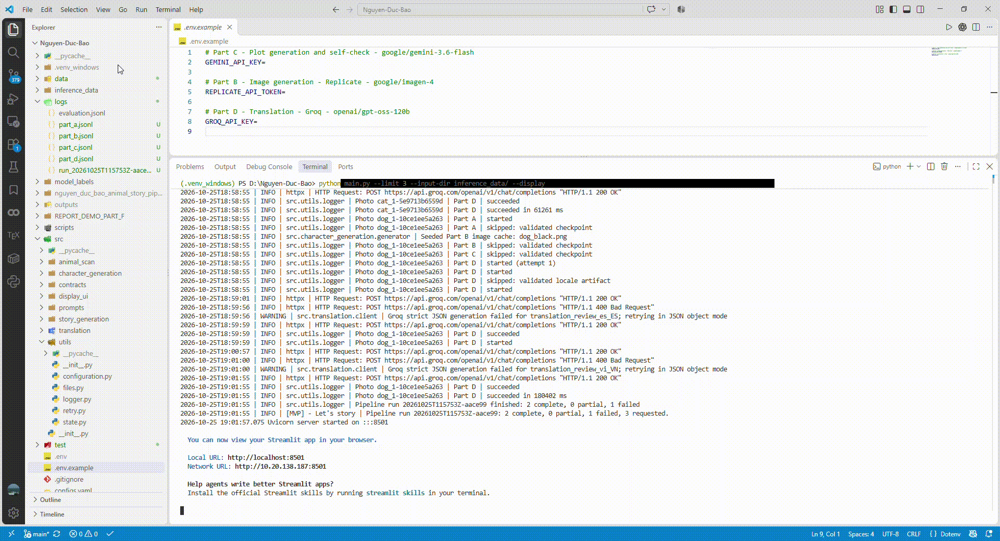
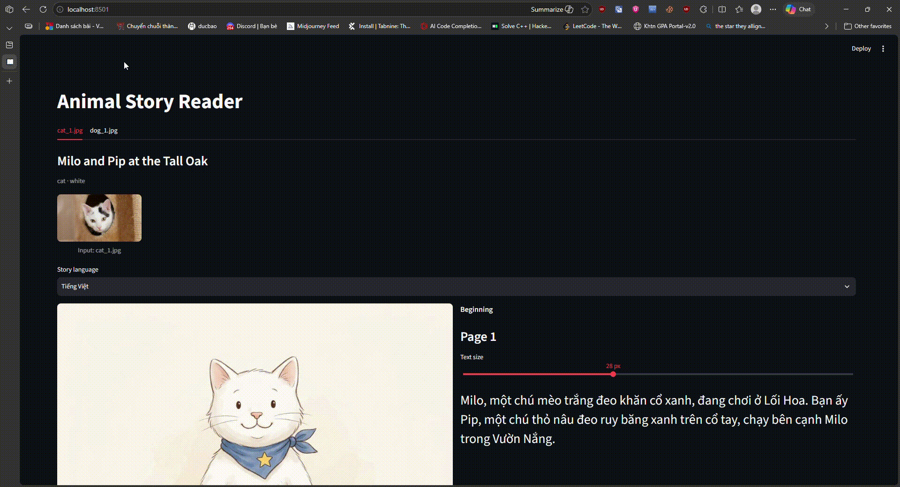

# Animal Story Pipeline

## Demo





**Note:** I was unaware that my recording app only supports recording one application window at a time. As a result, the Streamlit UI was not captured during the initial pipeline execution, so I reran the inference using artifacts from the previous run and recorded the UI separately afterward.

## Contents

- [Overview](#i-overview)
- [Prerequisites](#ii-prerequisites)
- [Setup and run](#iii-setup-and-run)
- [Troubleshooting](#iv-troubleshooting)
- [Input data](#v-input-data)
- [Outputs and logs](#vi-outputs-and-logs)
- [Project artifacts](#vii-project-artifacts)

## I. Overview

The main purpose of this project is to turn animal photos into illustrated, multilingual children's stories for ages 5-7 in 4 different languagues, including Englisht, French, Spanish and Vietnamese. The pipeline identifies each animal and its main color, creates a consistent character, writes a story, translates it, and opens the results in a local reader.

The project processes a folder of animal photos through these stages:

| Stage | Main Purposes |
| --- | --- |
| **Stage 1 — Animal scan** | Uses SpeciesNet to identify the species, BiRefNet to isolate the animal, and CLIP to estimate its main color. |
| **Stage 2 — Character image** | Generates a storybook-style character image with Replicate's Imagen 4. Character images are reused from a shared species-and-color cache when available. |
| **Stage 3 — Story** | Creates and reviews an English story for children aged 5–7. |
| **Stage 4 — Translation** | Translates and reviews the story in French, Spanish, and Vietnamese. |
| **Stage 5 — Checkpoints** | Saves per-image artifacts and stage state so completed work can be reused on later runs. |
| **Stage 6 — UI** | Opens a local Streamlit reader for the generated stories. |

Supported species: `cat`, `owl`, `hare`, `dog`, and `squirrel`. Supported colors: `black`, `white`, `brown`, `orange`, and `gray`. Images that do not match a supported species are marked as `unknown`; a failure for one image does not stop the rest of the batch. Additionally, the species will be assigned to the class with the highest proportion among all predicted classes.

## II. Prerequisites

- Python **3.11 or 3.12**
- [uv](https://docs.astral.sh/uv/) for installing the locked dependencies
- Kaggle access is needed only when downloading the source dataset. You can skip that step if you already have the expected input folders and labels.

## III. Setup and run

### 1. Get the repository

Clone or download this repository and run the following commands from its root directory.

### 2. Create and activate a virtual environment

In Windows PowerShell:

```powershell
python -m venv .venv
& .venv\Scripts\Activate.ps1
```

Install [uv](https://docs.astral.sh/uv/getting-started/installation/) if it is not already available in your terminal, then install the project dependencies into the active environment:

```bash
uv sync --locked --active --extra dataset
```

### 3. Configure provider credentials

Copy `.env.example` to `.env` and add the provider credentials used by the pipeline: `REPLICATE_API_TOKEN` for character images, `GEMINI_API_KEY` for stories, and `GROQ_API_KEY` for translations.

### 4. Prepare the dataset

To download the configured Kaggle dataset and build the project dataset, run:

```bash
python scripts/animal_dataset.py
```

The generated `data/raw/` images are local and are not included in the repository. The sample images in `inference_data/` are included.

### 5. Evaluate Stage 1

Evaluation uses the included `data/animal_colors.csv` to label images in `data/raw`; the dataset script creates the images but does not recreate this CSV. It writes species and color accuracy to `data/processed/stage_1/evaluation_report.json`.

```bash
python -m src.animal_scan.evaluation
```

Options:

| Argument | Purpose |
| --- | --- |
| `--config PATH` | Use a different YAML configuration file. Defaults to `configs.yaml`. |
| `--workers N` | Override the configured evaluation worker count. Must be at least 1. |
| `--cpu` | Run Stage 1 inference on the CPU. |
| `--gpu` | Run Stage 1 inference on the CUDA GPU. |

`--cpu` and `--gpu` are mutually exclusive. If neither is supplied, the configured device setting is used.

### 6. Run the full pipeline

```bash
python main.py --display
```

The command processes images from the configured input directory (`data/raw` by default). `--display` opens the local story reader after processing.

To see how the pipeline handles an unsupported species:

```bash
python main.py --input-dir inference_data --limit 3 --display
```

The demo contains a cat, a dog, and a bear. The bear represents an unsupported species; it can fail at character generation while the other images continue through the pipeline. See [inference_data/info.md](inference_data/info.md) for the sample mapping.

Pipeline options:

| Argument | Purpose |
| --- | --- |
| `--config PATH` | Use a different YAML configuration file. |
| `--input-dir PATH` | Process images from a different folder instead of the configured input directory. |
| `--limit N` | Process at most `N` images. Must be at least 1. |
| `--support-species SPECIES` | Choose the supporting story character's species. If omitted or invalid, a deterministic choice is made. |
| `--support-color COLOR` | Choose the supporting story character's color. If omitted or invalid, a deterministic choice is made. |
| `--areas ID [ID ...]` | Choose at least two configured story areas. |
| `--generate-context-images` | Generate an additional story-driven image for each story phase. |
| `--back-translation` | Back-translate saved translations into English for comparison; this makes additional model requests. |
| `--display` | Open the local story reader after processing. |
| `--refresh-speciesnet` | Force a refresh of the cached SpeciesNet model. |
| `--resume` | Reuse valid saved stage artifacts. This is the default. |
| `--no-resume` | Regenerate pipeline stages instead of reusing their saved checkpoints. |

The shared character-image cache is reused by species and color independently of `--resume`.

## IV. Troubleshooting

### `NXDOMAIN` when downloading a generated image

If the pipeline reports `NXDOMAIN` or `getaddrinfo failed` for `replicate.delivery`, Windows may be unable to resolve the image download hostname with the DNS server provided by the network. This can happen after the Replicate prediction succeeds but before the generated image is downloaded.

In **Command Prompt opened as Administrator**, check the network interface name first:

```bat
netsh interface show interface
```

If the interface is named `Wi-Fi`, temporarily switch its IPv4 DNS server to Google Public DNS, clear the DNS cache, and check whether the download hostname resolves:

```bat
netsh interface ipv4 set dnsservers name="Wi-Fi" source=static address=8.8.8.8 register=primary validate=yes
ipconfig /flushdns
nslookup replicate.delivery
```

## V. Input data

The configured dataset source is [Animal Image Dataset — 90 Different Animals on Kaggle](https://www.kaggle.com/datasets/iamsouravbanerjee/animal-image-dataset-90-different-animals). `configs.yaml` selects five supported species, samples other classes into `unknown`, and lists image IDs to remove during cleanup. Change those settings there if you want to prepare a different dataset.

The default Stage 1 inputs are:

- Images: `data/raw/<species>/<image>.<jpg|jpeg|png>`
- Ground-truth labels: `data/animal_colors.csv`
- Supported species and colors: `part_a.taxonomy` in `configs.yaml`

Stage 1 evaluation requires the included `data/animal_colors.csv` to have exactly these columns: `relative_path`, `species`, and `color`. It has one row for every image in the configured input directory. Each `relative_path` is relative to the repository root, and the `species` value matches the image's top-level folder. The generated evaluation report is not included in the repository.

## VI. Outputs and logs

- `data/processed/stage_1/results/` stores standalone Stage 1 scan results.
- `data/processed/stage_1/foreground/` stores extracted foreground images.
- `data/processed/stage_1/evaluation_report.json` stores evaluation metrics, including overall and per-folder species and color accuracy.
- `outputs/<image_id>/` stores full-pipeline artifacts for each input image, such as `scan.json`, `character.png`, `story_en.json`, translated stories, and `manifest.json`.
- `outputs/character_cache/` stores reusable character images and metadata by species and color.
- `logs/` stores structured pipeline and evaluation logs.

Stage 1 scan data may appear both in its standalone results folder and in an image's `outputs/<image_id>/` folder when it is used as a full-pipeline checkpoint.


# VII. Project artifacts

The project artifacts are available in the [report and demo directory](report_and_demo/):

- **Demo GIFs:** [Full pipeline (.gif)](report_and_demo/demo/inference_demo.gif) · [Story reader (.gif)](report_and_demo/demo/inference_streamlit_viewer.gif)
- **Technical notes:** [Project presentation](docs/project_presentation.md) · [Code walkthrough](docs/code_walkthrough.md)
- **Results:** [Results report](report_and_demo/report/results_report.md)
