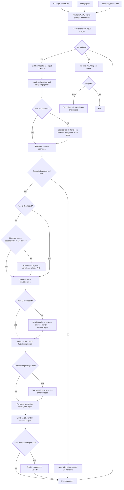
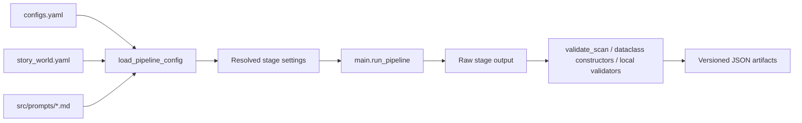
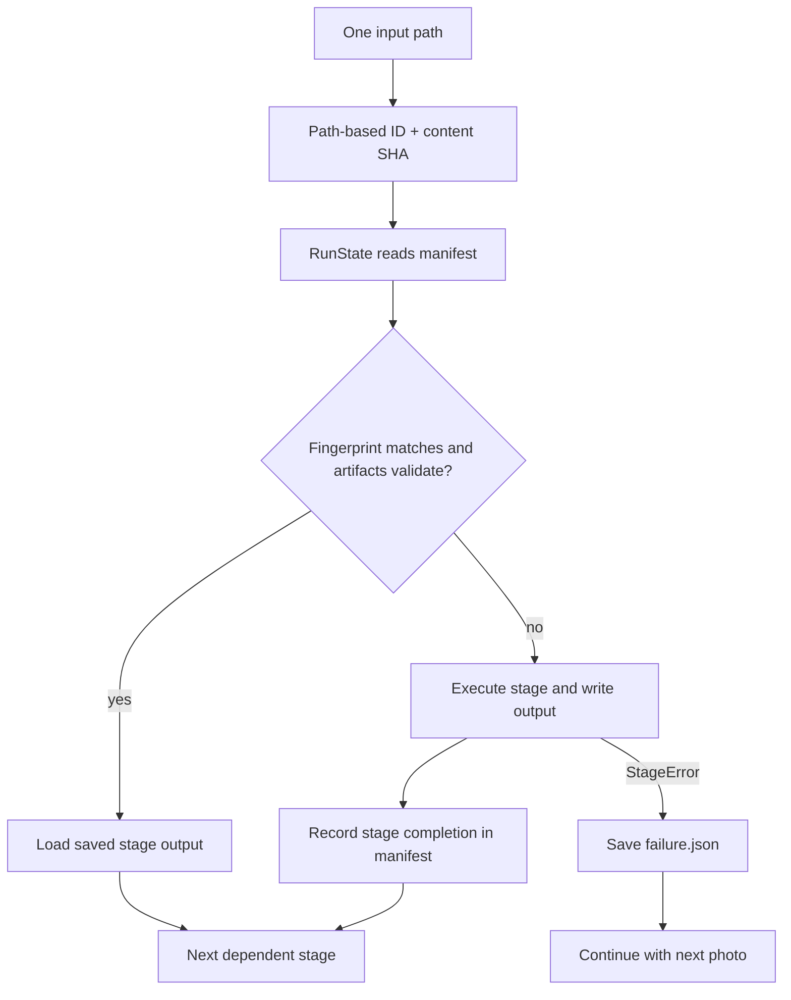
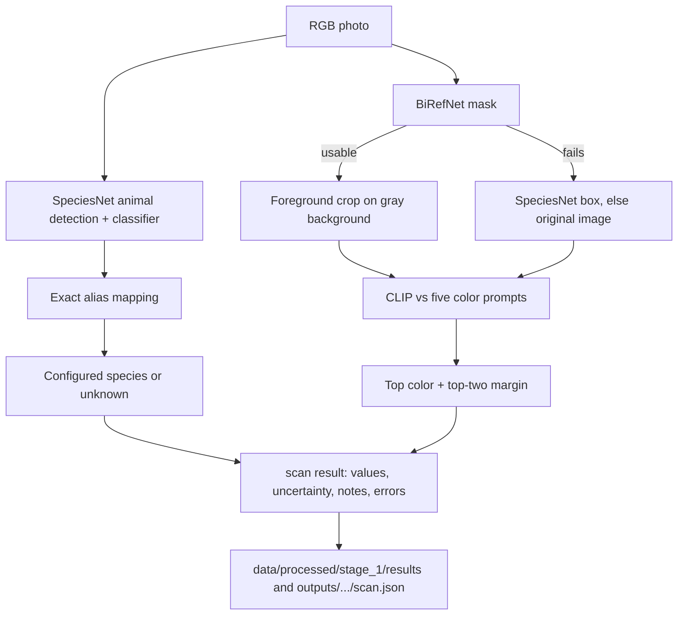
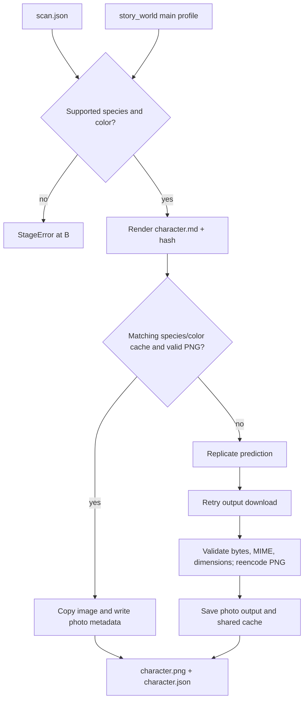
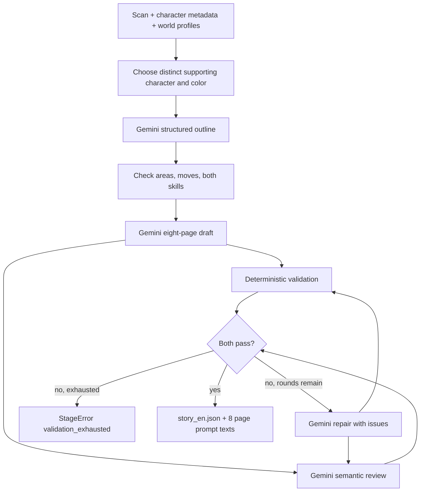
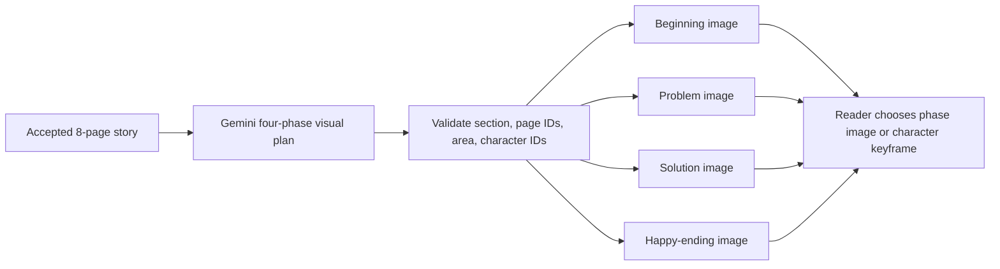
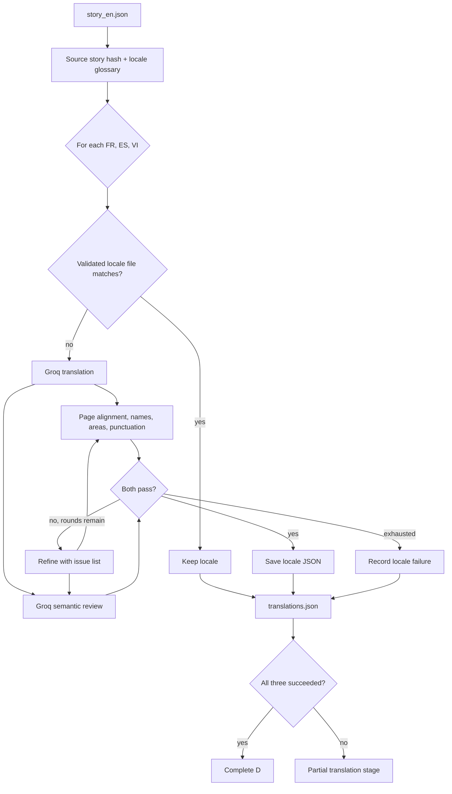
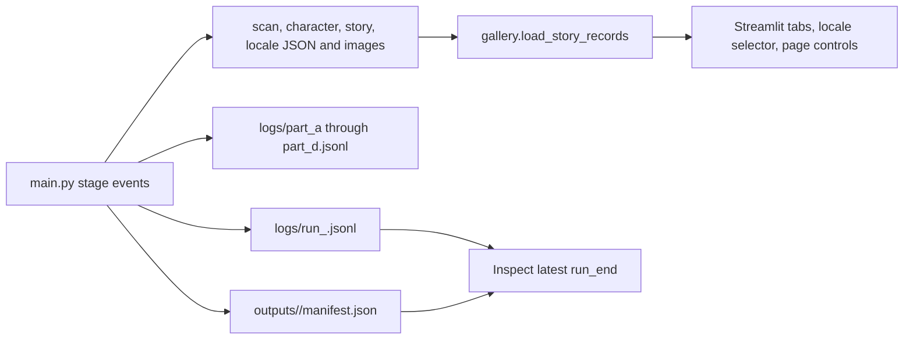

# Animal Story Pipeline — Code Walkthrough and Interview Defense

This guide follows the execution path from one input photograph to the reader. It explains code in functional blocks, with source links, rather than repeating a simple A → B → C → D diagram. The implementation described here is the repository state on 28 October 2026. The diagrams show control flow and data dependencies; optional branches are labeled.

## 1. Read the repository in this order

| Order | File or directory | Why it matters |
| --- | --- | --- |
| 1 | [`configs.yaml`](../configs.yaml), [`data/story_world.yaml`](../data/story_world.yaml) | Taxonomy, model IDs, paths, story world, characters, locale glossary, and stage settings. |
| 2 | [`main.py`](../main.py) | CLI and per-photo orchestration, checkpoints, error boundaries, and optional branches. |
| 3 | [`src/contracts/schema.py`](../src/contracts/schema.py) | Versioned objects and the rules at stage boundaries. |
| 4 | [`src/animal_scan/`](../src/animal_scan/) | Species detection, foreground extraction, color estimation, data loading, and evaluation. |
| 5 | [`src/character_generation/`](../src/character_generation/) | Replicate adapter, character cache, optional phase images, and unused animation helpers. |
| 6 | [`src/story_generation/`](../src/story_generation/) | Gemini outline, draft, review, correction, local checks, and page illustration prompts. |
| 7 | [`src/translation/`](../src/translation/) | Groq translation, locale review, repair, rate limiting, and optional back translation. |
| 8 | [`src/utils/`](../src/utils/), [`src/display_ui/`](../src/display_ui/) | Atomic persistence, retry policy, event logs, state reuse, and Streamlit output reader. |
| 9 | [`scripts/animal_dataset.py`](../scripts/animal_dataset.py), [`test/`](../test/) | Dataset preparation and focused behavior tests. |
| 10 | [`model_labels/label.py`](../model_labels/label.py), [`report_and_demo/`](../report_and_demo/) | A separate SpeciesNet label-extraction helper and the result and demo artifacts. |

The `src/prompts/` Markdown files are executable prompt templates: code renders their named fields and sends the result to the provider. `data/processed/`, `outputs/`, `logs/`, and `report_and_demo/` are generated evidence or deliverables, not alternate implementations. Binary images and videos are inputs or outputs, so the explanation follows their producers and consumers rather than describing their bytes.

`model_labels/label.py` is a standalone exploratory script: it loads the configured SpeciesNet classifier on CPU and writes its classifier label list to `model_labels/speciesnet_labels_extracted.txt`. It is not called by `main.py`.

## 2. Overall pipeline: control, artifacts, and failure boundaries



The graph omits some checkpoint decision diamonds for space: B, C, D, optional phase images, and back translation each use a stage fingerprint and artifact checks. A failed photo is caught inside the loop, so later photos continue. A failed optional phase-image branch is recorded as a partial photo while translation can continue. The reader is launched **after** the batch, only with `--display`.

## 3. Configuration and contracts

### Configuration blocks

1. [`load_pipeline_config()`](../src/utils/configuration.py) loads project `.env` values, YAML, and the story world. It checks the five supported species, five colors, required prompt files, locale order, model IDs, and provider credentials before the expensive vision models are constructed. It resolves paths relative to the config file. This guide does not require inspecting the credential file.
2. [`load_config()`](../src/animal_scan/config.py) separately validates Stage 1 taxonomy aliases, CLIP prompts, retry and worker settings, then exposes paths through `PartAConfig`.
3. [`StoryWorld.from_dict()`](../src/contracts/schema.py) requires a profile for every supported species and four or five localized areas. The current world contains Milo/cat, Luna/dog, Pip/hare, Tiko/owl, and Nala/squirrel, plus four garden areas.
4. [`validate_scan()`](../src/contracts/schema.py) accepts a configured species **or** `unknown`, an optional configured color, valid status, and uncertainty flags. `unknown` is an intentional boundary result, not a sixth character profile.
5. `CharacterResult`, `StoryResult`, and `TranslationBundle` serialize the metadata passed between stages. `StageError` carries stage, category, retryability, and a message; `ensure_under()` prevents artifact paths from escaping an output root.



**Caveat:** a schema or local validator checks only the fields it actually examines. For example, story causality and child suitability rely heavily on a model review; a `validation.passed` flag is not a human evaluation.

## 4. Entry point and per-photo orchestration

### [`main.py`](../main.py) in execution order

| Code block | What happens |
| --- | --- |
| `_log_step()` and `_valid_*()` near the top | Wrap a stage with start/end events and duration; verify persisted JSON, image, story, translation, and optional artifacts before reuse. |
| `run_pipeline()` preflight and image discovery | Load configuration, validate requested areas, discover sorted images, construct provider clients, create a UTC run ID and run log, then instantiate Stage 1 models. |
| Per-photo setup | Build an ID from the input path and a short hash, hash file contents, create `outputs/<image_id>/`, and load `manifest.json` through `RunState`. |
| A block | Fingerprint input and Stage 1 config; reuse a valid scan or call `PartAPipeline.process_one()`; save `scan.json`. |
| B block | Fingerprint scan, profile, prompt, and settings; reuse a valid character checkpoint, seed the shared cache, or call `generate_character()`. An unsupported species stops this photo at B. |
| C block | Fingerprint image, prompts, world, character image, and support/area choices; reuse or generate the English story. |
| `C_images` block | Only under `--generate-context-images`: plan and create four phase images. A `StageError` here is retained as a partial result while D still runs. |
| D block | Fingerprint story, world, prompts, model, and settings; reuse a validated bundle or translate each locale. A partial translation writes what succeeded. |
| `D_back_translation` block | Only under `--back-translation`: compare each saved locale with the English source and checkpoint diagnostic JSON. |
| Error and finish blocks | Save `failure.json`, append a photo summary, continue the loop, write `run_end`, and return nonzero if any photo was partial or failed. |
| `main()` CLI | Parses flags, resolves the optional input directory from the process working directory, invokes the pipeline, and launches Streamlit after it returns when requested. |



`RunState.is_complete()` checks status, fingerprint, file existence, path containment, and an optional validator. `stable_fingerprint()` hashes serialized inputs. `atomic_write_json()` writes through a temporary file and replaces the destination. `--no-resume` bypasses stage checkpoints; the shared Stage 2 species/color image cache remains independently available. A previous `failure.json` can remain after a successful rerun, so use the latest `run_end` and manifest state to judge current completion.

## 5. Stage 1: photo to a constrained scan

### Dataset and model code blocks

1. [`scripts/animal_dataset.py`](../scripts/animal_dataset.py) downloads the configured Kaggle source when absent, copies five supported classes, samples six other classes into `unknown` using a fixed seed, removes configured image IDs, and renumbers supported-class images. **Running it recreates the configured input directory**; it is preparation code, not a harmless read command.
2. [`data.py`](../src/animal_scan/data.py) discovers accepted image extensions in sorted order. For evaluation, it reads `data/animal_colors.csv` with exactly `relative_path,species,color`, checks paths and labels, and does not create a train/dev/test split.
3. [`models.py`](../src/animal_scan/models.py) runs SpeciesNet in a subprocess on a temporary copy. `_animal_detection()` selects the highest-confidence animal detection; `_classification()` reads classifier fields; `map_species_label()` matches **complete** configured alias fields and otherwise returns `unknown` with a note.
4. `BiRefNetSegmenter` loads a segmentation model lazily, normalizes a resized image, creates a foreground mask, rejects implausible mask fractions, saves transparent foreground evidence, and supplies an animal crop against neutral gray to CLIP.
5. `OpenAIClipColorClassifier` compares the crop with five configured color text prompts and softmaxes the logits. These scores rank configured labels; they are not calibrated probabilities of the animal's true color.
6. [`PartAPipeline.process_one()`](../src/animal_scan/pipeline.py) retries each internal step, falls back from failed segmentation to a SpeciesNet box or whole image, records uncertainty, and writes a per-image result. If CLIP fails, it leaves color `null` rather than inventing one.
7. [`evaluation.py`](../src/animal_scan/evaluation.py) verifies a one-to-one match between labels and discovered images, runs Stage 1, and computes overall and per-folder species/color accuracy. This is descriptive evaluation of the configured collection, not a held-out generalization estimate.



**Measured result:** The local Stage 1 evaluation, summarized in the [results report](../report_and_demo/report/results_report.md), recorded 259/356 species correct (72.8%) and 208/356 color correct (58.4%). On the 267 supported-species images, the figures were 170/267 (63.7%) and 144/267 (53.9%). Owl species accuracy was 2/52 (3.8%); the 89/89 `unknown` result was on known, curated out-of-taxonomy classes. These numbers do not establish performance on unseen distributions. The source images and generated JSON report are not included in the repository; the labels CSV is included.

## 6. Stage 2: scan and profile to a reusable character image

[`generate_character()`](../src/character_generation/generator.py) first rejects a failed/unknown scan, missing color, or profile mismatch. It reads [`character.md`](../src/prompts/part_b/character.md), demands an exact template-variable match, and hashes the rendered prompt. The shared cache key is `<species>_<color>` plus a fingerprint of the prompt and provider settings; a valid cached PNG is copied into this photo's output even when stage resume is disabled.

On a miss, [`ReplicateImageClient`](../src/character_generation/client.py) submits `google/imagen-4` with the configured aspect ratio, image size, output format, and safety filter. It separately retries the returned file's `read()` call. A completed prediction whose delivery download fails does **not** trigger a second paid prediction inside the client. The generator checks byte size, MIME, decodability, and dimensions, converts the image to PNG, then writes `character.png` and `character.json` atomically. The metadata records a prompt hash, model, backend, dimensions, and provider parameters; it does not claim a reproducible seed when none was supplied.



The original input photo is **not** sent as a reference image to Imagen 4. The result follows species, color, and fixed profile detail. Therefore the cache intentionally merges distinct animals sharing species and color; that improves reuse but cannot preserve individual markings. [`animation.py`](../src/character_generation/animation.py) contains reference-guided frame and sprite helpers, but the configured Replicate client rejects reference-image settings and `main.py` does not call these helpers. Do not present animation generation as a working main-pipeline feature.

## 7. Stage 3: structured English story, review, and image prompts

[`generate_story()`](../src/story_generation/generator.py) verifies that character metadata matches the scan. `choose_support()` chooses a different species and color; valid CLI overrides are honored and missing/invalid choices fall back to a deterministic image-ID hash. The selected areas must contain at least two configured IDs. Prompts and story facts are drawn from `data/story_world.yaml` rather than invented profiles.

The generator asks Gemini for an **outline**, checks area sequence and both skills, then asks for an eight-page **draft**. Each review round combines [`validate_story_payload()`](../src/story_generation/validation.py) with a Gemini review prompt. Local checks include page IDs, section order (two pages per section), 40 whitespace-separated words per page, selected areas, two names, species/colors, dialogue slogans, and known third-profile names. The model review is asked to judge coherence, child suitability, safety, and causal skill use. Failed reviews can trigger at most two correction rounds; exhaustion fails C. A passing story becomes `story_en.json`. The same function saves **eight text prompts** in `page_illustration_prompts.json`; it does not generate eight page images.



[`GeminiStoryClient`](../src/story_generation/client.py) requests JSON using a response schema and low thinking level, adapts unsupported schema fields, parses the returned object, and classifies provider failures. A structured response reduces formatting errors; it does not guarantee narrative truth or age suitability.

### Optional four-phase images

With `--generate-context-images`, [`context_images.py`](../src/character_generation/context_images.py) requests one visual plan for each narrative section, checks page IDs, selected areas, and character IDs, then sends four text prompts to the same image client. It writes `phase_visual_plan.json`, `phase_image_prompts.json`, and `phase_<section>.png`. These prompts reconstruct characters from fixed metadata; there is no image-reference input. A phase-image error leaves the photo partial but does not stop translation.



## 8. Stage 4: three independent translations

[`translate_story()`](../src/translation/translator.py) requires eight aligned English pages and exactly `fr-FR`, `es-ES`, and `vi-VN`. It builds a locale glossary from the story world: names, genders, pronouns, slogans, and area names. For each locale, it may reuse an already validated locale file with matching source hash, age, and fingerprint. Otherwise it asks Groq to translate, performs local checks, asks Groq to review, and optionally repairs up to two rounds. It writes each successful `<locale>.json` immediately, then writes `translations.json` after all attempts. A failed locale does not discard successful siblings; the stage raises `partial_translation` if any remain incomplete.



[`GroqTranslationClient`](../src/translation/client.py) requests strict JSON schema and can fall back to JSON-object mode for a specific JSON validation error. [`GroqRateLimiter`](../src/translation/rate_limit.py) reserves estimated requests and tokens in a process-local rolling minute. [`validation.py`](../src/translation/validation.py) checks page alignment, nonempty text, mapped names and areas when present in source, plus selected French and Spanish punctuation patterns. Faithfulness, natural phrasing, and age suitability depend on model review; a local validator cannot prove them. `--back-translation` invokes `back_translate_story()` as a separate, token-consuming diagnostic and saves `back_translation_<locale>.json`.

## 9. Persistence, logs, and reader



[`PipelineEventLogger`](../src/utils/logger.py) writes one aggregate run log and routes A–D events to per-part logs. [`retry_provider_call()`](../src/utils/retry.py) retries recognized transport/429/5xx failures with bounded backoff; Stage 1's internal `_run_step()` has its own configured retry count. The log's latest `run_end` is a stronger run-status signal than an old `failure.json`.

[`gallery.py`](../src/display_ui/gallery.py) loads saved English stories and translations; it can recover independently validated locale files when a bundle is absent or partial. It prefers an optional phase image and falls back to `character.png`. [`app.py`](../src/display_ui/app.py) renders tabs, a language selector, adjustable text size, and previous/next page controls. This is a local viewer for persisted artifacts, not a second generation path.

## 10. Evaluation and tests: what the evidence supports

The Stage 1 report is a snapshot of **356 labeled images** in the configured dataset. Per-folder metrics help expose the large variance: cat species 48/51, dog 28/54, hare 46/56, owl 2/52, squirrel 46/54, and unknown 89/89. The five supported classes total 267 images. The report contains no held-out split, confidence intervals, human story-rating study, or independent translation-quality score.

The `test/` files cover contracts, Stage 1 mapping/fallback, Stage 2 validation, story constraints, translation and rate limits, optional phase images, CLI failure isolation, reader behavior, and utilities. They are focused tests with mocked providers or local objects; they do not replace a live end-to-end provider run. Sample `outputs/` demonstrate artifacts for cat and dog, and a bear scan of `unknown` followed by a B-stage `unsupported_species` failure. Some output folders retain historical `failure.json` from an earlier attempt, even when their manifest later shows complete stages.

## 11. Interview defense: 10 critical questions

Each answer distinguishes the implemented defense from what still needs evidence.

1. **How do you know the scan recognizes an animal, rather than just a label in a large classifier?** SpeciesNet output is accepted only when an animal detection exists, and its label must match a complete configured alias field. This can still miss a true animal or map a wrong high-scoring label. **Next:** inspect a confusion matrix and detection failures; evaluate on an independently collected set.
2. **Why is `unknown` allowed in Stage 1 but rejected by Stage 2?** It is a valid out-of-taxonomy scan result, while the story world has profiles only for five supported species. The B gate prevents an invented character identity. This limits coverage. **Next:** offer an explicit unsupported-species user path or add profiles only after evaluation and design work.
3. **Are the CLIP softmax values meaningful confidence scores?** They rank five text prompts for this image; they are not calibrated probabilities. The top-two margin is only an uncertainty heuristic, and segmentation failure forces uncertainty. **Next:** calibrate on labeled data and report reliability diagrams or selective accuracy.
4. **Why does the cache reuse one picture for every cat of the same color?** The character prompt currently depends on species, color, and a fixed profile, so that key avoids duplicate paid generation. It loses individual markings. **Next:** add validated visual attributes or an image-conditioned model and include those attributes in the key.
5. **Can `validation.passed=true` prove the story is safe and coherent?** No. Local checks enforce measurable structure and a Gemini review judges semantics, but both can miss problems. **Next:** run blinded human review, collect failure categories, and revise prompts and local rules against those cases.
6. **What happens if one provider fails after another has already charged for work?** A stage error is saved per photo and the batch continues. In Stage 2, output download is retried separately so the client avoids resubmitting a completed prediction for a delivery-only failure. A later rerun may still need recovery work. **Next:** persist provider prediction IDs and implement explicit retrieval of completed outputs.
7. **Why are there several forms of cache or checkpoint?** `manifest.json` reuses a per-photo stage only when fingerprint and artifacts validate; Stage 2 also has a shared species/color image cache; D can reuse a successful locale while another failed. These optimize different scopes. **Next:** document cache invalidation and add a recovery UI that explains each reuse decision.
8. **How do you prove translated pages preserve meaning?** The code checks alignment and some glossary/punctuation rules, then relies on Groq review for semantic faithfulness. That is useful screening, not proof. **Next:** bilingual human ratings, targeted adversarial examples, and a quantitative error taxonomy by locale.
9. **Does the reported 72.8% species accuracy generalize?** No. It is descriptive accuracy on the configured, labeled 356-image collection; `unknown` is drawn from known source classes. Owl accuracy is only 3.8%. **Next:** freeze a held-out set, include new cameras/backgrounds/species, and report per-class precision/recall and intervals.
10. **How reproducible is a rerun?** Inputs, config, prompts, hashes, artifacts, and model IDs are recorded or fingerprinted. Some model IDs are not pinned to immutable versions; image generation has no reproducible seed; external services can change. **Next:** pin provider versions where available, record request IDs and model revisions, and archive evaluation manifests.

## 12. Five design-choice challenges: why A instead of B?

1. **Why SpeciesNet + exact aliases rather than train a custom five-class classifier?** It met the zero-shot, no-training scope and handles an explicit `unknown` outcome. The current owl and dog results show this choice is weak for some classes. **Future option:** compare a small supervised baseline on a proper split, subject to the project's data constraints.
2. **Why segment with BiRefNet before CLIP instead of running CLIP on the full photograph?** Foreground isolation tries to remove background color cues; fallback keeps the scan usable when segmentation fails. The color result is still only 58.4% overall, so the benefit has not been isolated. **Future option:** run a controlled ablation of full image, box crop, and segmentation on the same labeled set.
3. **Why prompt Imagen 4 from structured attributes instead of conditioning on the original photo?** The selected Replicate model integration accepts a text prompt and the implementation prioritizes a stable story-world character. It cannot guarantee likeness to the source animal. **Future option:** evaluate an image-conditioned model, identity consistency, and rights/privacy requirements before changing the interface.
4. **Why a two-stage outline/draft plus review/repair instead of one Gemini call?** The outline makes area changes and skill use explicit; bounded review offers a correction path. It costs more calls and has no measured improvement yet. **Future option:** A/B test one-shot versus staged generation on human-rated coherence, safety, latency, and cost.
5. **Why use Groq for translations instead of a dedicated machine-translation service?** The current pipeline needs structured eight-page output, locale glossary control, and a review/refine loop in one interface. That does not establish that Groq translates better. **Future option:** compare a dedicated MT baseline and bilingual human judgments for faithfulness, naturalness, child-level vocabulary, latency, and price.

## 13. A concise, honest project claim

The repository implements an inspectable, per-photo workflow that transforms supported animal scans into a character image, an eight-page English story, three reviewed translations, and a local reader. It records contracts, artifacts, logs, and resumable stage state. Its measured vision accuracy is uneven, and its generative quality checks are primarily automated; the next research work is a held-out vision evaluation and human assessment of stories, translations, and visual identity.

# Detailed code reference

The sections below are organized **package → file → class/function**. Each file starts with the purpose of its imports. A heading names every production class and function, including meaningful class methods and nested helpers. The explanations follow blocks of behavior: inputs, decisions, side effects, and failure paths. Line links point to the current source. Constant-only files and prompt templates have file-level explanations because they contain no Python functions.

## Root entry point

### File: [`main.py`](../main.py)

**Libraries in context.** `argparse` defines CLI switches; `pathlib`, `hashlib`, and `uuid` identify inputs and runs; `datetime` and `time` timestamp and time work; `logging` and `sys` report status and exit codes; `yaml` reads display configuration; Pillow verifies image artifacts. The `src.*` imports are this project's stage adapters, contracts, file/log/state utilities, and viewer launcher. `json` is imported but is not materially used in the current file.

#### [`_log_step()`](../main.py#L37)

Accepts a stage operation as a callable, emits `step_start`, measures elapsed time, and emits `step_end` with success or error details. It preserves a `StageError` category and retryability; an unexpected exception is logged as `unexpected` before being re-raised. This wrapper observes a stage call—it does not itself retry it.


**Key source excerpt (opening logic; full source linked above):**

```python
def _log_step(
    events: EventLogger,
    *,
    run_id: str,
    image_id: str,
    step: str,
    operation: Callable[[], Any],
    locale: str | None = None,
) -> Any:
    started = time.perf_counter()
    common = {"run_id": run_id, "image_id": image_id, "step": step}
    if locale:
        common["locale"] = locale
    events.write({**common, "event": "step_start", "attempt": 1, "status": "running"})
    try:
        result = operation()
    except StageError as error:
        events.write(
            {
                **common,
                "event": "step_end",
                "status": "failed",
                "duration_ms": round((time.perf_counter() - started) * 1000, 2),
                **error.to_dict(),
            }
        )
        raise
    except Exception as error:
        events.write(
            {
                **common,
                "event": "step_end",
                "status": "failed",
                "duration_ms": round((time.perf_counter() - started) * 1000, 2),
                "category": "unexpected",
```

#### [`_read_scan()`](../main.py#L89)

Reads a persisted scan JSON and runs `validate_scan()` against the configured species, colors, and unknown label. This prevents a checkpoint from bypassing the A→B data contract.


**Full source definition:**

```python
def _read_scan(path: Path, species: set[str], colors: set[str], unknown: str) -> Any:
    return validate_scan(read_json(path), species, colors, unknown)


```

#### [`_valid_image()`](../main.py#L93)

Uses Pillow's `Image.verify()` to reject a missing, corrupt, or unrecognized image. It checks decodability, not visual quality or character consistency.


**Full source definition:**

```python
def _valid_image(path: Path) -> bool:
    try:
        with Image.open(path) as image:
            image.verify()
        return True
    except (OSError, UnidentifiedImageError):
        return False


```

#### [`_valid_json()`](../main.py#L102)

Tries to parse a JSON file. It is a low-level integrity check; stage-specific validators apply the deeper rules.


**Full source definition:**

```python
def _valid_json(path: Path) -> bool:
    try:
        read_json(path)
        return True
    except (OSError, ValueError):
        return False


```

#### [`_valid_context_artifact()`](../main.py#L110)

Chooses image verification for `.png` paths and JSON parsing for the other optional phase-image artifacts. `RunState.is_complete()` uses it when deciding whether to skip `C_images`.


**Full source definition:**

```python
def _valid_context_artifact(path: Path) -> bool:
    if path.suffix.lower() == ".png":
        return _valid_image(path)
    return _valid_json(path)


```

#### [`_valid_back_translation()`](../main.py#L116)

Requires eight page IDs in order and a `differences` list in a diagnostic artifact. It checks shape, not the correctness of the model's comparison.


**Full source definition:**

```python
def _valid_back_translation(path: Path) -> bool:
    try:
        data = read_json(path)
        pages = data.get("pages")
        return (
            isinstance(pages, list)
            and [page.get("page") for page in pages] == list(range(1, 9))
            and isinstance(data.get("differences"), list)
        )
    except (OSError, ValueError, AttributeError, TypeError):
        return False


```

#### [`_valid_character()`](../main.py#L129)

Checks the saved PNG plus `character.json` schema, image ID, species, color, and complete status against the current scan. This is the semantic guard on top of B's fingerprint and file-existence checks.


**Full source definition:**

```python
def _valid_character(root: Path, scan: Any) -> bool:
    try:
        data = read_json(root / "character.json")
        image = root / "character.png"
        if not _valid_image(image):
            return False
        return (
            data.get("schema_version") == "1.0"
            and data.get("image_id") == scan.image_id
            and data.get("species") == scan.species
            and data.get("color") == scan.color
            and data.get("status") == "complete"
        )
    except (OSError, ValueError, AttributeError):
        return False


```

#### [`_valid_story()`](../main.py#L146)

Deserializes `StoryResult` and checks identity, eight pages, validation flag, consecutive page IDs, and two pages in each required section. It does not rerun the complete story reviewer on checkpoint reuse.


**Full source definition:**

```python
def _valid_story(root: Path, scan: Any) -> bool:
    try:
        story = StoryResult.from_dict(read_json(root / "story_en.json"))
        return (
            story.image_id == scan.image_id
            and story.species == scan.species
            and story.color == scan.color
            and len(story.pages) == 8
            and story.validation.get("passed") is True
            and [page.page for page in story.pages] == list(range(1, 9))
            and [page.section for page in story.pages]
            == [
                section
                for section in ("beginning", "problem", "solution", "happy_ending")
                for _ in range(2)
            ]
        )
    except (OSError, ValueError, ContractError, AttributeError):
        return False


```

#### [`_valid_translations()`](../main.py#L167)

Requires bundle schema version `1.0`, all three configured locale keys, a passed bundle flag, and eight aligned pages with passed validation per locale. It checks the bundle's persisted structure, not translation meaning.


**Full source definition:**

```python
def _valid_translations(root: Path) -> bool:
    try:
        bundle = read_json(root / "translations.json")
        translations = bundle.get("translations", {})
        if bundle.get("schema_version") != "1.0" or set(translations) != {
            "fr-FR",
            "es-ES",
            "vi-VN",
        }:
            return False
        return bundle.get("validation", {}).get("passed") is True and all(
            len(translations[locale].get("pages", [])) == 8
            and [page.get("page") for page in translations[locale]["pages"]]
            == list(range(1, 9))
            and translations[locale].get("validation", {}).get("passed") is True
            for locale in translations
        )
    except (OSError, ValueError, AttributeError, TypeError):
        return False


```

#### [`_stage_error_status()`](../main.py#L188)

Maps D's `partial_translation` error to a `partial` photo summary; other `StageError`s become `failed`. This preserves successful locale outputs in the run summary.


**Full source definition:**

```python
def _stage_error_status(error: StageError) -> str:
    """Keep a saved-but-incomplete translation run distinct from total failure."""
    if error.step == "D" and error.category == "partial_translation":
        return "partial"
    return "failed"


```

#### [`_prompt_digest()`](../main.py#L195)

SHA-256 hashes prompt-file bytes. If a prompt changes, dependent stage fingerprints change and a stale checkpoint cannot be silently reused.


**Full source definition:**

```python
def _prompt_digest(paths: list[str]) -> list[str]:
    result = []
    for path in paths:
        result.append(hashlib.sha256(Path(path).read_bytes()).hexdigest())
    return result


```

#### [`run_pipeline()`](../main.py#L202)

**Preflight block (roughly lines 214–299):** loads and validates YAML/world, checks requested areas, discovers sorted images, constructs Replicate/Gemini/Groq clients before heavy vision models, resolves prompt paths, starts an aggregate run log, and constructs Stage 1. A Stage 1 construction failure writes `run_end` with `setup_failed` and returns code 2.

**Per-photo A/B block (roughly lines 301–443):** computes an image ID and content hash, loads `manifest.json`, fingerprints A settings, and either loads `scan.json` or runs Stage 1. It logs a partial scan but still validates and saves it. B then incorporates scan/profile/prompt/settings into its fingerprint. A valid photo checkpoint may seed the shared character cache. An unsupported species has no world profile and raises a B `StageError`; otherwise `generate_character()` handles shared-cache reuse or provider generation.

**Story and optional-image block (roughly lines 444–579):** C's fingerprint includes prompts, world bytes, support/area choices, scan, and character-image hash. It reuses a validated story or calls `generate_story()`. If requested, `C_images` plans and generates four phase images; its `StageError` is saved as a partial outcome while the function continues to D.

**Translation and diagnostics block (roughly lines 581–706):** D's fingerprint includes locale settings/prompts, world bytes, accepted story hash, and model. It reuses a validated bundle or calls `translate_story()` with per-locale event callbacks. The optional back-translation branch has its own fingerprint and artifact validation.

**Error and finish block (roughly lines 707–781):** records per-photo complete/partial/failed outcomes, saves `failure.json` for stage or unexpected errors, then keeps processing later photos. Finally writes `run_end`, counts outcomes, and returns 1 if any photo is partial/failed, otherwise 0. This function does not itself launch Streamlit.


**Key source excerpt (opening logic; full source linked above):**

```python
def run_pipeline(
    config_path: Path,
    input_dir: Path | None = None,
    limit: int | None = None,
    refresh_speciesnet: bool = False,
    resume_override: bool | None = None,
    support_species: str | None = None,
    support_color: str | None = None,
    areas: list[str] | None = None,
    generate_context_images: bool = False,
    back_translation: bool = False,
) -> int:
    root, document, world = load_pipeline_config(config_path)
    configured_areas = set(world.areas_by_id())
    if areas is not None and (len(areas) < 2 or len(set(areas)) != len(areas) or not set(areas) <= configured_areas):
        raise ContractError("--areas must contain at least two distinct configured area IDs")
    config = load_config(config_path)
    part_e = document["part_e"]
    if resume_override is not None:
        part_e["resume"] = resume_override
    input_dir = input_dir or config.paths["input_dir"]
    if not input_dir.is_dir():
        raise ContractError(f"Input directory does not exist: {input_dir}")
    image_paths = list(
        discover_images(input_dir, tuple(config.values["image_extensions"]), limit)
    )
    if not image_paths:
        raise ContractError(f"No supported images found in {input_dir}")

    # Instantiate configured clients before the local vision models so missing credentials fail early.
    image_settings = dict(document["part_b"])
    image_settings.update(
        {
            "allowed_species": set(config.taxonomy["species"]),
            "allowed_colors": set(config.taxonomy["colors"]),
```

#### [`main()`](../main.py#L784)

Defines flags for input, support character/color, areas, context images, back translation, display, model refresh, and resume. A relative `--input-dir` is resolved from the process working directory. It calls `run_pipeline()`, optionally opens the saved-output viewer, maps selected setup exceptions to exit code 2, and is wired to `sys.exit()` in the module guard.


**Key source excerpt (opening logic; full source linked above):**

```python
def main(argv: list[str] | None = None) -> int:
    parser = argparse.ArgumentParser(
        description="Run animal scan, character generation, story, and translation."
    )
    parser.add_argument(
        "--config",
        default=str(PROJECT_ROOT / "configs.yaml"),
        help="Shared YAML config.",
    )
    parser.add_argument(
        "--input-dir", help="Override configured image input directory."
    )
    parser.add_argument("--limit", type=int, help="Process at most this many images.")
    parser.add_argument("--support-species", help="Supporting animal species; missing, unsupported, or duplicate values fall back to deterministic random selection.")
    parser.add_argument("--support-color", help="Supporting animal color; missing, unsupported, or duplicate values fall back to deterministic random selection.")
    parser.add_argument("--areas", nargs="+", help="Area IDs for the story (choose at least two configured areas).")
    parser.add_argument("--generate-context-images", action="store_true", help="Generate a story-driven image for each story phase.")
    parser.add_argument("--back-translation", action="store_true", help="Back-translate saved translations to English for comparison (uses extra model requests).")
    parser.add_argument("--display", action="store_true", help="Open a local story reader after pipeline processing finishes.")
    parser.add_argument(
        "--refresh-speciesnet",
        action="store_true",
        help="Force SpeciesNet to refresh its cached model.",
    )
    resume = parser.add_mutually_exclusive_group()
    resume.add_argument(
        "--resume",
        dest="resume",
        action="store_true",
        help="Reuse validated artifacts (default).",
    )
    resume.add_argument(
        "--no-resume",
        dest="resume",
        action="store_false",
```

## Package: `src`

### File: [`src/__init__.py`](../src/__init__.py)

**Libraries in context.** None. This file marks the application namespace and contains only its short package description; it performs no runtime work.

## Package: `src.contracts`

### File: [`src/contracts/__init__.py`](../src/contracts/__init__.py)

**Libraries in context.** None. It marks the contracts package and has no executable symbols.

### File: [`src/contracts/schema.py`](../src/contracts/schema.py)

**Libraries in context.** `dataclasses` provides immutable value objects and dictionary conversion; `pathlib` handles artifact-path checks; `typing.Any` describes dynamically loaded JSON values. These classes are shared by all stages rather than belonging to one provider.

#### [`ContractError`](../src/contracts/schema.py#L15)

A `ValueError` subtype for invalid config or persisted/inter-stage data. The CLI can distinguish this from provider-stage failure.


**Full source definition:**

```python
class ContractError(ValueError):
    """Raised when persisted or inter-stage data violates its contract."""


```

#### [`StageError`](../src/contracts/schema.py#L19)

A `RuntimeError` subtype carrying the stage (`A`, `B`, `C`, `D`, or optional branch), category, retryable flag, and readable message. It is the common language for a controlled stage failure.


**Full source definition:**

```python
class StageError(RuntimeError):
    def __init__(self, step: str, category: str, retryable: bool, message: str) -> None:
        super().__init__(message)
        self.step = step
        self.category = category
        self.retryable = retryable
        self.message = message

    def to_dict(self, *, attempt: int = 1) -> dict[str, Any]:
        from datetime import datetime, timezone

        return {
            "stage": self.step,
            "category": self.category,
            "message": self.message,
            "retryable": self.retryable,
            "timestamp": datetime.now(timezone.utc).isoformat(),
            "attempt": attempt,
        }


```

#### [`StageError.__init__()`](../src/contracts/schema.py#L20)

Stores the four fields and passes the message to the base exception so ordinary exception rendering remains useful.


**Full source definition:**

```python
    def __init__(self, step: str, category: str, retryable: bool, message: str) -> None:
        super().__init__(message)
        self.step = step
        self.category = category
        self.retryable = retryable
        self.message = message

```

#### [`StageError.to_dict()`](../src/contracts/schema.py#L27)

Serializes a failure with UTC timestamp and attempt number for `failure.json`, manifest history, and logs.


**Full source definition:**

```python
    def to_dict(self, *, attempt: int = 1) -> dict[str, Any]:
        from datetime import datetime, timezone

        return {
            "stage": self.step,
            "category": self.category,
            "message": self.message,
            "retryable": self.retryable,
            "timestamp": datetime.now(timezone.utc).isoformat(),
            "attempt": attempt,
        }


```

#### [`_mapping()`](../src/contracts/schema.py#L40)

Rejects a non-dictionary JSON/YAML node with a field-specific `ContractError`; later constructors can then safely use mapping access.


**Full source definition:**

```python
def _mapping(value: Any, label: str) -> dict[str, Any]:
    if not isinstance(value, dict):
        raise ContractError(f"{label} must be an object")
    return value


```

#### [`_text()`](../src/contracts/schema.py#L46)

Requires a string, normally nonempty after trimming; the optional `empty` argument allows a caller to relax that rule.


**Full source definition:**

```python
def _text(value: Any, label: str, *, empty: bool = False) -> str:
    if not isinstance(value, str) or (not empty and not value.strip()):
        raise ContractError(f"{label} must be a non-empty string")
    return value


```

#### [`_locales()`](../src/contracts/schema.py#L52)

Requires exactly the expected locale keys and validates each localized string. It prevents a partially localized world/profile from entering generation.


**Full source definition:**

```python
def _locales(value: Any, label: str, expected: tuple[str, ...] = LOCALES) -> dict[str, str]:
    mapping = _mapping(value, label)
    if set(mapping) != set(expected):
        raise ContractError(f"{label} must define exactly {', '.join(expected)}")
    return {locale: _text(mapping[locale], f"{label}.{locale}") for locale in expected}


```

#### [`ScanResult`](../src/contracts/schema.py#L60)

Immutable boundary object for Stage 1's image ID/path, species, optional color, status, uncertainty flags, errors, and original raw record. `raw` keeps diagnostics available without affecting dataclass equality.


**Full source definition:**

```python
class ScanResult:
    image_id: str
    input_path: str
    species: str
    color: str | None
    status: str
    species_uncertain: bool
    color_uncertain: bool
    errors: tuple[dict[str, Any], ...] = ()
    raw: dict[str, Any] = field(default_factory=dict, compare=False)

    def to_dict(self) -> dict[str, Any]:
        result = asdict(self)
        result.pop("raw", None)
        result["schema_version"] = SCHEMA_VERSION
        result["errors"] = list(self.errors)
        return result


```

#### [`ScanResult.to_dict()`](../src/contracts/schema.py#L71)

Serializes the compact inter-stage form, drops `raw`, adds schema version `1.0`, and converts error tuples back to JSON arrays.


**Full source definition:**

```python
    def to_dict(self) -> dict[str, Any]:
        result = asdict(self)
        result.pop("raw", None)
        result["schema_version"] = SCHEMA_VERSION
        result["errors"] = list(self.errors)
        return result


```

#### [`validate_scan()`](../src/contracts/schema.py#L79)

Checks schema version, configured-or-unknown species, optional configured color, status, error-list shape, and Boolean uncertainty flags. It returns a `ScanResult`; `unknown` is accepted deliberately, leaving B to decide whether a character profile exists.


**Full source definition:**

```python
def validate_scan(
    raw: dict[str, Any], allowed_species: set[str], allowed_colors: set[str],
    unknown_species: str = "unknown",
) -> ScanResult:
    value = _mapping(raw, "scan")
    if value.get("schema_version", SCHEMA_VERSION) != SCHEMA_VERSION:
        raise ContractError("Unsupported scan schema_version")
    species = _text(value.get("species"), "scan.species")
    color = value.get("color")
    if species not in (*allowed_species, unknown_species):
        raise ContractError(f"Unsupported species label: {species}")
    if color is not None and color not in allowed_colors:
        raise ContractError(f"Unsupported color label: {color}")
    status = _text(value.get("status"), "scan.status")
    if status not in {"complete", "partial", "failed"}:
        raise ContractError(f"Unsupported Stage 1 status: {status}")
    errors = value.get("errors", [])
    if not isinstance(errors, list) or not all(isinstance(item, dict) for item in errors):
        raise ContractError("scan.errors must be a list of objects")
    for flag in ("species_uncertain", "color_uncertain"):
        if not isinstance(value.get(flag), bool):
            raise ContractError(f"scan.{flag} must be a boolean")
    return ScanResult(
        image_id=_text(value.get("image_id"), "scan.image_id"),
        input_path=_text(value.get("input_path"), "scan.input_path"),
        species=species,
        color=color,
        status=status,
        species_uncertain=value["species_uncertain"],
        color_uncertain=value["color_uncertain"],
        errors=tuple(errors),
        raw=dict(value),
    )


```

#### [`MainProfile`](../src/contracts/schema.py#L115)

Immutable character bible: species, name, gender, English pronouns/slogan, skill, visual detail, and localized names/slogans.


**Full source definition:**

```python
class MainProfile:
    species: str
    name: str
    gender: str
    pronouns_en: str
    slogan_en: str
    skill: str
    visual_detail: str
    names: dict[str, str]
    slogans: dict[str, str]

    @classmethod
    def from_dict(cls, value: dict[str, Any]) -> "MainProfile":
        value = _mapping(value, "main profile")
        return cls(
            species=_text(value.get("species"), "profile.species"),
            name=_text(value.get("name"), "profile.name"),
            gender=_text(value.get("gender"), "profile.gender"),
            pronouns_en=_text(value.get("pronouns_en"), "profile.pronouns_en"),
            slogan_en=_text(value.get("slogan_en"), "profile.slogan_en"),
            skill=_text(value.get("skill"), "profile.skill"),
            visual_detail=_text(value.get("visual_detail"), "profile.visual_detail"),
            names=_locales(value.get("names"), "profile.names"),
            slogans=_locales(value.get("slogans"), "profile.slogans"),
        )


```

#### [`MainProfile.from_dict()`](../src/contracts/schema.py#L127)

Validates every required profile field and the exact locale dictionaries before creating the typed object.


**Full source definition:**

```python
    def from_dict(cls, value: dict[str, Any]) -> "MainProfile":
        value = _mapping(value, "main profile")
        return cls(
            species=_text(value.get("species"), "profile.species"),
            name=_text(value.get("name"), "profile.name"),
            gender=_text(value.get("gender"), "profile.gender"),
            pronouns_en=_text(value.get("pronouns_en"), "profile.pronouns_en"),
            slogan_en=_text(value.get("slogan_en"), "profile.slogan_en"),
            skill=_text(value.get("skill"), "profile.skill"),
            visual_detail=_text(value.get("visual_detail"), "profile.visual_detail"),
            names=_locales(value.get("names"), "profile.names"),
            slogans=_locales(value.get("slogans"), "profile.slogans"),
        )


```

#### [`StoryWorld`](../src/contracts/schema.py#L143)

Holds the garden location, the species-to-profile map, locale punctuation notes, and pronoun data used by story and translation prompts.


**Full source definition:**

```python
class StoryWorld:
    location: dict[str, Any]
    main: dict[str, MainProfile]
    punctuation: dict[str, str]
    pronouns: dict[str, Any]

    @classmethod
    def from_dict(cls, value: dict[str, Any], species: set[str]) -> "StoryWorld":
        value = _mapping(value, "story world")
        location = _mapping(value.get("location"), "location")
        _locales(location.get("names"), "location.names")
        areas = location.get("areas")
        if not isinstance(areas, list) or len(areas) not in (4, 5):
            raise ContractError("location.areas must contain four or five areas")
        area_ids: set[str] = set()
        for area in areas:
            area = _mapping(area, "area")
            area_id = _text(area.get("id"), "area.id")
            if area_id in area_ids:
                raise ContractError(f"Duplicate area id: {area_id}")
            area_ids.add(area_id)
            _locales(area.get("names"), f"area.{area_id}.names")
            _text(area.get("description"), f"area.{area_id}.description")
        main_data = _mapping(value.get("main"), "main")
        if set(main_data) != species:
            raise ContractError("story world must define every configured species exactly once")
        main = {key: MainProfile.from_dict({"species": key, **main_data[key]}) for key in species}
        punctuation = _mapping(value.get("punctuation"), "punctuation")
        if set(punctuation) != set(TARGET_LOCALES):
            raise ContractError("punctuation must define fr-FR, es-ES, and vi-VN")
        return cls(location, main, punctuation, _mapping(value.get("pronouns"), "pronouns"))

    def areas_by_id(self) -> dict[str, dict[str, Any]]:
        return {area["id"]: area for area in self.location["areas"]}


```

#### [`StoryWorld.from_dict()`](../src/contracts/schema.py#L150)

Requires localized location names, four or five unique localized areas, exactly one profile per configured species, and punctuation notes for all three target locales. It rejects duplicate area IDs or missing profile coverage early.


**Full source definition:**

```python
    def from_dict(cls, value: dict[str, Any], species: set[str]) -> "StoryWorld":
        value = _mapping(value, "story world")
        location = _mapping(value.get("location"), "location")
        _locales(location.get("names"), "location.names")
        areas = location.get("areas")
        if not isinstance(areas, list) or len(areas) not in (4, 5):
            raise ContractError("location.areas must contain four or five areas")
        area_ids: set[str] = set()
        for area in areas:
            area = _mapping(area, "area")
            area_id = _text(area.get("id"), "area.id")
            if area_id in area_ids:
                raise ContractError(f"Duplicate area id: {area_id}")
            area_ids.add(area_id)
            _locales(area.get("names"), f"area.{area_id}.names")
            _text(area.get("description"), f"area.{area_id}.description")
        main_data = _mapping(value.get("main"), "main")
        if set(main_data) != species:
            raise ContractError("story world must define every configured species exactly once")
        main = {key: MainProfile.from_dict({"species": key, **main_data[key]}) for key in species}
        punctuation = _mapping(value.get("punctuation"), "punctuation")
        if set(punctuation) != set(TARGET_LOCALES):
            raise ContractError("punctuation must define fr-FR, es-ES, and vi-VN")
        return cls(location, main, punctuation, _mapping(value.get("pronouns"), "pronouns"))

```

#### [`StoryWorld.areas_by_id()`](../src/contracts/schema.py#L175)

Builds an ID-keyed lookup from the area list so story and illustration validators can check area references efficiently.


**Full source definition:**

```python
    def areas_by_id(self) -> dict[str, dict[str, Any]]:
        return {area["id"]: area for area in self.location["areas"]}


```

#### [`CharacterResult`](../src/contracts/schema.py#L180)

Stage 2 metadata: matched identity, image filename, backend/model, prompt digest, provider parameters/request ID, dimensions, MIME type, and complete status. It stores provenance but cannot certify visual likeness.


**Full source definition:**

```python
class CharacterResult:
    schema_version: str
    image_id: str
    species: str
    color: str
    profile_id: str
    name: str
    image_path: str
    model: str
    backend: str
    parameters: dict[str, Any]
    prompt_sha256: str
    request_id: str | None
    width: int
    height: int
    mime_type: str
    status: str = "complete"

    def to_dict(self) -> dict[str, Any]:
        return asdict(self)


```

#### [`CharacterResult.to_dict()`](../src/contracts/schema.py#L198)

Converts the dataclass to the JSON-ready `character.json` dictionary.


**Full source definition:**

```python
    def to_dict(self) -> dict[str, Any]:
        return asdict(self)


```

#### [`StoryPage`](../src/contracts/schema.py#L203)

One numbered story page with section, area ID, text, and an optional illustration prompt field.


**Full source definition:**

```python
class StoryPage:
    page: int
    section: str
    area_id: str
    text: str
    illustration_prompt: str | None = None

    def to_dict(self) -> dict[str, Any]:
        return asdict(self)


```

#### [`StoryPage.to_dict()`](../src/contracts/schema.py#L210)

Serializes a page for `story_en.json`.


**Full source definition:**

```python
    def to_dict(self) -> dict[str, Any]:
        return asdict(self)


```

#### [`StoryResult`](../src/contracts/schema.py#L215)

Typed accepted English-story artifact containing identity, support character/color, location, pages, validation result, model, and prompt hash.


**Key source excerpt (opening logic; full source linked above):**

```python
class StoryResult:
    schema_version: str
    image_id: str
    title: str
    language: str
    character_id: str
    species: str
    color: str
    support_id: str
    support_color: str
    location_id: str
    pages: tuple[StoryPage, ...]
    validation: dict[str, Any]
    model: str
    prompt_sha256: str

    def to_dict(self) -> dict[str, Any]:
        result = asdict(self)
        result["pages"] = [page.to_dict() for page in self.pages]
        return result

    @classmethod
    def from_dict(cls, value: dict[str, Any]) -> "StoryResult":
        value = _mapping(value, "story")
        if value.get("schema_version") != SCHEMA_VERSION:
            raise ContractError("Unsupported story schema_version")
        pages_data = value.get("pages")
        if not isinstance(pages_data, list):
            raise ContractError("story.pages must be a list")
        pages = []
        for page in pages_data:
            page = _mapping(page, "story page")
            pages.append(StoryPage(
                page=page.get("page"), section=_text(page.get("section"), "page.section"),
                area_id=_text(page.get("area_id"), "page.area_id"), text=_text(page.get("text"), "page.text"),
```

#### [`StoryResult.to_dict()`](../src/contracts/schema.py#L231)

Serializes the story and explicitly converts page objects to a JSON list.


**Full source definition:**

```python
    def to_dict(self) -> dict[str, Any]:
        result = asdict(self)
        result["pages"] = [page.to_dict() for page in self.pages]
        return result

```

#### [`StoryResult.from_dict()`](../src/contracts/schema.py#L237)

Reconstructs an accepted story from saved JSON, validating schema version and core text/mapping fields. The caller's `_valid_story()` supplies additional eight-page/order checks when loading checkpoints.


**Full source definition:**

```python
    def from_dict(cls, value: dict[str, Any]) -> "StoryResult":
        value = _mapping(value, "story")
        if value.get("schema_version") != SCHEMA_VERSION:
            raise ContractError("Unsupported story schema_version")
        pages_data = value.get("pages")
        if not isinstance(pages_data, list):
            raise ContractError("story.pages must be a list")
        pages = []
        for page in pages_data:
            page = _mapping(page, "story page")
            pages.append(StoryPage(
                page=page.get("page"), section=_text(page.get("section"), "page.section"),
                area_id=_text(page.get("area_id"), "page.area_id"), text=_text(page.get("text"), "page.text"),
                illustration_prompt=page.get("illustration_prompt"),
            ))
        return cls(
            schema_version=SCHEMA_VERSION,
            image_id=_text(value.get("image_id"), "story.image_id"),
            title=_text(value.get("title"), "story.title"),
            language=_text(value.get("language"), "story.language"),
            character_id=_text(value.get("character_id"), "story.character_id"),
            species=_text(value.get("species"), "story.species"), color=_text(value.get("color"), "story.color"),
            support_id=_text(value.get("support_id"), "story.support_id"),
            support_color=_text(value.get("support_color"), "story.support_color"),
            location_id=_text(value.get("location_id"), "story.location_id"),
            pages=tuple(pages), validation=_mapping(value.get("validation"), "story.validation"),
            model=_text(value.get("model"), "story.model"), prompt_sha256=_text(value.get("prompt_sha256"), "story.prompt_sha256"),
        )


```

#### [`Translation`](../src/contracts/schema.py#L268)

One locale's aligned page dictionaries and validation metadata.


**Full source definition:**

```python
class Translation:
    locale: str
    pages: tuple[dict[str, Any], ...]
    validation: dict[str, Any]

    def to_dict(self) -> dict[str, Any]:
        return {"locale": self.locale, "pages": list(self.pages), "validation": self.validation}


```

#### [`Translation.to_dict()`](../src/contracts/schema.py#L273)

Serializes that locale to its standalone JSON and into the bundle.


**Full source definition:**

```python
    def to_dict(self) -> dict[str, Any]:
        return {"locale": self.locale, "pages": list(self.pages), "validation": self.validation}


```

#### [`TranslationBundle`](../src/contracts/schema.py#L278)

Collects the source-story hash, completed locales, and overall validation/failure summary. It can represent a partial result.


**Full source definition:**

```python
class TranslationBundle:
    schema_version: str
    image_id: str
    source_story_sha256: str
    translations: dict[str, Translation]
    validation: dict[str, Any]

    def to_dict(self) -> dict[str, Any]:
        return {
            "schema_version": self.schema_version, "image_id": self.image_id,
            "source_story_sha256": self.source_story_sha256,
            "translations": {key: value.to_dict() for key, value in self.translations.items()},
            "validation": self.validation,
        }


```

#### [`TranslationBundle.to_dict()`](../src/contracts/schema.py#L285)

Serializes nested `Translation` objects into `translations.json`.


**Full source definition:**

```python
    def to_dict(self) -> dict[str, Any]:
        return {
            "schema_version": self.schema_version, "image_id": self.image_id,
            "source_story_sha256": self.source_story_sha256,
            "translations": {key: value.to_dict() for key, value in self.translations.items()},
            "validation": self.validation,
        }


```

#### [`ensure_under()`](../src/contracts/schema.py#L294)

Resolves a candidate and root path and rejects the candidate if it escapes the root. Character and image writers use it to keep artifacts inside the intended output tree.


**Full source definition:**

```python
def ensure_under(path: str | Path, root: str | Path) -> Path:
    candidate = Path(path).resolve()
    base = Path(root).resolve()
    try:
        candidate.relative_to(base)
    except ValueError as error:
        raise ContractError("Artifact path must stay within the configured output root") from error
    return candidate

```

## Package: `src.utils`

### File: [`src/utils/__init__.py`](../src/utils/__init__.py)

**Libraries in context.** None. This package marker contains a description only and does not initialize shared state.

### File: [`src/utils/configuration.py`](../src/utils/configuration.py)

**Libraries in context.** `pathlib` resolves config-relative files; `yaml` parses settings/world mappings; `os` checks environment variables; `python-dotenv` loads project credentials; internal contract classes validate world shape and fail preflight with specific messages.

#### [`load_pipeline_config()`](../src/utils/configuration.py#L14)

Loads project credentials and the YAML document, requires A–E mappings, exact configured taxonomies/locales, valid model IDs/temperatures, and every named prompt/world file. It validates the world with `StoryWorld.from_dict()`, requires three provider keys, resolves paths relative to the config directory, and returns `(root, document, world)`. The function performs preflight; it does not call providers or read input photos.


**Key source excerpt (opening logic; full source linked above):**

```python
def load_pipeline_config(path: str | Path) -> tuple[Path, dict[str, Any], StoryWorld]:
    config_path = Path(path).resolve()
    root = config_path.parent
    # Prefer project credentials over stale values inherited from the shell.
    load_dotenv(root / ".env", override=True)
    with config_path.open(encoding="utf-8") as stream:
        document = yaml.safe_load(stream)
    if not isinstance(document, dict):
        raise ContractError("Configuration must be a YAML mapping")
    for key in ("part_a", "part_b", "part_c", "part_d", "part_e"):
        if not isinstance(document.get(key), dict):
            raise ContractError(f"Configuration must define {key} as a mapping")
    species = set(document["part_a"]["taxonomy"]["species"])
    colors = set(document["part_a"]["taxonomy"]["colors"])
    if species != {"cat", "owl", "hare", "dog", "squirrel"}:
        raise ContractError("Configured species must be cat, owl, hare, dog, and squirrel")
    if colors != {"black", "white", "brown", "orange", "gray"}:
        raise ContractError("Configured colors must be black, white, brown, orange, and gray")
    part_b, part_c, part_d, part_e = (document[key] for key in ("part_b", "part_c", "part_d", "part_e"))
    if part_b.get("backend") != "replicate":
        raise ContractError("part_b.backend must be replicate")
    for section_name in ("part_b", "part_c", "part_d"):
        model_id = document[section_name].get("model_id")
        if not isinstance(model_id, str) or not model_id.strip():
            raise ContractError(f"{section_name}.model_id must be a non-empty string")
    if part_d.get("locales") != list(TARGET_LOCALES):
        raise ContractError("part_d.locales must be [fr-FR, es-ES, vi-VN]")
    if not 0 <= float(part_c.get("temperature", -1)) <= 2:
        raise ContractError("part_c.temperature must be between 0 and 2")
    if not 0 <= float(part_d.get("temperature", -1)) <= 2:
        raise ContractError("part_d.temperature must be between 0 and 2")
    if int(part_e.get("max_attempts", 0)) < 1:
        raise ContractError("part_e.max_attempts must be at least one")
    world_path = root / part_e["world_path"]
    for key, section in (("prompt_path", part_b),
```

### File: [`src/utils/files.py`](../src/utils/files.py)

**Libraries in context.** `json` encodes/decodes artifacts; `tempfile` creates a sibling temporary file; `os.replace` atomically swaps it into place; `pathlib` normalizes path handling.

#### [`atomic_write_json()`](../src/utils/files.py#L10)

Creates the parent directory, writes UTF-8 pretty JSON and a trailing newline to a temporary file beside the destination, then replaces the destination. The `finally` block removes a leftover temp file after failure.


**Full source definition:**

```python
def atomic_write_json(path: str | Path, value: Any) -> None:
    """Write JSON via a same-directory temporary file to avoid partial results."""
    destination = Path(path)
    destination.parent.mkdir(parents=True, exist_ok=True)
    temporary_path: Path | None = None
    try:
        with tempfile.NamedTemporaryFile(
            mode="w",
            encoding="utf-8",
            newline="\n",
            dir=destination.parent,
            prefix=f".{destination.name}.",
            suffix=".tmp",
            delete=False,
        ) as stream:
            temporary_path = Path(stream.name)
            json.dump(value, stream, indent=2, ensure_ascii=False)
            stream.write("\n")
        os.replace(temporary_path, destination)
    finally:
        if temporary_path is not None and temporary_path.exists():
            temporary_path.unlink()


```

#### [`atomic_write_bytes()`](../src/utils/files.py#L34)

Uses the same sibling-temp-and-replace pattern for images, flushing and `fsync`ing bytes before replacement. This guards against a truncated final artifact after an interrupted write.


**Full source definition:**

```python
def atomic_write_bytes(path: str | Path, value: bytes) -> None:
    """Atomically persist binary artifacts beside their destination."""
    destination = Path(path)
    destination.parent.mkdir(parents=True, exist_ok=True)
    temporary_path: Path | None = None
    try:
        with tempfile.NamedTemporaryFile(
            mode="wb", dir=destination.parent, prefix=f".{destination.name}.",
            suffix=".tmp", delete=False,
        ) as stream:
            temporary_path = Path(stream.name)
            stream.write(value)
            stream.flush()
            os.fsync(stream.fileno())
        os.replace(temporary_path, destination)
    finally:
        if temporary_path is not None and temporary_path.exists():
            temporary_path.unlink()


```

#### [`read_json()`](../src/utils/files.py#L54)

Reads UTF-8 JSON from a path and returns its decoded Python value; schema validation is the caller's job.


**Full source definition:**

```python
def read_json(path: str | Path) -> Any:
    import json

    with Path(path).open(encoding="utf-8") as stream:
        return json.load(stream)

```

### File: [`src/utils/logger.py`](../src/utils/logger.py)

**Libraries in context.** `json` serializes line records; `logging` displays selected progress in the terminal; `threading.Lock` protects simultaneous append operations; `datetime` gives UTC timestamps; `pathlib` creates log directories; `Protocol` describes the logger interface.

#### [`EventLogger`](../src/utils/logger.py#L21)

A structural typing protocol: any object with `write(event)` can receive stage events. It lets Stage 1 and the orchestrator accept compatible loggers.


**Full source definition:**

```python
class EventLogger(Protocol):
    def write(self, event: dict[str, Any]) -> None: ...


```

#### [`EventLogger.write()`](../src/utils/logger.py#L22)

Declares the one-method interface; it has no implementation or side effect.


**Full source definition:**

```python
    def write(self, event: dict[str, Any]) -> None: ...


class JsonlEventLogger:
```

#### [`JsonlEventLogger`](../src/utils/logger.py#L25)

Append-only JSON Lines writer with optional console rendering. Every record gets a timestamp unless the caller supplied one.


**Key source excerpt (opening logic; full source linked above):**

```python
class JsonlEventLogger:
    """Append timestamped, thread-safe structured pipeline events."""

    def __init__(self, path: str | Path, *, console: bool = True) -> None:
        self.path = Path(path)
        self.console = console
        self.path.parent.mkdir(parents=True, exist_ok=True)
        self._lock = threading.Lock()

    def write(self, event: dict[str, Any]) -> None:
        record = dict(event)
        record.setdefault("timestamp", datetime.now(timezone.utc).isoformat())
        serialized = json.dumps(record, ensure_ascii=False, separators=(",", ":"))
        with self._lock:
            with self.path.open("a", encoding="utf-8") as stream:
                stream.write(serialized + "\n")
        if self.console:
            self._write_console_event(record)

    @staticmethod
    def _write_console_event(event: dict[str, Any]) -> None:
        event_name = event.get("event")
        image_id = event.get("image_id")
        step = event.get("step")
        if event_name == "run_start":
            LOGGER.info(
                "Pipeline run %s started: %s photo(s)",
                event.get("run_id", "unknown"),
                event.get("photo_count", "?"),
            )
            return
        if event_name == "run_end":
            results = event.get("results", [])
            complete = sum(
                isinstance(result, dict) and result.get("status") == "complete"
```

#### [`JsonlEventLogger.__init__()`](../src/utils/logger.py#L28)

Stores the target path, creates its directory, and initializes a lock for thread-safe writes.


**Full source definition:**

```python
    def __init__(self, path: str | Path, *, console: bool = True) -> None:
        self.path = Path(path)
        self.console = console
        self.path.parent.mkdir(parents=True, exist_ok=True)
        self._lock = threading.Lock()

```

#### [`JsonlEventLogger.write()`](../src/utils/logger.py#L34)

Copies the event, adds UTC timestamp, serializes compact JSON, appends one line under the lock, and optionally converts it to a readable terminal event.


**Full source definition:**

```python
    def write(self, event: dict[str, Any]) -> None:
        record = dict(event)
        record.setdefault("timestamp", datetime.now(timezone.utc).isoformat())
        serialized = json.dumps(record, ensure_ascii=False, separators=(",", ":"))
        with self._lock:
            with self.path.open("a", encoding="utf-8") as stream:
                stream.write(serialized + "\n")
        if self.console:
            self._write_console_event(record)

```

#### [`JsonlEventLogger._write_console_event()`](../src/utils/logger.py#L45)

Formats run start/end and per-photo step start/retry/end. It maps Stage 1 internal names such as `speciesnet` to “Stage 1” labels and prints failures as errors without dumping every JSON field.


**Key source excerpt (opening logic; full source linked above):**

```python
    def _write_console_event(event: dict[str, Any]) -> None:
        event_name = event.get("event")
        image_id = event.get("image_id")
        step = event.get("step")
        if event_name == "run_start":
            LOGGER.info(
                "Pipeline run %s started: %s photo(s)",
                event.get("run_id", "unknown"),
                event.get("photo_count", "?"),
            )
            return
        if event_name == "run_end":
            results = event.get("results", [])
            complete = sum(
                isinstance(result, dict) and result.get("status") == "complete"
                for result in results
            ) if isinstance(results, list) else 0
            partial = sum(
                isinstance(result, dict) and result.get("status") == "partial"
                for result in results
            ) if isinstance(results, list) else 0
            failed = len(results) - complete - partial if isinstance(results, list) else 0
            LOGGER.info(
                "Pipeline run %s finished: %d complete, %d partial, %d failed",
                event.get("run_id", "unknown"), complete, partial, failed,
            )
            return
        if not image_id or not step:
            return

        step_name = str(step)
        if step_name in _PART_A_STEP_LABELS:
            part = "A"
            detail = _PART_A_STEP_LABELS[step_name]
        else:
```

#### [`PipelineEventLogger`](../src/utils/logger.py#L108)

Fan-out logger for one aggregate run log and four persistent A–D part logs.


**Key source excerpt (opening logic; full source linked above):**

```python
class PipelineEventLogger:
    """Write pipeline events to the run log and the matching part log."""

    def __init__(self, log_dir: str | Path, run_id: str) -> None:
        log_dir = Path(log_dir)
        self.run_id = run_id
        self.run_logger = JsonlEventLogger(log_dir / f"run_{run_id}.jsonl")
        self.part_loggers = {
            part: JsonlEventLogger(
                log_dir / f"part_{part.lower()}.jsonl", console=False
            )
            for part in "ABCD"
        }
        for part, logger in self.part_loggers.items():
            logger.write(
                {
                    "run_id": run_id,
                    "event": "part_log_start",
                    "part": part,
                }
            )

    def write(self, event: dict[str, Any]) -> None:
        self.run_logger.write(event)

        step = event.get("step")
        if isinstance(step, str):
            part = step.split("_", 1)[0]
            if part in self.part_loggers:
                self.part_loggers[part].write(event)

        if event.get("event") == "run_end":
            results = event.get("results")
            if not isinstance(results, list):
                return
```

#### [`PipelineEventLogger.__init__()`](../src/utils/logger.py#L111)

Creates `run_<id>.jsonl`, `part_a.jsonl` through `part_d.jsonl`, and a `part_log_start` record for each stage log.


**Full source definition:**

```python
    def __init__(self, log_dir: str | Path, run_id: str) -> None:
        log_dir = Path(log_dir)
        self.run_id = run_id
        self.run_logger = JsonlEventLogger(log_dir / f"run_{run_id}.jsonl")
        self.part_loggers = {
            part: JsonlEventLogger(
                log_dir / f"part_{part.lower()}.jsonl", console=False
            )
            for part in "ABCD"
        }
        for part, logger in self.part_loggers.items():
            logger.write(
                {
                    "run_id": run_id,
                    "event": "part_log_start",
                    "part": part,
                }
            )

```

#### [`PipelineEventLogger.write()`](../src/utils/logger.py#L130)

Always writes the aggregate event, copies events with an A–D `step` into the matching part log, and adds per-photo terminal-result records to the appropriate part log when `run_end` arrives.


**Full source definition:**

```python
    def write(self, event: dict[str, Any]) -> None:
        self.run_logger.write(event)

        step = event.get("step")
        if isinstance(step, str):
            part = step.split("_", 1)[0]
            if part in self.part_loggers:
                self.part_loggers[part].write(event)

        if event.get("event") == "run_end":
            results = event.get("results")
            if not isinstance(results, list):
                return
            for result in results:
                if not isinstance(result, dict):
                    continue
                stage = result.get("stage")
                if isinstance(stage, str) and stage in self.part_loggers:
                    self.part_loggers[stage].write(
                        {
                            "run_id": event.get("run_id", self.run_id),
                            "image_id": result.get("image_id"),
                            "step": stage,
                            "event": "photo_result",
                            **result,
                        }
                    )


```

#### [`configure_logging()`](../src/utils/logger.py#L159)

Sets the standard terminal log format, severity level, and timestamp display for CLI runs.


**Full source definition:**

```python
def configure_logging(level: int = logging.INFO) -> None:
    """Configure timestamped console logging for the command-line pipeline."""
    logging.basicConfig(
        level=level,
        format="%(asctime)s | %(levelname)s | %(name)s | %(message)s",
        datefmt="%Y-%m-%dT%H:%M:%S",
    )

```

### File: [`src/utils/retry.py`](../src/utils/retry.py)

**Libraries in context.** `time` sleeps between attempts; `random` adds small jitter; `re` extracts provider-requested retry delays from messages; `Callable` and `TypeVar` preserve operation signatures in reusable retry helpers.

#### [`provider_retry_after_seconds()`](../src/utils/retry.py#L13)

**Exception-chain block:** `current` starts at the caught error; `for _ in range(3)` examines it and at most two `__cause__` objects. Each iteration first looks for a direct `retry_after` attribute, then for `current.response.headers["retry-after"]`. A present value is converted to a nonnegative float; an invalid header does not stop later parsing.

**Message-parsing block:** The function checks the current exception text for a compound duration after “retry/try again in,” extracts each `h`, `m`, and `s` component, and sums them in seconds. If that pattern does not match, three narrower regular expressions cover single-second retry phrases, an approximate rate-limit reset, and “Expected available in … seconds.” When no pattern matches, `current = current.__cause__` advances the chain; after three levels it returns `None`.

**Full implementation from [`retry.py`](../src/utils/retry.py#L13):**

```python
def provider_retry_after_seconds(error: Exception) -> float | None:
    """Read a provider's retry delay from headers or its error message."""
    current: BaseException | None = error
    for _ in range(3):
        if current is None:
            break
        value = getattr(current, "retry_after", None)
        if value is None:
            headers = getattr(getattr(current, "response", None), "headers", None)
            if headers is not None:
                value = headers.get("retry-after")
        if value is not None:
            try:
                return max(float(value), 0)
            except (TypeError, ValueError):
                pass
        message = str(current)
        compound = re.search(
            r"(?:retry|try\s+again)\s+in\s+((?:\d+(?:\.\d+)?\s*(?:h|m|s)\s*)+)",
            message,
            re.IGNORECASE,
        )
        if compound:
            duration = compound.group(1)
            parts = re.findall(r"(\d+(?:\.\d+)?)\s*(h|m|s)", duration, re.IGNORECASE)
            multipliers = {"h": 3600, "m": 60, "s": 1}
            return sum(float(amount) * multipliers[unit.lower()] for amount, unit in parts)
        for pattern in (
            r"(?:retry|try\s+again)\s+in\s+([0-9]+(?:\.[0-9]+)?)\s*s\b",
            r"rate\s+limit\s+resets\s+in\s+~?\s*([0-9]+(?:\.[0-9]+)?)\s*s\b",
            r"expected\s+available\s+in\s+([0-9]+(?:\.[0-9]+)?)\s+seconds?\b",
        ):
            match = re.search(pattern, message, re.IGNORECASE)
            if match:
                return float(match.group(1))
        current = current.__cause__
    return None
```

The [`test_retry_delay_uses_each_provider_response()`](../test/test_api_errors.py#L105) cases correspond to those regex branches and the nested-header branch. Parsing a delay is separate from deciding whether an error is transient and separate from sleeping.

#### [`retry_call()`](../src/utils/retry.py#L52)

Generic bounded retry loop for a synchronous callable. It validates attempt/delay settings, consults an optional classifier, reports retries, sleeps a fixed delay, and rethrows the final or disallowed exception.


**Full source definition:**

```python
def retry_call(
    operation: Callable[[], T],
    *,
    max_attempts: int,
    delay_seconds: float = 0,
    should_retry: Callable[[Exception], bool] | None = None,
    on_retry: Callable[[int, Exception], None] | None = None,
) -> T:
    """Retry a synchronous operation a bounded number of times."""
    if max_attempts < 1:
        raise ValueError("max_attempts must be at least 1")
    if delay_seconds < 0:
        raise ValueError("delay_seconds cannot be negative")

    for attempt in range(1, max_attempts + 1):
        try:
            return operation()
        except Exception as error:
            if attempt == max_attempts or (
                should_retry is not None and not should_retry(error)
            ):
                raise
            if on_retry is not None:
                on_retry(attempt, error)
            if delay_seconds:
                time.sleep(delay_seconds)
    raise RuntimeError("Retry loop exited without a result.")


```

#### [`is_transient_provider_error()`](../src/utils/retry.py#L81)

Treats explicit `retryable`, HTTP 408/409/425/429/5xx, and common timeout/connection/SSL exception names as transient. Other errors are left to fail immediately.


**Full source definition:**

```python
def is_transient_provider_error(error: Exception) -> bool:
    """Return true only for common retryable provider and transport failures."""
    if getattr(error, "retryable", False) is True:
        return True
    status = getattr(error, "status_code", None)
    if status is None:
        response = getattr(error, "response", None)
        status = getattr(response, "status_code", None)
    if status in (408, 409, 425, 429) or (isinstance(status, int) and status >= 500):
        return True
    name = type(error).__name__.lower()
    return any(token in name for token in ("timeout", "connection", "connect", "ssl", "temporar"))


```

#### [`retry_provider_call()`](../src/utils/retry.py#L95)

**Attempt block:** The operation runs inside a 1-based bounded loop. On an exception, the helper re-raises immediately if this was the final attempt or `is_transient_provider_error()` says it is permanent; otherwise it invokes the optional retry callback.

**Delay block:** It calls `provider_retry_after_seconds(error)` on that particular caught error. A positive provider hint over 120 seconds is re-raised instead of waiting. Otherwise it uses the hint or exponential `base_delay_seconds × 2^(attempt−1)` capped at 30 seconds, adds small random jitter, sleeps, and retries. Thus different successive provider errors can produce different waits; the parsing test checks the hints, while retry-loop tests check whether the operation is attempted again.


**Full source definition:**

```python
def retry_provider_call(
    operation: Callable[[], T], *, max_attempts: int = 3,
    base_delay_seconds: float = 1, on_retry: Callable[[int, Exception], None] | None = None,
) -> T:
    """Retry transient provider failures with capped exponential jitter."""
    if max_attempts < 1 or base_delay_seconds < 0:
        raise ValueError("Invalid provider retry settings")
    for attempt in range(1, max_attempts + 1):
        try:
            return operation()
        except Exception as error:
            if attempt >= max_attempts or not is_transient_provider_error(error):
                raise
            if on_retry:
                on_retry(attempt, error)
            retry_after = provider_retry_after_seconds(error)
            if retry_after is not None and retry_after > 120:
                raise
            delay = (
                retry_after
                if retry_after is not None
                else min(base_delay_seconds * (2 ** (attempt - 1)), 30)
            )
            time.sleep(delay + random.uniform(0, min(0.25, delay / 4)))
    raise RuntimeError("Provider retry loop exited without a result")

```

### File: [`src/utils/state.py`](../src/utils/state.py)

**Libraries in context.** `hashlib` computes content digests; `json` produces stable fingerprint input; `datetime` timestamps completion; `pathlib` checks artifact paths; `typing.Callable` lets checkpoint validation be injected; internal file helpers persist the manifest atomically.

#### [`sha256_bytes()`](../src/utils/state.py#L14)

Returns the SHA-256 hex digest of bytes, used by stable fingerprints.


**Full source definition:**

```python
def sha256_bytes(value: bytes) -> str:
    return hashlib.sha256(value).hexdigest()


```

#### [`sha256_file()`](../src/utils/state.py#L18)

Hashes a file in one-megabyte chunks so large images need not be loaded into memory just to identify content.


**Full source definition:**

```python
def sha256_file(path: str | Path) -> str:
    digest = hashlib.sha256()
    with Path(path).open("rb") as stream:
        for chunk in iter(lambda: stream.read(1024 * 1024), b""):
            digest.update(chunk)
    return digest.hexdigest()


```

#### [`stable_fingerprint()`](../src/utils/state.py#L26)

Serializes arbitrary fingerprint parts with sorted keys and fixed JSON separators, then hashes the bytes. The orchestrator combines inputs, settings, prompts, and dependency artifacts to invalidate downstream stages.


**Full source definition:**

```python
def stable_fingerprint(*parts: Any) -> str:
    encoded = json.dumps(parts, ensure_ascii=False, sort_keys=True, separators=(",", ":"), default=str)
    return sha256_bytes(encoded.encode("utf-8"))


```

#### [`RunState`](../src/utils/state.py#L31)

Manages one photo's `manifest.json`: input identity, per-stage completion fingerprints/artifact paths, and accumulated errors.


**Key source excerpt (opening logic; full source linked above):**

```python
class RunState:
    def __init__(self, path: str | Path, image_id: str, input_sha256: str) -> None:
        self.path = Path(path)
        self.image_id = image_id
        self.input_sha256 = input_sha256
        self.data: dict[str, Any] = {
            "schema_version": SCHEMA_VERSION,
            "image_id": image_id,
            "input_sha256": input_sha256,
            "stage": {},
            "errors": [],
        }
        try:
            stored = read_json(self.path)
            if (stored.get("schema_version") == SCHEMA_VERSION
                    and stored.get("image_id") == image_id
                    and stored.get("input_sha256") == input_sha256):
                self.data = stored
        except (OSError, ValueError, AttributeError):
            pass

    def is_complete(
        self, stage: str, fingerprint: str, root: Path,
        validator: Callable[[Path], bool] | None = None,
    ) -> bool:
        item = self.data["stage"].get(stage, {})
        if item.get("status") != "complete" or item.get("fingerprint") != fingerprint:
            return False
        paths = item.get("artifact_paths", [])
        if not isinstance(paths, list) or not paths:
            return False
        for raw in paths:
            candidate = Path(raw)
            if not candidate.is_absolute():
                candidate = root / candidate
```

#### [`RunState.__init__()`](../src/utils/state.py#L32)

Starts a fresh versioned state, then reuses a saved manifest only when schema, image ID, and input hash match. Invalid or missing JSON falls back to the fresh state.


**Full source definition:**

```python
    def __init__(self, path: str | Path, image_id: str, input_sha256: str) -> None:
        self.path = Path(path)
        self.image_id = image_id
        self.input_sha256 = input_sha256
        self.data: dict[str, Any] = {
            "schema_version": SCHEMA_VERSION,
            "image_id": image_id,
            "input_sha256": input_sha256,
            "stage": {},
            "errors": [],
        }
        try:
            stored = read_json(self.path)
            if (stored.get("schema_version") == SCHEMA_VERSION
                    and stored.get("image_id") == image_id
                    and stored.get("input_sha256") == input_sha256):
                self.data = stored
        except (OSError, ValueError, AttributeError):
            pass

```

#### [`RunState.is_complete()`](../src/utils/state.py#L52)

Returns true only when stage status and fingerprint match, artifact paths form a nonempty list, every path resolves under the photo root, files exist, and any supplied validator passes.


**Full source definition:**

```python
    def is_complete(
        self, stage: str, fingerprint: str, root: Path,
        validator: Callable[[Path], bool] | None = None,
    ) -> bool:
        item = self.data["stage"].get(stage, {})
        if item.get("status") != "complete" or item.get("fingerprint") != fingerprint:
            return False
        paths = item.get("artifact_paths", [])
        if not isinstance(paths, list) or not paths:
            return False
        for raw in paths:
            candidate = Path(raw)
            if not candidate.is_absolute():
                candidate = root / candidate
            try:
                candidate.resolve().relative_to(root.resolve())
            except ValueError:
                return False
            if not candidate.is_file() or (validator is not None and not validator(candidate)):
                return False
        return True

```

#### [`RunState.complete()`](../src/utils/state.py#L74)

Requires every artifact to exist inside the photo root, records relative paths and completion time, then saves the manifest. Relative paths make saved state more portable.


**Full source definition:**

```python
    def complete(self, stage: str, fingerprint: str, artifacts: list[Path], root: Path) -> None:
        relative = []
        for path in artifacts:
            resolved = path.resolve()
            try:
                relative.append(resolved.relative_to(root.resolve()).as_posix())
            except ValueError as error:
                raise ValueError("Checkpoint artifacts must stay under the photo output folder") from error
            if not resolved.is_file():
                raise FileNotFoundError(f"Cannot checkpoint missing artifact: {resolved.name}")
        self.data["stage"][stage] = {
            "status": "complete", "fingerprint": fingerprint,
            "artifact_paths": relative,
            "completed_at": datetime.now(timezone.utc).isoformat(),
        }
        self.save()

```

#### [`RunState.failed()`](../src/utils/state.py#L91)

Appends an error, marks that stage failed in the manifest, and persists it. Historical errors remain even after later stage completion.


**Full source definition:**

```python
    def failed(self, failure: dict[str, Any]) -> None:
        self.data["errors"].append(dict(failure))
        stage = failure.get("stage", "unknown")
        self.data["stage"][stage] = {"status": "failed", "error": dict(failure)}
        self.save()

```

#### [`RunState.save()`](../src/utils/state.py#L97)

Writes the manifest via `atomic_write_json()`.


**Full source definition:**

```python
    def save(self) -> None:
        atomic_write_json(self.path, self.data)

```

## Package: `src.animal_scan`

### File: [`src/animal_scan/__init__.py`](../src/animal_scan/__init__.py)

**Libraries in context.** None. This package marker contains no executable code.

### File: [`src/animal_scan/config.py`](../src/animal_scan/config.py)

**Libraries in context.** `yaml` parses the shared config, `pathlib` resolves paths, `dataclasses` makes the configuration object immutable at the attribute level, and `typing.Any` reflects the nested YAML dictionary. This module validates Stage 1's local settings independently from full-pipeline preflight.

#### [`PartAConfig`](../src/animal_scan/config.py#L11)

Pairs the config file's directory with the `part_a` mapping. The object is frozen, although the nested dictionaries it references are still mutable.


**Full source definition:**

```python
class PartAConfig:
    project_root: Path
    values: dict[str, Any]

    @property
    def taxonomy(self) -> dict[str, Any]:
        return self.values["taxonomy"]

    @property
    def paths(self) -> dict[str, Path]:
        return {
            key: resolve_path(self.project_root, value)
            for key, value in self.values["paths"].items()
        }


```

#### [`PartAConfig.taxonomy`](../src/animal_scan/config.py#L16)

Returns the species, colors, unknown label, and alias map used by scan and evaluation code.


**Full source definition:**

```python
    def taxonomy(self) -> dict[str, Any]:
        return self.values["taxonomy"]

```

#### [`PartAConfig.paths`](../src/animal_scan/config.py#L20)

Converts configured path strings to `Path` objects relative to the config file directory. A caller can use a different config location without embedding one machine's absolute paths.


**Full source definition:**

```python
    def paths(self) -> dict[str, Path]:
        return {
            key: resolve_path(self.project_root, value)
            for key, value in self.values["paths"].items()
        }


```

#### [`resolve_path()`](../src/animal_scan/config.py#L27)

Leaves an absolute path alone and prefixes a relative path with the supplied root. Dataset setup also imports this helper.


**Full source definition:**

```python
def resolve_path(root: Path, value: str | Path) -> Path:
    path = Path(value)
    return path if path.is_absolute() else root / path


```

#### [`load_config_document()`](../src/animal_scan/config.py#L32)

Resolves and parses YAML, requires a dictionary root, and returns its parent directory plus the complete document.


**Full source definition:**

```python
def load_config_document(path: str | Path) -> tuple[Path, dict[str, Any]]:
    config_path = Path(path).resolve()
    with config_path.open(encoding="utf-8") as stream:
        document = yaml.safe_load(stream)
    if not isinstance(document, dict):
        raise ValueError("Configuration must contain a mapping at its root")
    return config_path.parent, document


```

#### [`load_config()`](../src/animal_scan/config.py#L41)

Requires `part_a`; validates unique nonempty species/colors, an unknown label outside the supported species, complete alias lists, positive retry/worker settings, one CLIP prompt per color, and a 0–1 uncertainty margin. It also checks required Stage 1 sections and returns `PartAConfig`. This is configuration-shape validation, not a model download or inference call.


**Key source excerpt (opening logic; full source linked above):**

```python
def load_config(path: str | Path) -> PartAConfig:
    project_root, document = load_config_document(path)
    if not isinstance(document.get("part_a"), dict):
        raise ValueError("Configuration must contain a 'part_a' mapping")

    values = document["part_a"]
    taxonomy = values.get("taxonomy", {})
    if not isinstance(taxonomy, dict):
        raise ValueError("part_a.taxonomy must be a mapping")
    species = taxonomy.get("species")
    colors = taxonomy.get("colors")
    for name, labels in (("species", species), ("colors", colors)):
        if (
            not isinstance(labels, list)
            or not labels
            or not all(isinstance(label, str) and label.strip() for label in labels)
            or len(set(labels)) != len(labels)
        ):
            raise ValueError(f"taxonomy.{name} must contain unique non-empty labels")
    unknown_species = taxonomy.get("unknown_species")
    if (
        not isinstance(unknown_species, str)
        or not unknown_species.strip()
        or unknown_species in species
    ):
        raise ValueError("taxonomy.unknown_species must be a non-empty label")

    aliases = taxonomy.get("species_aliases", {})
    if not isinstance(aliases, dict) or set(aliases) != set(species):
        raise ValueError("species_aliases must define every configured species exactly once")
    for species_name, accepted_labels in aliases.items():
        if not isinstance(accepted_labels, list) or not accepted_labels or not all(
            isinstance(alias, str) and alias.strip() for alias in accepted_labels
        ):
            raise ValueError(f"species_aliases.{species_name} must contain labels")
```

### File: [`src/animal_scan/data.py`](../src/animal_scan/data.py)

**Libraries in context.** `csv` reads ground-truth labels, `pathlib` handles image paths, `dataclasses` defines a typed example, and PyTorch's `Dataset`/`DataLoader` provide an iterable evaluation view. No training split or model optimization occurs here.

#### [`LabeledExample`](../src/animal_scan/data.py#L14)

Immutable record of one image path and its ground-truth species and color.


**Full source definition:**

```python
class LabeledExample:
    image_path: Path
    species: str
    color: str


```

#### [`LabeledImageDataset`](../src/animal_scan/data.py#L20)

Adapts the labeled-example list to PyTorch's dataset interface for deterministic iteration.


**Full source definition:**

```python
class LabeledImageDataset(Dataset[dict[str, str]]):
    """The current labeled collection; no train/dev/test split is created."""

    def __init__(self, examples: list[LabeledExample]) -> None:
        self.examples = examples

    def __len__(self) -> int:
        return len(self.examples)

    def __getitem__(self, index: int) -> dict[str, str]:
        example = self.examples[index]
        return {
            "image_path": str(example.image_path),
            "species": example.species,
            "color": example.color,
        }


```

#### [`LabeledImageDataset.__init__()`](../src/animal_scan/data.py#L23)

Stores the already validated example list; it does not load image pixels.


**Full source definition:**

```python
    def __init__(self, examples: list[LabeledExample]) -> None:
        self.examples = examples

```

#### [`LabeledImageDataset.__len__()`](../src/animal_scan/data.py#L26)

Returns the number of examples for the data loader.


**Full source definition:**

```python
    def __len__(self) -> int:
        return len(self.examples)

```

#### [`LabeledImageDataset.__getitem__()`](../src/animal_scan/data.py#L29)

Converts one example to a string-path/species/color dictionary, which the data loader can batch.


**Full source definition:**

```python
    def __getitem__(self, index: int) -> dict[str, str]:
        example = self.examples[index]
        return {
            "image_path": str(example.image_path),
            "species": example.species,
            "color": example.color,
        }


```

#### [`load_labeled_examples()`](../src/animal_scan/data.py#L38)

Requires the CSV columns in exact order, resolves each relative image path under the project root, verifies the file exists, and checks each species/color against configured labels. It returns typed examples; full one-to-one inventory validation happens in `evaluation.py`.


**Full source definition:**

```python
def load_labeled_examples(config: PartAConfig) -> list[LabeledExample]:
    csv_path = config.paths["labels_csv"]
    examples: list[LabeledExample] = []
    with csv_path.open(newline="", encoding="utf-8") as stream:
        reader = csv.DictReader(stream)
        if reader.fieldnames != ["relative_path", "species", "color"]:
            raise ValueError(
                f"{csv_path} must have columns relative_path,species,color"
            )
        for row_number, row in enumerate(reader, start=2):
            relative_path = row["relative_path"]
            image_path = config.project_root / relative_path
            if not image_path.is_file():
                raise FileNotFoundError(
                    f"Labeled image on row {row_number} is missing: {relative_path}"
                )
            if row["species"] not in (
                *config.taxonomy["species"],
                config.taxonomy["unknown_species"],
            ):
                raise ValueError(f"Unsupported species label on row {row_number}")
            if row["color"] not in config.taxonomy["colors"]:
                raise ValueError(f"Unsupported color label on row {row_number}")
            examples.append(LabeledExample(image_path, row["species"], row["color"]))
    return examples


```

#### [`create_test_loader()`](../src/animal_scan/data.py#L65)

Builds a non-shuffled PyTorch `DataLoader` from all labeled examples with a positive batch size. “Test” here means descriptive evaluation of the available labeled collection, not a held-out test partition.


**Full source definition:**

```python
def create_test_loader(
    config: PartAConfig, batch_size: int = 32
) -> DataLoader[dict[str, list[str]]]:
    """Load all available labels for descriptive evaluation without a held-out split."""
    if batch_size < 1:
        raise ValueError("batch_size must be at least 1")
    return DataLoader(
        LabeledImageDataset(load_labeled_examples(config)),
        batch_size=batch_size,
        shuffle=False,
    )


```

#### [`discover_images()`](../src/animal_scan/data.py#L78)

Recursively finds configured image extensions, sorts paths case-insensitively, and yields all or the first `limit` paths. The stable order makes CLI limits and evaluation repeatable.


**Full source definition:**

```python
def discover_images(
    input_dir: Path, extensions: tuple[str, ...], limit: int | None = None
) -> Iterator[Path]:
    normalized_extensions = {extension.casefold() for extension in extensions}
    images = sorted(
        (
            path
            for path in input_dir.rglob("*")
            if path.is_file() and path.suffix.casefold() in normalized_extensions
        ),
        key=lambda path: path.as_posix().casefold(),
    )
    yield from images if limit is None else images[:limit]

```

### File: [`src/animal_scan/models.py`](../src/animal_scan/models.py)

**Libraries in context.** `subprocess`, `tempfile`, `shutil`, `sys`, and `os` isolate and run the SpeciesNet CLI; `json` parses its result; `threading` protects a forced model refresh; `math` rejects invalid confidence values. `numpy`, `torch`, and `torch.nn.functional` prepare tensors and resize masks. Pillow crops and composites images. `dataclasses` supplies small immutable predictions. BiRefNet uses `transformers` lazily, and CLIP is imported lazily when first needed.

#### [`SpeciesPrediction`](../src/animal_scan/models.py#L22)

Carries SpeciesNet's label, optional confidence, and optional normalized animal bounding box.


**Full source definition:**

```python
class SpeciesPrediction:
    label: str | None
    confidence: float | None
    bounding_box: tuple[float, float, float, float] | None


```

#### [`SegmentPrediction`](../src/animal_scan/models.py#L29)

Carries two BiRefNet products: a transparent RGBA foreground for saving and an RGB crop on neutral background for color classification.


**Full source definition:**

```python
class SegmentPrediction:
    foreground_rgba: Image.Image
    color_image: Image.Image


```

#### [`normalize_label()`](../src/animal_scan/models.py#L34)

Case-folds and normalizes spaces, underscores, and hyphens so benign formatting differences do not break configured alias matching.


**Full source definition:**

```python
def normalize_label(value: str) -> str:
    return " ".join(value.casefold().replace("_", " ").replace("-", " ").split())


```

#### [`map_species_label()`](../src/animal_scan/models.py#L38)

Removes an optional numeric prefix, splits SpeciesNet taxonomy fields on semicolons, and compares complete normalized fields with the configured aliases. It returns `(supported_species, None)` on an exact field match; otherwise `(unknown, explanatory_note)`. It does not use broad substring matching that could misclassify an out-of-taxonomy label.


**Full source definition:**

```python
def map_species_label(
    label: str | None,
    aliases: dict[str, list[str]],
    unknown_species: str = "unknown",
) -> tuple[str, str | None]:
    if not label:
        return unknown_species, "SpeciesNet returned no classification label."

    raw_label = label.strip()
    if ": " in raw_label:
        prefix, remainder = raw_label.split(": ", 1)
        if prefix.isdigit():
            raw_label = remainder

    candidates = {normalize_label(raw_label)}
    if ";" in raw_label:
        fields = [field.strip() for field in raw_label.split(";")]
        # SpeciesNet classifier labels are UUID; class; order; family; genus;
        # species; common name. Match aliases against complete fields only.
        candidates.update(normalize_label(field) for field in fields[1:] if field)
        if len(fields) > 5 and fields[4] and fields[5]:
            candidates.add(normalize_label(f"{fields[4]} {fields[5]}"))

    for species, accepted_labels in aliases.items():
        if candidates.intersection(normalize_label(item) for item in accepted_labels):
            return species, None
    return unknown_species, f"SpeciesNet label {label!r} is not an exact configured alias."


```

#### [`_classification()`](../src/animal_scan/models.py#L67)

Tries several SpeciesNet output field names, handles list/dict/string variants, takes the first class when scores are present, and rejects nonfinite or out-of-range scores. Missing data returns `(None, None)` rather than fabricating a label.


**Full source definition:**

```python
def _classification(row: dict[str, Any]) -> tuple[str | None, float | None]:
    for key in (
        "processed_classification",
        "raw_classifications",
        "classifications",
        "classification",
        "prediction",
    ):
        value = row.get(key)
        if isinstance(value, list):
            value = value[0] if value else None
        if isinstance(value, dict):
            classes = value.get("classes", value.get("class"))
            scores = value.get("scores", value.get("score"))
            if isinstance(classes, list):
                label = classes[0] if classes else None
                confidence = scores[0] if isinstance(scores, list) and scores else None
                if label is not None:
                    score = float(confidence) if confidence is not None else None
                    if score is not None and (
                        not math.isfinite(score) or not 0 <= score <= 1
                    ):
                        raise ValueError(
                            "SpeciesNet returned an invalid classification score."
                        )
                    return str(label), score
            elif isinstance(classes, str) and classes:
                score = float(scores) if scores is not None else None
                if score is not None and (
                    not math.isfinite(score) or not 0 <= score <= 1
                ):
                    raise ValueError(
                        "SpeciesNet returned an invalid classification score."
                    )
                return classes, score
        elif isinstance(value, str) and value:
            return value, None
    return None, None


```

#### [`_animal_detection()`](../src/animal_scan/models.py#L107)

Filters detections to animal categories and selects the highest reported detection confidence. With no animal detection, later parsing returns an empty prediction even if another classifier field exists.


**Full source definition:**

```python
def _animal_detection(row: dict[str, Any]) -> dict[str, Any] | None:
    detections = row.get("detections", [])
    if isinstance(detections, dict):
        detections = [detections]
    if not isinstance(detections, list):
        return None
    animals = [
        detection
        for detection in detections
        if isinstance(detection, dict)
        and str(detection.get("category", "")).casefold()
        in {"1", "animal", "animal_detection"}
    ]
    if not animals:
        return None
    return max(animals, key=lambda item: float(item.get("conf", 0.0)))


```

#### [`_parse_bbox()`](../src/animal_scan/models.py#L125)

Converts a four-element box to floats and accepts only normalized 0–1 coordinates with positive width and height. Malformed boxes become `None` so cropping can fall back.


**Full source definition:**

```python
def _parse_bbox(value: Any) -> tuple[float, float, float, float] | None:
    if not isinstance(value, (tuple, list)) or len(value) != 4:
        return None
    try:
        bbox = tuple(float(part) for part in value)
    except (TypeError, ValueError):
        return None
    if not all(0 <= part <= 1 for part in bbox) or bbox[2] <= 0 or bbox[3] <= 0:
        return None
    return cast(tuple[float, float, float, float], bbox)


```

#### [`parse_speciesnet_output()`](../src/animal_scan/models.py#L137)

Reads the first prediction row, requires an animal detection, obtains its class (or row-level fallback class), and returns a `SpeciesPrediction` with parsed box. This is the adapter between SpeciesNet's JSON shape and the project's scan code.


**Full source definition:**

```python
def parse_speciesnet_output(document: dict[str, Any]) -> SpeciesPrediction:
    predictions = document.get("predictions")
    row = predictions[0] if isinstance(predictions, list) and predictions else document
    if not isinstance(row, dict):
        return SpeciesPrediction(None, None, None)
    detection = _animal_detection(row)
    if detection is None:
        return SpeciesPrediction(None, None, None)
    label, confidence = _classification(detection)
    if label is None:
        label, confidence = _classification(row)
    return SpeciesPrediction(label, confidence, _parse_bbox(detection.get("bbox")))


```

#### [`_crop_box()`](../src/animal_scan/models.py#L151)

Converts normalized `x,y,width,height` to clamped pixel coordinates and keeps at least a one-pixel box. It supports fallback color evidence.


**Full source definition:**

```python
def _crop_box(
    bbox: tuple[float, float, float, float], size: tuple[int, int]
) -> tuple[int, int, int, int]:
    width, height = size
    x, y, box_width, box_height = bbox
    left = max(0, min(width - 1, round(x * width)))
    top = max(0, min(height - 1, round(y * height)))
    right = max(left + 1, min(width, round((x + box_width) * width)))
    bottom = max(top + 1, min(height, round((y + box_height) * height)))
    return left, top, right, bottom


```

#### [`SpeciesNetRunner`](../src/animal_scan/models.py#L163)

Adapter for one-file SpeciesNet subprocess inference. It keeps settings and whether the next request must force a model refresh.


**Key source excerpt (opening logic; full source linked above):**

```python
class SpeciesNetRunner:
    def __init__(
        self, settings: dict[str, Any], force_model_download: bool = False
    ) -> None:
        self.settings = settings
        self.force_model_download = force_model_download
        self._refresh_lock = threading.Lock()

    def predict(self, image_path: Path) -> SpeciesPrediction:
        if not self.force_model_download:
            return self._predict(image_path, force_model_download=False)
        with self._refresh_lock:
            force_download = self.force_model_download
            prediction = self._predict(image_path, force_model_download=force_download)
            self.force_model_download = False
            return prediction

    def _predict(
        self, image_path: Path, force_model_download: bool
    ) -> SpeciesPrediction:
        with tempfile.TemporaryDirectory(prefix="part-a-speciesnet-") as temporary:
            folder = Path(temporary) / "image"
            folder.mkdir()
            copied_image = folder / image_path.name
            shutil.copy2(image_path, copied_image)
            output_file = Path(temporary) / "predictions.json"
            command = list(self.settings["command"])
            if command and command[0].casefold() == "python":
                command[0] = sys.executable
            command.extend(["--model", self.settings["model_id"]])
            command.extend(
                [
                    "--folders",
                    str(folder),
                    "--predictions_json",
```

#### [`SpeciesNetRunner.__init__()`](../src/animal_scan/models.py#L164)

Stores settings/refresh state and creates a lock so parallel photos cannot all force-download the model.


**Full source definition:**

```python
    def __init__(
        self, settings: dict[str, Any], force_model_download: bool = False
    ) -> None:
        self.settings = settings
        self.force_model_download = force_model_download
        self._refresh_lock = threading.Lock()

```

#### [`SpeciesNetRunner.predict()`](../src/animal_scan/models.py#L171)

Calls `_predict()` directly for normal use. With refresh enabled, serializes the first call under a lock and clears the refresh flag afterward.


**Full source definition:**

```python
    def predict(self, image_path: Path) -> SpeciesPrediction:
        if not self.force_model_download:
            return self._predict(image_path, force_model_download=False)
        with self._refresh_lock:
            force_download = self.force_model_download
            prediction = self._predict(image_path, force_model_download=force_download)
            self.force_model_download = False
            return prediction

```

#### [`SpeciesNetRunner._predict()`](../src/animal_scan/models.py#L180)

Copies one image into a temporary directory, builds the configured `python -m speciesnet.scripts.run_model` command, optionally disables visible CUDA for CPU mode, and executes with a timeout. It checks process exit and output-file existence, parses JSON, and returns the project's prediction. Temporary files disappear after the call.


**Key source excerpt (opening logic; full source linked above):**

```python
    def _predict(
        self, image_path: Path, force_model_download: bool
    ) -> SpeciesPrediction:
        with tempfile.TemporaryDirectory(prefix="part-a-speciesnet-") as temporary:
            folder = Path(temporary) / "image"
            folder.mkdir()
            copied_image = folder / image_path.name
            shutil.copy2(image_path, copied_image)
            output_file = Path(temporary) / "predictions.json"
            command = list(self.settings["command"])
            if command and command[0].casefold() == "python":
                command[0] = sys.executable
            command.extend(["--model", self.settings["model_id"]])
            command.extend(
                [
                    "--folders",
                    str(folder),
                    "--predictions_json",
                    str(output_file),
                ]
            )
            if force_model_download:
                command.append("--force_model_download")
            environment = None
            if self.settings.get("device") == "cpu":
                environment = os.environ.copy()
                environment["CUDA_VISIBLE_DEVICES"] = ""
            completed = subprocess.run(
                command,
                capture_output=True,
                text=True,
                timeout=int(self.settings["timeout_seconds"]),
                check=False,
                env=environment,
            )
```

#### [`BiRefNetSegmenter`](../src/animal_scan/models.py#L229)

Lazy adapter around the configured foreground-segmentation model.


**Key source excerpt (opening logic; full source linked above):**

```python
class BiRefNetSegmenter:
    def __init__(self, settings: dict[str, Any], device: str) -> None:
        self.settings = settings
        self.device = device
        self.model: Any = None

    def _load(self) -> None:
        if self.model is None:
            from transformers import AutoModelForImageSegmentation

            self.model = AutoModelForImageSegmentation.from_pretrained(
                self.settings["model_id"],
                trust_remote_code=bool(self.settings["trust_remote_code"]),
            ).to(self.device)
            self.model.eval()

    def segment(self, image: Image.Image) -> SegmentPrediction:
        self._load()
        size = int(self.settings["image_size"])
        resized = image.convert("RGB").resize((size, size), Image.Resampling.BILINEAR)
        pixels = torch.from_numpy(
            np.array(resized, dtype=np.float32, copy=True) / 255.0
        )
        pixels = pixels.permute(2, 0, 1)
        mean = torch.tensor([0.485, 0.456, 0.406]).view(3, 1, 1)
        std = torch.tensor([0.229, 0.224, 0.225]).view(3, 1, 1)
        batch = ((pixels - mean) / std).unsqueeze(0)
        parameters = getattr(self.model, "parameters", None)
        model_parameter = next(parameters(), None) if callable(parameters) else None
        model_dtype = (
            model_parameter.dtype if model_parameter is not None else batch.dtype
        )
        batch = batch.to(device=self.device, dtype=model_dtype)
        with torch.inference_mode():
            output = self.model(batch)
```

#### [`BiRefNetSegmenter.__init__()`](../src/animal_scan/models.py#L230)

Keeps settings/device; defers model loading until segmentation is actually requested.


**Full source definition:**

```python
    def __init__(self, settings: dict[str, Any], device: str) -> None:
        self.settings = settings
        self.device = device
        self.model: Any = None

```

#### [`BiRefNetSegmenter._load()`](../src/animal_scan/models.py#L235)

Loads `AutoModelForImageSegmentation` from the configured model ID, moves it to CPU/GPU, and puts it in evaluation mode. The configured `trust_remote_code` flag is passed to Transformers.


**Full source definition:**

```python
    def _load(self) -> None:
        if self.model is None:
            from transformers import AutoModelForImageSegmentation

            self.model = AutoModelForImageSegmentation.from_pretrained(
                self.settings["model_id"],
                trust_remote_code=bool(self.settings["trust_remote_code"]),
            ).to(self.device)
            self.model.eval()

```

#### [`BiRefNetSegmenter.segment()`](../src/animal_scan/models.py#L245)

Resizes RGB input, applies ImageNet normalization, matches tensor dtype to model parameters, and runs inference. It extracts/upsamples the output mask, applies sigmoid and a configured threshold, rejects implausibly tiny/large foreground fractions, creates transparent RGBA evidence, and composites/crops an RGB image for CLIP. Bad outputs raise an error so the pipeline can use fallback evidence.


**Key source excerpt (opening logic; full source linked above):**

```python
    def segment(self, image: Image.Image) -> SegmentPrediction:
        self._load()
        size = int(self.settings["image_size"])
        resized = image.convert("RGB").resize((size, size), Image.Resampling.BILINEAR)
        pixels = torch.from_numpy(
            np.array(resized, dtype=np.float32, copy=True) / 255.0
        )
        pixels = pixels.permute(2, 0, 1)
        mean = torch.tensor([0.485, 0.456, 0.406]).view(3, 1, 1)
        std = torch.tensor([0.229, 0.224, 0.225]).view(3, 1, 1)
        batch = ((pixels - mean) / std).unsqueeze(0)
        parameters = getattr(self.model, "parameters", None)
        model_parameter = next(parameters(), None) if callable(parameters) else None
        model_dtype = (
            model_parameter.dtype if model_parameter is not None else batch.dtype
        )
        batch = batch.to(device=self.device, dtype=model_dtype)
        with torch.inference_mode():
            output = self.model(batch)
        if isinstance(output, dict):
            output = output.get("logits", output.get("pred"))
        if isinstance(output, (tuple, list)):
            output = output[-1]
        if not isinstance(output, torch.Tensor):
            raise RuntimeError("BiRefNet returned no segmentation tensor.")
        mask_tensor = output
        if mask_tensor.ndim == 4:
            mask_tensor = mask_tensor[:, :1]
        mask_tensor = functional.interpolate(
            mask_tensor.float(),
            size=(image.height, image.width),
            mode="bilinear",
            align_corners=False,
        )[0, 0]
        mask = (mask_tensor.sigmoid().clamp(0, 1).cpu().numpy() * 255).astype(np.uint8)
```

#### [`OpenAIClipColorClassifier`](../src/animal_scan/models.py#L307)

Lazy zero-shot color adapter comparing one image with five configured text prompts.


**Full source definition:**

```python
class OpenAIClipColorClassifier:
    def __init__(self, settings: dict[str, Any], device: str) -> None:
        self.settings = settings
        self.device = device
        self.model: Any = None
        self.preprocess: Any = None
        self.tokens: Any = None

    def _load(self) -> None:
        if self.model is None:
            import clip

            self.model, self.preprocess = clip.load(
                self.settings["model_id"], device=self.device
            )
            self.model.eval()
            self.tokens = clip.tokenize(list(self.settings["prompts"].values())).to(
                self.device
            )

    def predict(self, image: Image.Image) -> dict[str, float]:
        self._load()
        image_tensor = (
            self.preprocess(image.convert("RGB")).unsqueeze(0).to(self.device)
        )
        with torch.inference_mode():
            logits, _ = self.model(image_tensor, self.tokens)
            scores = torch.softmax(logits, dim=-1)[0].cpu().tolist()
        return {
            color: float(score)
            for color, score in zip(self.settings["prompts"], scores, strict=True)
        }


```

#### [`OpenAIClipColorClassifier.__init__()`](../src/animal_scan/models.py#L308)

Stores settings/device and leaves model, preprocessing function, and tokenized prompts uninitialized.


**Full source definition:**

```python
    def __init__(self, settings: dict[str, Any], device: str) -> None:
        self.settings = settings
        self.device = device
        self.model: Any = None
        self.preprocess: Any = None
        self.tokens: Any = None

```

#### [`OpenAIClipColorClassifier._load()`](../src/animal_scan/models.py#L315)

Loads CLIP by model ID, switches to evaluation mode, and tokenizes the configured color descriptions once for reuse.


**Full source definition:**

```python
    def _load(self) -> None:
        if self.model is None:
            import clip

            self.model, self.preprocess = clip.load(
                self.settings["model_id"], device=self.device
            )
            self.model.eval()
            self.tokens = clip.tokenize(list(self.settings["prompts"].values())).to(
                self.device
            )

```

#### [`OpenAIClipColorClassifier.predict()`](../src/animal_scan/models.py#L327)

Preprocesses the crop, runs image/text inference without gradients, softmaxes the logits, and returns one score per configured color. The scores are comparative within this prompt set.


**Full source definition:**

```python
    def predict(self, image: Image.Image) -> dict[str, float]:
        self._load()
        image_tensor = (
            self.preprocess(image.convert("RGB")).unsqueeze(0).to(self.device)
        )
        with torch.inference_mode():
            logits, _ = self.model(image_tensor, self.tokens)
            scores = torch.softmax(logits, dim=-1)[0].cpu().tolist()
        return {
            color: float(score)
            for color, score in zip(self.settings["prompts"], scores, strict=True)
        }


```

#### [`crop_species_box()`](../src/animal_scan/models.py#L341)

Uses `_crop_box()` on the original image when a SpeciesNet box exists and rejects an unusably tiny crop; returns `None` if no box is available.


**Full source definition:**

```python
def crop_species_box(
    image: Image.Image, bbox: tuple[float, float, float, float] | None
) -> Image.Image | None:
    if bbox is None:
        return None
    crop = image.crop(_crop_box(bbox, image.size))
    return crop if crop.width >= 2 and crop.height >= 2 else None

```

### File: [`src/animal_scan/pipeline.py`](../src/animal_scan/pipeline.py)

**Libraries in context.** `ThreadPoolExecutor` permits bounded Stage 1 photo concurrency; `hashlib` gives stable path-derived IDs; `time` measures steps; `datetime` timestamps records; Pillow opens/saves images. Internal model adapters perform inference, and JSON/log utilities persist evidence.

#### [`_now()`](../src/animal_scan/pipeline.py#L27)

Returns an ISO-format UTC timestamp for Stage 1 result and event records.


**Full source definition:**

```python
def _now() -> str:
    return datetime.now(timezone.utc).isoformat()


```

#### [`PartAPipeline`](../src/animal_scan/pipeline.py#L31)

Owns the three model adapters, device choice, taxonomy aliases, result paths, and Stage 1 event logger. Its per-photo method is also called directly by `main.py`.


**Key source excerpt (opening logic; full source linked above):**

```python
class PartAPipeline:
    def __init__(
        self,
        config: PartAConfig,
        speciesnet: Any | None = None,
        birefnet: Any | None = None,
        clip_classifier: Any | None = None,
        event_logger: JsonlEventLogger | None = None,
        refresh_speciesnet: bool = False,
    ) -> None:
        self.config = config
        settings = config.values
        device = settings["device"]
        if device == "auto":
            import torch

            device = "cuda" if torch.cuda.is_available() else "cpu"
        self.device = device
        self.speciesnet = speciesnet or SpeciesNetRunner(
            {**settings["speciesnet"], "device": device},
            force_model_download=refresh_speciesnet,
        )
        self.birefnet = birefnet or BiRefNetSegmenter(settings["birefnet"], device)
        self.clip_classifier = clip_classifier or OpenAIClipColorClassifier(
            settings["clip"], device
        )
        self.paths = config.paths
        self.events = event_logger or JsonlEventLogger(self.paths["log_file"])
        self.aliases = config.taxonomy["species_aliases"]

    def process_paths(self, image_paths: list[Path]) -> list[dict[str, Any]]:
        max_workers = int(self.config.values["concurrency"]["max_workers"])
        with ThreadPoolExecutor(
            max_workers=max_workers, thread_name_prefix="part-a-photo"
        ) as executor:
```

#### [`PartAPipeline.__init__()`](../src/animal_scan/pipeline.py#L32)

Chooses CUDA when `device=auto` and available, constructs or accepts injected SpeciesNet/BiRefNet/CLIP adapters, then keeps paths/logger/aliases. Injection allows model-independent tests.


**Full source definition:**

```python
    def __init__(
        self,
        config: PartAConfig,
        speciesnet: Any | None = None,
        birefnet: Any | None = None,
        clip_classifier: Any | None = None,
        event_logger: JsonlEventLogger | None = None,
        refresh_speciesnet: bool = False,
    ) -> None:
        self.config = config
        settings = config.values
        device = settings["device"]
        if device == "auto":
            import torch

            device = "cuda" if torch.cuda.is_available() else "cpu"
        self.device = device
        self.speciesnet = speciesnet or SpeciesNetRunner(
            {**settings["speciesnet"], "device": device},
            force_model_download=refresh_speciesnet,
        )
        self.birefnet = birefnet or BiRefNetSegmenter(settings["birefnet"], device)
        self.clip_classifier = clip_classifier or OpenAIClipColorClassifier(
            settings["clip"], device
        )
        self.paths = config.paths
        self.events = event_logger or JsonlEventLogger(self.paths["log_file"])
        self.aliases = config.taxonomy["species_aliases"]

```

#### [`PartAPipeline.process_paths()`](../src/animal_scan/pipeline.py#L61)

Maps `process_one()` across image paths with the configured maximum worker count. `executor.map` returns results in input order even when individual work overlaps.


**Full source definition:**

```python
    def process_paths(self, image_paths: list[Path]) -> list[dict[str, Any]]:
        max_workers = int(self.config.values["concurrency"]["max_workers"])
        with ThreadPoolExecutor(
            max_workers=max_workers, thread_name_prefix="part-a-photo"
        ) as executor:
            return list(executor.map(self.process_one, image_paths))

```

#### [`PartAPipeline.process_one()`](../src/animal_scan/pipeline.py#L68)

**Input block:** generates image ID, opens RGB pixels, and returns a saved failed result if the file is unreadable. **Species block:** calls SpeciesNet through `_run_step()`, exact-maps its label, and stores mapping notes or a model error. **Foreground block:** calls BiRefNet; on failure uses a SpeciesNet crop or original photo and marks color evidence uncertain. **Color block:** calls CLIP, validates five scores, picks the maximum, and flags close top-two scores; on CLIP failure leaves color `None`. **Result block:** sets `complete`, `partial`, or `failed` from errors/uncertainty/unknown species, records provenance and notes, and writes Stage 1 JSON. A partial scan may still have a usable configured color.


**Key source excerpt (opening logic; full source linked above):**

```python
    def process_one(self, image_path: Path) -> dict[str, Any]:
        image_id = self._image_id(image_path)
        input_path = self._display_path(image_path)
        errors: list[dict[str, str]] = []
        notes: list[str] = []
        started = time.perf_counter()
        try:
            self.events.write(
                {
                    "timestamp": _now(),
                    "event": "step_start",
                    "image_id": image_id,
                    "input_path": input_path,
                    "step": "input",
                    "attempt": 1,
                    "status": "running",
                }
            )
            image = Image.open(image_path).convert("RGB")
        except (OSError, ValueError) as error:
            self.events.write(
                {
                    "timestamp": _now(),
                    "event": "step_end",
                    "image_id": image_id,
                    "input_path": input_path,
                    "step": "input",
                    "duration_ms": round((time.perf_counter() - started) * 1000, 2),
                    "status": "failed",
                    "error": str(error),
                }
            )
            result = self._empty_result(image_id, input_path, str(error))
            self._save_result(image_id, result)
            return result
```

#### [`PartAPipeline._run_step()`](../src/animal_scan/pipeline.py#L260)

Wraps an internal Stage 1 operation with start/retry/end events, elapsed time, and configured bounded attempts/fixed delay. Unlike the provider retry helper, this retries any raised exception until attempts are exhausted, then returns a `(success, value, error)` tuple.


**Key source excerpt (opening logic; full source linked above):**

```python
    def _run_step(
        self,
        image_id: str,
        input_path: str,
        step: str,
        operation: Callable[[], Any],
    ) -> tuple[bool, Any, str | None]:
        retries = self.config.values["retries"]
        attempts = int(retries["max_attempts"])
        delay = float(retries["retry_delay_seconds"])
        for attempt in range(1, attempts + 1):
            started = time.perf_counter()
            self.events.write(
                {
                    "timestamp": _now(),
                    "event": "step_start",
                    "image_id": image_id,
                    "input_path": input_path,
                    "step": step,
                    "attempt": attempt,
                    "status": "running",
                }
            )
            try:
                value = operation()
            except Exception as error:
                message = f"{type(error).__name__}: {error}"
                duration_ms = round((time.perf_counter() - started) * 1000, 2)
                if attempt < attempts:
                    self.events.write(
                        {
                            "timestamp": _now(),
                            "event": "step_retry",
                            "image_id": image_id,
                            "input_path": input_path,
```

#### [`PartAPipeline._validated_color_scores()`](../src/animal_scan/pipeline.py#L334)

Requires exactly one score for every configured color and values within 0–1. This catches malformed CLIP adapter output before a top color is chosen.


**Full source definition:**

```python
    def _validated_color_scores(self, scores: Any) -> dict[str, float]:
        colors = self.config.taxonomy["colors"]
        if not isinstance(scores, dict) or set(scores) != set(colors):
            raise ValueError("CLIP must return one score for each configured color.")
        validated = {color: float(scores[color]) for color in colors}
        if any(not 0 <= score <= 1 for score in validated.values()):
            raise ValueError("CLIP softmax scores must be between zero and one.")
        return validated

```

#### [`PartAPipeline._image_id()`](../src/animal_scan/pipeline.py#L343)

Combines the file stem with the first 12 hex digits of a hash of its display path relative to the configured input directory when possible. Two same-named files in different folders therefore get distinct IDs.


**Full source definition:**

```python
    def _image_id(self, image_path: Path) -> str:
        try:
            display_name = (
                image_path.resolve()
                .relative_to(self.paths["input_dir"].resolve())
                .as_posix()
            )
        except ValueError:
            display_name = image_path.resolve().as_posix()
        digest = hashlib.sha256(display_name.encode("utf-8")).hexdigest()[:12]
        return f"{Path(display_name).stem}-{digest}"

```

#### [`PartAPipeline._display_path()`](../src/animal_scan/pipeline.py#L355)

Prefers a repository-relative artifact path; falls back to an absolute path for files outside the project root.


**Full source definition:**

```python
    def _display_path(self, image_path: Path) -> str:
        try:
            return image_path.resolve().relative_to(self.config.project_root).as_posix()
        except ValueError:
            return image_path.resolve().as_posix()

```

#### [`PartAPipeline._save_foreground()`](../src/animal_scan/pipeline.py#L361)

Writes a PNG of the mask-based foreground or fallback evidence and returns its display path. `None` evidence yields no path.


**Full source definition:**

```python
    def _save_foreground(self, image_id: str, image: Image.Image | None) -> str | None:
        if image is None:
            return None
        directory = self.paths["foreground_dir"]
        directory.mkdir(parents=True, exist_ok=True)
        destination = directory / f"{image_id}.png"
        image.save(destination, format="PNG")
        return self._display_path(destination)

```

#### [`PartAPipeline._save_result()`](../src/animal_scan/pipeline.py#L370)

Atomically writes the standalone Stage 1 result under `data/processed/stage_1/results/`. In a full run, `main.py` separately writes `outputs/<image_id>/scan.json`.


**Full source definition:**

```python
    def _save_result(self, image_id: str, result: dict[str, Any]) -> None:
        directory = self.paths["results_dir"]
        destination = directory / f"{image_id}.json"
        atomic_write_json(destination, result)

```

#### [`PartAPipeline._empty_result()`](../src/animal_scan/pipeline.py#L375)

Builds a complete failed-result shape for an unreadable input: `unknown` species, no color/foreground, uncertainty flags, model IDs, and an input error.


**Full source definition:**

```python
    def _empty_result(
        self, image_id: str, input_path: str, error: str
    ) -> dict[str, Any]:
        return {
            "schema_version": "1.0",
            "image_id": image_id,
            "input_path": input_path,
            "species": "unknown",
            "species_confidence": None,
            "species_uncertain": True,
            "color": None,
            "color_confidence": None,
            "color_scores": None,
            "color_uncertain": True,
            "color_uncertainty_reason": "Input image could not be opened.",
            "foreground_status": "unavailable",
            "foreground_path": None,
            "mapping_notes": [],
            "processing_notes": [],
            "models": {
                "species": self.config.values["speciesnet"]["model_id"],
                "foreground": self.config.values["birefnet"]["model_id"],
                "color": self.config.values["clip"]["model_id"],
            },
            "timestamp": _now(),
            "duration_ms": None,
            "status": "failed",
            "errors": [{"step": "input", "message": error}],
        }

```

### File: [`src/animal_scan/evaluation.py`](../src/animal_scan/evaluation.py)

**Libraries in context.** `argparse`/`sys` make a separate evaluation CLI; `Counter` detects duplicate paths and counts statuses; `datetime` timestamps the report; `logging` reports device/progress; `yaml` is included in CLI error handling. Internal data/config/pipeline modules produce predictions; `atomic_write_json` stores the report.

#### [`_validate_examples()`](../src/animal_scan/evaluation.py#L24)

Discovers all accepted input images and compares them with labeled CSV paths. It rejects duplicate label rows, paths outside the input directory, images without a top-level class folder, folder/species disagreement, missing images, and unlabeled images. This establishes a one-to-one evaluation inventory.


**Key source excerpt (opening logic; full source linked above):**

```python
def _validate_examples(
    config: PartAConfig,
    examples: list[Any],
) -> tuple[list[Path], dict[Path, str]]:
    input_dir = config.paths["input_dir"].resolve()
    supported_images = {
        path.resolve()
        for path in discover_images(
            input_dir,
            tuple(config.values["image_extensions"]),
        )
    }
    labeled_paths = [example.image_path.resolve() for example in examples]
    duplicates = sorted(
        path for path, count in Counter(labeled_paths).items() if count > 1
    )
    if duplicates:
        raise ValueError(
            "Ground-truth CSV contains duplicate image paths: "
            + ", ".join(path.as_posix() for path in duplicates[:10])
        )

    folders_by_path: dict[Path, str] = {}
    for example, image_path in zip(examples, labeled_paths, strict=True):
        try:
            relative_path = image_path.relative_to(input_dir)
        except ValueError as error:
            raise ValueError(
                f"Ground-truth image is outside the configured input directory: {image_path}"
            ) from error
        if len(relative_path.parts) < 2:
            raise ValueError(
                f"Ground-truth image must be inside a subfolder of {input_dir}: {image_path}"
            )
        folder = relative_path.parts[0]
```

#### [`_metric()`](../src/animal_scan/evaluation.py#L89)

Packages correct count, total count, and accuracy; returns `None` for an empty denominator.


**Full source definition:**

```python
def _metric(correct: int, total: int) -> dict[str, int | float | None]:
    return {
        "correct": correct,
        "total": total,
        "accuracy": correct / total if total else None,
    }


```

#### [`evaluate_dataset()`](../src/animal_scan/evaluation.py#L97)

Loads/validates all labels, checks worker and CPU/GPU settings, points Stage 1 logging at the evaluation log, and runs `PartAPipeline.process_paths()`. It compares predictions with ground truth, accumulates dataset and folder totals/status counts, records selected inference device, and writes `evaluation_report.json`. It does not produce a train/test split or confidence interval.


**Key source excerpt (opening logic; full source linked above):**

```python
def evaluate_dataset(
    config: PartAConfig,
    workers: int | None = None,
    device: str | None = None,
) -> dict[str, Any]:
    """Run Stage 1 over the configured labeled collection and save its accuracy report."""
    examples = load_labeled_examples(config)
    image_paths, folders_by_path = _validate_examples(config, examples)

    evaluation = config.values.get("evaluation")
    if not isinstance(evaluation, dict):
        raise ValueError("Configuration must define part_a.evaluation as a mapping")
    effective_workers = int(
        workers if workers is not None else evaluation.get("workers", 1)
    )
    if effective_workers < 1:
        raise ValueError("Worker count must be at least 1")
    if device not in (None, "cpu", "cuda"):
        raise ValueError("Evaluation device must be 'cpu', 'cuda', or omitted")
    if device is not None:
        config.values["device"] = device
    requested_device = str(config.values.get("device", "auto"))
    if requested_device == "cuda":
        import torch

        if not torch.cuda.is_available():
            raise ValueError("GPU inference was requested, but CUDA is unavailable")

    report_path_value = evaluation.get("report_path")
    if not isinstance(report_path_value, str) or not report_path_value.strip():
        raise ValueError("Configuration must define part_a.evaluation.report_path")
    log_file_value = evaluation.get("log_file")
    if not isinstance(log_file_value, str) or not log_file_value.strip():
        raise ValueError("Configuration must define part_a.evaluation.log_file")
    report_path = Path(report_path_value)
```

#### [`evaluate_dataset.summarize()`](../src/animal_scan/evaluation.py#L197)

Nested helper that turns one folder's or the full dataset's raw totals into the shared species/color metric shape used in the final report.


**Full source definition:**

```python
    def summarize(totals: dict[str, int]) -> dict[str, Any]:
        count = totals["total_images"]
        return {
            "total_images": count,
            "species": _metric(totals["species_correct"], count),
            "color": _metric(totals["color_correct"], count),
        }

```

#### [`main()`](../src/animal_scan/evaluation.py#L225)

Parses `--config`, `--workers`, `--cpu`, and `--gpu`; configures terminal logging; runs evaluation; prints compact accuracy/report-path lines; and returns 2 with a readable error on selected setup/runtime failures.


**Key source excerpt (opening logic; full source linked above):**

```python
def main(argv: list[str] | None = None) -> int:
    parser = argparse.ArgumentParser(
        description="Evaluate Stage 1 species and color accuracy on labeled images."
    )
    parser.add_argument(
        "--config",
        type=Path,
        default=PROJECT_ROOT / "configs.yaml",
        help="Shared YAML configuration.",
    )
    parser.add_argument(
        "--workers",
        type=int,
        help="Override part_a.evaluation.workers for this evaluation.",
    )
    device_group = parser.add_mutually_exclusive_group()
    device_group.add_argument(
        "--cpu",
        dest="device",
        action="store_const",
        const="cpu",
        help="Run Stage 1 inference on the CPU.",
    )
    device_group.add_argument(
        "--gpu",
        dest="device",
        action="store_const",
        const="cuda",
        help="Run Stage 1 inference on the CUDA GPU.",
    )
    parser.set_defaults(device=None)
    arguments = parser.parse_args(argv)
    if arguments.workers is not None and arguments.workers < 1:
        parser.error("--workers must be at least 1")

```

## Package: `src.character_generation`

### File: [`src/character_generation/__init__.py`](../src/character_generation/__init__.py)

**Libraries in context.** None. This package marker contains no executable code.

### File: [`src/character_generation/client.py`](../src/character_generation/client.py)

**Libraries in context.** `os` obtains the Replicate credential, `logging` reports prediction/download phases, `dataclasses` stores a typed response, and `Protocol` defines an interchangeable image-client interface. `pathlib` and `typing` describe caller inputs. The Replicate SDK is imported inside initialization so absence can become a controlled `StageError`; internal retry utilities distinguish prediction from download retry.

#### [`ImageResponse`](../src/character_generation/client.py#L17)

Immutable normalized provider result: raw bytes, MIME, model, optional request ID/seed, and whether a seed is supported. Generator code can handle provider output through one interface.


**Full source definition:**

```python
class ImageResponse:
    data: bytes
    mime_type: str
    model: str
    request_id: str | None = None
    seed: int | None = None
    seed_supported: bool = False


```

#### [`ImageClient`](../src/character_generation/client.py#L26)

A protocol for image providers: given prompt, output directory, and settings, return `ImageResponse`.


**Full source definition:**

```python
class ImageClient(Protocol):
    def generate(self, prompt: str, *, output_dir: Path, settings: dict[str, Any]) -> ImageResponse: ...


```

#### [`ImageClient.generate()`](../src/character_generation/client.py#L27)

Declares the protocol signature only; the actual request is implemented by `ReplicateImageClient` or a test fake.


**Full source definition:**

```python
    def generate(self, prompt: str, *, output_dir: Path, settings: dict[str, Any]) -> ImageResponse: ...


def _provider_error(error: Exception, stage: str) -> StageError:
```

#### [`_provider_error()`](../src/character_generation/client.py#L30)

Classifies status codes and transport exception names into credentials, rate limit, invalid request, transient, or generic provider errors, carrying retryability into `StageError`.


**Full source definition:**

```python
def _provider_error(error: Exception, stage: str) -> StageError:
    status = getattr(error, "status_code", None)
    if status is None:
        status = getattr(error, "status", None)
    if status is None:
        status = getattr(getattr(error, "response", None), "status_code", None)
    retryable = status in (408, 409, 425, 429) or (isinstance(status, int) and status >= 500)
    name = type(error).__name__.lower()
    retryable = retryable or any(
        token in name for token in ("timeout", "connection", "connect", "ssl")
    )
    if status in (401, 403):
        category = "credentials"
        retryable = False
    elif status == 429:
        category = "rate_limit"
    elif status == 400:
        category = "invalid_request"
        retryable = False
    elif retryable:
        category = "provider_transient"
    else:
        category = "provider_error"
    return StageError(stage, category, retryable, f"{type(error).__name__}: {error}")


```

#### [`ReplicateImageClient`](../src/character_generation/client.py#L56)

Concrete adapter for the configured `google/imagen-4` model on Replicate.


**Key source excerpt (opening logic; full source linked above):**

```python
class ReplicateImageClient:
    def __init__(
        self, model_id: str, timeout_seconds: float = 120,
        api_token: str | None = None,
    ) -> None:
        self.api_token = api_token or os.environ.get("REPLICATE_API_TOKEN")
        if not self.api_token:
            raise StageError("B", "missing_credentials", False, "REPLICATE_API_TOKEN is required for image generation")
        try:
            from replicate import Client
        except ImportError as error:
            raise StageError("B", "dependency_missing", False, "Install the replicate dependency") from error
        self.client = Client(api_token=self.api_token, timeout=timeout_seconds)
        self.model_id = model_id
        self.timeout_seconds = timeout_seconds

    def generate(self, prompt: str, *, output_dir: Path, settings: dict[str, Any]) -> ImageResponse:
        del output_dir  # The image is returned in memory and persisted by the caller.
        if settings.get("reference_image_path") or settings.get("reference_image_paths"):
            raise StageError(
                "B", "unsupported_input", False,
                "The configured Replicate model does not accept reference image inputs",
            )

        model_input = {
            "prompt": prompt,
            "aspect_ratio": str(settings.get("aspect_ratio", "1:1")),
            "image_size": str(settings.get("image_size", "1K")),
            "output_format": str(settings.get("output_format", "jpg")),
            "safety_filter_level": str(settings.get("safety_filter_level", "block_medium_and_above")),
        }
        wait_seconds = max(1, min(60, int(self.timeout_seconds)))
        image_id = settings.get("image_id", "unknown")
        try:
            LOGGER.info(
```

#### [`ReplicateImageClient.__init__()`](../src/character_generation/client.py#L57)

Requires `REPLICATE_API_TOKEN`, imports `replicate.Client`, and constructs a client with a configured timeout. Missing key/dependency fails before any image work.


**Full source definition:**

```python
    def __init__(
        self, model_id: str, timeout_seconds: float = 120,
        api_token: str | None = None,
    ) -> None:
        self.api_token = api_token or os.environ.get("REPLICATE_API_TOKEN")
        if not self.api_token:
            raise StageError("B", "missing_credentials", False, "REPLICATE_API_TOKEN is required for image generation")
        try:
            from replicate import Client
        except ImportError as error:
            raise StageError("B", "dependency_missing", False, "Install the replicate dependency") from error
        self.client = Client(api_token=self.api_token, timeout=timeout_seconds)
        self.model_id = model_id
        self.timeout_seconds = timeout_seconds

```

#### [`ReplicateImageClient.generate()`](../src/character_generation/client.py#L72)

Rejects reference-image settings because this integration sends text-only inputs. It builds model input from prompt, ratio, size, format, and safety level, then submits a prediction with `client.run()`. Once output exists, it checks for a readable file and retries **that file's** `read()` call on transient errors. If delivery remains unavailable, it raises a non-retryable `image_download_failed` stage error to avoid automatically submitting another paid prediction. It checks nonempty bytes and derives MIME from the provider or requested format before returning `ImageResponse`.


**Key source excerpt (opening logic; full source linked above):**

```python
    def generate(self, prompt: str, *, output_dir: Path, settings: dict[str, Any]) -> ImageResponse:
        del output_dir  # The image is returned in memory and persisted by the caller.
        if settings.get("reference_image_path") or settings.get("reference_image_paths"):
            raise StageError(
                "B", "unsupported_input", False,
                "The configured Replicate model does not accept reference image inputs",
            )

        model_input = {
            "prompt": prompt,
            "aspect_ratio": str(settings.get("aspect_ratio", "1:1")),
            "image_size": str(settings.get("image_size", "1K")),
            "output_format": str(settings.get("output_format", "jpg")),
            "safety_filter_level": str(settings.get("safety_filter_level", "block_medium_and_above")),
        }
        wait_seconds = max(1, min(60, int(self.timeout_seconds)))
        image_id = settings.get("image_id", "unknown")
        try:
            LOGGER.info(
                "Photo %s | Stage 2 | submitting %s prediction to Replicate",
                image_id,
                self.model_id,
            )
            output = self.client.run(self.model_id, input=model_input, wait=wait_seconds)
            read = getattr(output, "read", None)
            if not callable(read):
                raise StageError("B", "empty_image", False, "Replicate returned no readable image file")
            LOGGER.info(
                "Photo %s | Stage 2 | prediction finished; downloading generated image",
                image_id,
            )
            download_attempts = max(1, int(settings.get("max_attempts", 3)))
            download_delay = max(0, float(settings.get("backoff_seconds", 1)))

            def log_download_retry(attempt: int, error: Exception) -> None:
```

#### [`ReplicateImageClient.generate.log_download_retry()`](../src/character_generation/client.py#L106)

Nested callback that logs a retry count and error for the output-download loop. It has no effect on prediction submission.


**Full source definition:**

```python
            def log_download_retry(attempt: int, error: Exception) -> None:
                LOGGER.warning(
                    "Photo %s | Stage 2 | image download retry %d/%d: %s",
                    image_id,
                    attempt + 1,
                    download_attempts,
                    error,
                )

```

#### [`create_image_client()`](../src/character_generation/client.py#L162)

Factory that accepts only the configured `replicate` backend and returns `ReplicateImageClient`; unsupported backends fail with a controlled B-stage error.


**Full source definition:**

```python
def create_image_client(settings: dict[str, Any]) -> ImageClient:
    backend = settings.get("backend")
    if backend != "replicate":
        raise StageError("B", "invalid_backend", False, f"Unsupported image backend: {backend}")
    return ReplicateImageClient(
        str(settings["model_id"]),
        float(settings.get("timeout_seconds", 120)),
    )

```

### File: [`src/character_generation/generator.py`](../src/character_generation/generator.py)

**Libraries in context.** `hashlib` and `json` fingerprint rendered prompts/cache inputs; `re` locates template placeholders; `logging` reports cache reuse; `pathlib` manages paths; Pillow validates/reencodes provider images. Internal contracts enforce scan/profile identity and safe output paths; atomic writers prevent incomplete images/metadata; retry utilities handle transient provider calls.

#### [`render_prompt()`](../src/character_generation/generator.py#L22)

Extracts `{variable}` names, requires an exact match with supplied values, substitutes them, and rejects unresolved fields. A changed prompt cannot silently omit or introduce a value.


**Full source definition:**

```python
def render_prompt(template: str, values: dict[str, Any]) -> str:
    required = set(_FIELD.findall(template))
    if required != set(values):
        missing, extra = sorted(required - set(values)), sorted(set(values) - required)
        raise ValueError(f"Prompt variables mismatch (missing={missing}, extra={extra})")
    rendered = _FIELD.sub(lambda match: str(values[match.group(1)]), template)
    if re.search(r"\{[^{}]+\}", rendered):
        raise ValueError("Prompt contains an unresolved template variable")
    return rendered


```

#### [`_cache_fingerprint()`](../src/character_generation/generator.py#L33)

Hashes prompt digest and provider parameters (backend, model, ratio, size, format, safety level). It invalidates a shared cache entry when those image-generation inputs change.


**Full source definition:**

```python
def _cache_fingerprint(prompt_sha256: str, settings: dict[str, Any]) -> str:
    cache_inputs = {
        "prompt_sha256": prompt_sha256,
        "backend": settings["backend"],
        "model_id": settings["model_id"],
        "aspect_ratio": settings.get("aspect_ratio", "1:1"),
        "image_size": settings.get("image_size", "1K"),
        "output_format": settings.get("output_format", "jpg"),
        "safety_filter_level": settings.get(
            "safety_filter_level", "block_medium_and_above"
        ),
    }
    return hashlib.sha256(
        json.dumps(cache_inputs, sort_keys=True, separators=(",", ":")).encode("utf-8")
    ).hexdigest()


```

#### [`seed_character_cache()`](../src/character_generation/generator.py#L50)

When B already has a valid per-photo checkpoint, reconstructs its prompt fingerprint, verifies the saved PNG and dimensions, then copies it into the shared `<species>_<color>` cache with model/parameter metadata. It allows an older valid photo result to populate the cross-photo cache.


**Key source excerpt (opening logic; full source linked above):**

```python
def seed_character_cache(
    scan: ScanResult,
    profile: MainProfile,
    settings: dict[str, Any],
    cache_dir: Path,
    image_path: Path,
    metadata_path: Path,
) -> None:
    """Promote a validated per-photo checkpoint into the shared species/color cache."""
    template = Path(settings["prompt_path"]).read_text(encoding="utf-8")
    values = {
        "species": scan.species,
        "color": scan.color,
        "visual_detail": profile.visual_detail,
        "pose": settings.get(
            "default_pose", "standing in a relaxed, welcoming pose with a gentle expression"
        ),
        "aspect_ratio": settings.get("aspect_ratio", "1:1"),
        "image_size": settings.get("image_size", "1K"),
    }
    prompt_sha256 = hashlib.sha256(render_prompt(template, values).encode("utf-8")).hexdigest()
    cache_dir.mkdir(parents=True, exist_ok=True)
    cache_stem = f"{scan.species}_{scan.color}"
    cache_image = ensure_under(cache_dir / f"{cache_stem}.png", cache_dir)
    cache_metadata = ensure_under(cache_dir / f"{cache_stem}.json", cache_dir)
    character = read_json(metadata_path)
    with Image.open(image_path) as image:
        image.verify()
    with Image.open(image_path) as image:
        width, height = image.size
        if (
            image.format != "PNG"
            or min(width, height) < 256
            or max(width, height) > int(settings.get("max_dimension", 4096))
        ):
```

#### [`generate_character()`](../src/character_generation/generator.py#L102)

**Gate:** rejects failed/unknown scans, missing configured color, and profile mismatch before a provider call. **Prompt/cache:** renders `character.md`, hashes it, and uses a matching valid shared PNG if available. **Provider path:** calls the image client through transient retry, validates response length/MIME, decodes and dimension-checks the image, and reencodes it as PNG. **Persistence:** writes photo image/metadata and then the shared cache. It records no seed when the provider response has none. A cached image is a reused story-world character, not proof of source-photo identity.


**Key source excerpt (opening logic; full source linked above):**

```python
def generate_character(
    scan: ScanResult, profile: MainProfile, settings: dict[str, Any], output_dir: Path, client: Any,
    cache_dir: Path | None = None,
) -> CharacterResult:
    if scan.status == "failed" or scan.species == "unknown" or scan.species not in settings["allowed_species"]:
        raise StageError("B", "unsupported_species", False, f"Cannot create a character for species {scan.species!r}")
    if scan.color is None or scan.color not in settings["allowed_colors"]:
        raise StageError("B", "missing_color", False, "Stage 1 did not produce a configured color")
    if profile.species != scan.species:
        raise StageError("B", "profile_mismatch", False, "Character profile does not match the Stage 1 species")
    template_path = Path(settings["prompt_path"])
    template = template_path.read_text(encoding="utf-8")
    values = {
        "species": scan.species, "color": scan.color, "visual_detail": profile.visual_detail,
        "pose": settings.get("default_pose", "standing in a relaxed, welcoming pose with a gentle expression"),
        "aspect_ratio": settings.get("aspect_ratio", "1:1"), "image_size": settings.get("image_size", "1K"),
    }
    prompt = render_prompt(template, values)
    digest = hashlib.sha256(prompt.encode("utf-8")).hexdigest()
    output_dir.mkdir(parents=True, exist_ok=True)
    cache_image: Path | None = None
    cache_metadata: Path | None = None
    cache_fingerprint: str | None = None
    if cache_dir is not None:
        cache_dir.mkdir(parents=True, exist_ok=True)
        cache_stem = f"{scan.species}_{scan.color}"
        cache_image = ensure_under(cache_dir / f"{cache_stem}.png", cache_dir)
        cache_metadata = ensure_under(cache_dir / f"{cache_stem}.json", cache_dir)
        cache_fingerprint = _cache_fingerprint(digest, settings)
        try:
            cached = read_json(cache_metadata)
            if cached.get("cache_fingerprint") == cache_fingerprint:
                with Image.open(cache_image) as image:
                    image.verify()
                with Image.open(cache_image) as image:
```

### File: [`src/character_generation/context_images.py`](../src/character_generation/context_images.py)

**Libraries in context.** `json` puts story/roster data into prompts, `io.BytesIO` moves image bytes through Pillow, and `pathlib` names outputs. The module reuses story prompt-rendering helpers, contracts for the four sections, and atomic writers. Pillow verifies image responses. It is called only by the optional `--generate-context-images` branch.

#### [`validate_phase_plans()`](../src/character_generation/context_images.py#L31)

Requires exactly four unique sections; checks each section's story-page IDs, selected/actually-used area, one or two known characters including the main one, and nonempty scene/action/emotion fields. It returns plans in narrative order and raises `C_images` errors for invalid plans.


**Full source definition:**

```python
def validate_phase_plans(
    plans: Any, story: StoryResult, allowed_areas: set[str], character_ids: set[str],
) -> list[dict[str, Any]]:
    if not isinstance(plans, list) or len(plans) != len(SECTIONS):
        raise StageError("C_images", "invalid_phase_plan", False, "Visual planner must return exactly four phase plans")
    expected_pages = {section: [page.page for page in story.pages if page.section == section] for section in SECTIONS}
    seen: set[str] = set()
    for plan in plans:
        if not isinstance(plan, dict):
            raise StageError("C_images", "invalid_phase_plan", False, "Each visual plan must be an object")
        section = plan.get("section")
        if section not in SECTIONS or section in seen:
            raise StageError("C_images", "invalid_phase_plan", False, "Visual plans must contain each story phase exactly once")
        seen.add(section)
        if plan.get("page_ids") != expected_pages[section]:
            raise StageError("C_images", "invalid_phase_plan", False, f"Page IDs do not match phase {section}")
        phase_areas = {page.area_id for page in story.pages if page.section == section}
        if plan.get("area_id") not in allowed_areas or plan.get("area_id") not in phase_areas:
            raise StageError("C_images", "invalid_phase_plan", False, f"Phase {section} uses an unselected area")
        ids = plan.get("character_ids")
        if not isinstance(ids, list) or not ids or len(ids) > 2 or len(set(ids)) != len(ids) or not set(ids) <= character_ids:
            raise StageError("C_images", "invalid_phase_plan", False, f"Phase {section} contains an unknown or duplicate character")
        if story.species not in ids:
            raise StageError("C_images", "invalid_phase_plan", False, f"Phase {section} must include the main character")
        for key in ("scene", "action", "emotion"):
            if not isinstance(plan.get(key), str) or not plan[key].strip():
                raise StageError("C_images", "invalid_phase_plan", False, f"Phase {section} is missing {key}")
    return sorted(plans, key=lambda plan: SECTIONS.index(plan["section"]))


```

#### [`generate_context_images()`](../src/character_generation/context_images.py#L61)

Builds area summaries and fixed appearance metadata for main/support characters, groups story pages by phase, and asks Gemini for a structured visual plan. After validation it saves the plan, renders one prompt per phase, calls the image client four times without reference-image fields, verifies/reencodes each result as PNG, and saves phase images plus prompt records. The outer pipeline decides whether a failure here is a partial outcome.


**Key source excerpt (opening logic; full source linked above):**

```python
def generate_context_images(
    story: StoryResult, world: StoryWorld, story_settings: dict[str, Any],
    image_settings: dict[str, Any], output_dir: Path, story_client: Any, image_client: Any,
) -> list[Path]:
    main = world.main[story.species]
    support = world.main[story.support_id]
    selected_areas = set(story_settings.get("selected_areas") or world.areas_by_id())
    area_summary = [
        {"id": area_id, "name": world.areas_by_id()[area_id]["names"]["en"],
         "description": world.areas_by_id()[area_id]["description"]}
        for area_id in sorted(selected_areas)
    ]
    roster = {
        main.species: {"name": main.name, "species": main.species, "color": story.color, "visual_detail": main.visual_detail},
        support.species: {"name": support.name, "species": support.species, "color": story.support_color, "visual_detail": support.visual_detail},
    }
    pages_by_phase = {
        section: [{"page": page.page, "area_id": page.area_id, "text": page.text}
                  for page in story.pages if page.section == section]
        for section in SECTIONS
    }
    plan_template = _load_template(story_settings["prompt_phase_plan"])
    plan_prompt = _render(plan_template, {
        "story_pages": json.dumps(pages_by_phase, ensure_ascii=False),
        "characters": json.dumps(roster, ensure_ascii=False),
        "areas": json.dumps(area_summary, ensure_ascii=False),
    })
    response = _call(story_client, plan_prompt, "story_phase_visual_plan", PHASE_PLAN_SCHEMA,
                     int(story_settings.get("review_max_output_tokens", 700)), 0,
                     story_settings.get("on_retry"))
    plans = validate_phase_plans(response.get("plans"), story, selected_areas, set(roster))
    atomic_write_json(output_dir / "phase_visual_plan.json", {"plans": plans})
    template = _load_template(story_settings["prompt_context"])
    area_lookup = world.areas_by_id()
    outputs: list[Path] = []
```

### File: [`src/character_generation/animation.py`](../src/character_generation/animation.py)

**Libraries in context.** `io.BytesIO` encodes in-memory GIF/PNG, `re` fills pose template fields, `pathlib` names output files, and Pillow verifies/resizes/composites frames. Internal path/error/write helpers control artifacts. This module is an optional helper and is **not called by `main.py`**; the current Replicate client rejects its reference-image setting.

#### [`generate_animation_frames()`](../src/character_generation/animation.py#L23)

Requires at least four poses, fills frame number/reference description/action/emotion in a template, requests each frame with a reference-image path, verifies returned bytes as an image, and saves `frame_01.png` etc. It assumes an image client that supports reference inputs; the configured client does not.


**Full source definition:**

```python
def generate_animation_frames(
    reference_image: Path, prompt_template_path: Path, output_dir: Path,
    client: Any, settings: dict[str, Any],
    poses: tuple[tuple[str, str], ...] = DEFAULT_POSES,
) -> list[Path]:
    """Generate four reference-guided frames; provider identity still needs human review."""
    if len(poses) < 4:
        raise ValueError("At least four poses are required")
    template = prompt_template_path.read_text(encoding="utf-8")
    description = settings.get("reference_description", "the same animal character as the reference image")
    output_dir.mkdir(parents=True, exist_ok=True)
    frames: list[Path] = []
    for index, (emotion, action) in enumerate(poses, start=1):
        prompt = re.sub(r"\{frame_number\}", str(index), template)
        prompt = re.sub(r"\{reference_description\}", description, prompt)
        prompt = re.sub(r"\{action\}", action, prompt)
        prompt = re.sub(r"\{emotion\}", emotion, prompt)
        if re.search(r"\{[^{}]+\}", prompt):
            raise ValueError("Pose prompt contains an unresolved variable")
        response = client.generate(prompt, output_dir=output_dir, settings={**settings, "reference_image_path": str(reference_image)})
        path = ensure_under(output_dir / f"frame_{index:02d}.png", output_dir)
        try:
            with Image.open(io.BytesIO(response.data)) as image:
                image.verify()
        except (OSError, UnidentifiedImageError) as error:
            raise StageError("B", "image_decode", False, f"Pose frame {index} is not a valid image") from error
        atomic_write_bytes(path, response.data)
        frames.append(path)
    return frames


```

#### [`assemble_animation()`](../src/character_generation/animation.py#L54)

Requires four saved frames, converts each to RGBA, normalizes canvas size, then writes a looping `frames.gif` and horizontal `sprite_sheet.png`. It assembles existing images and makes no provider call.


**Full source definition:**

```python
def assemble_animation(frames: list[Path], output_dir: Path, *, duration_ms: int = 350) -> tuple[Path, Path]:
    if len(frames) < 4:
        raise ValueError("At least four frames are required for the animation bonus")
    output_dir.mkdir(parents=True, exist_ok=True)
    images = []
    for path in frames:
        with Image.open(path) as image:
            images.append(image.convert("RGBA"))
    size = (max(image.width for image in images), max(image.height for image in images))
    normalized = []
    for image in images:
        canvas = Image.new("RGBA", size, (255, 255, 255, 0))
        canvas.alpha_composite(image.resize(size))
        normalized.append(canvas)
    gif_buffer = io.BytesIO()
    normalized[0].save(gif_buffer, format="GIF", save_all=True, append_images=normalized[1:], duration=duration_ms, loop=0, disposal=2)
    gif_path = ensure_under(output_dir / "frames.gif", output_dir)
    atomic_write_bytes(gif_path, gif_buffer.getvalue())
    sheet = Image.new("RGBA", (size[0] * len(normalized), size[1]), (255, 255, 255, 0))
    for idx, image in enumerate(normalized):
        sheet.alpha_composite(image, (idx * size[0], 0))
    sheet_buffer = io.BytesIO()
    sheet.save(sheet_buffer, format="PNG")
    sheet_path = ensure_under(output_dir / "sprite_sheet.png", output_dir)
    atomic_write_bytes(sheet_path, sheet_buffer.getvalue())
    return gif_path, sheet_path

```

## Package: `src.story_generation`

### File: [`src/story_generation/__init__.py`](../src/story_generation/__init__.py)

**Libraries in context.** None. Package marker with no executable symbols.

### File: [`src/story_generation/client.py`](../src/story_generation/client.py)

**Libraries in context.** `json` parses model text; `os` obtains `GEMINI_API_KEY`; `typing.Any` describes response-schema data; internal `StageError` gives provider failures stage/category context. Google GenAI classes are imported lazily inside methods.

#### [`_parse_json_object()`](../src/story_generation/client.py#L11)

Trims a possible Markdown code fence, tries full JSON parsing, then tries decoding an object embedded after prose. It raises the original JSON error if neither succeeds. This is tolerant parsing, not validation of story requirements.


**Full source definition:**

```python
def _parse_json_object(content: str) -> Any:
    candidate = content.strip()
    if candidate.startswith("```"):
        candidate = candidate[3:].lstrip()
        if candidate[:4].casefold() == "json":
            candidate = candidate[4:].lstrip()
        if candidate.endswith("```"):
            candidate = candidate[:-3].rstrip()

    try:
        return json.loads(candidate)
    except json.JSONDecodeError as original_error:
        # Be tolerant of a JSON object wrapped in prose or a Markdown fence.
        object_start = candidate.find("{")
        if object_start >= 0:
            try:
                parsed, _ = json.JSONDecoder().raw_decode(candidate, object_start)
                return parsed
            except json.JSONDecodeError:
                pass
        raise original_error


```

#### [`_gemini_api_schema()`](../src/story_generation/client.py#L34)

Transforms the project's JSON schema into fields accepted by the Gemini Developer API, removing `additionalProperties` and converting a two-type nullable field into scalar type plus `nullable=true`.


**Full source definition:**

```python
def _gemini_api_schema(schema: dict[str, Any]) -> dict[str, Any]:
    """Remove JSON Schema fields unsupported by the Gemini Developer API."""
    def strip_unsupported(value: Any) -> Any:
        if isinstance(value, dict):
            schema: dict[str, Any] = {}
            for key, item in value.items():
                if key in {"additionalProperties", "additional_properties"}:
                    continue
                if (
                    key == "type"
                    and isinstance(item, list)
                    and "null" in item
                    and len(item) == 2
                ):
                    schema["type"] = next(type_name for type_name in item if type_name != "null")
                    schema["nullable"] = True
                else:
                    schema[key] = strip_unsupported(item)
            return schema
        if isinstance(value, list):
            return [strip_unsupported(item) for item in value]
        return value

    return strip_unsupported(schema)


```

#### [`_gemini_api_schema.strip_unsupported()`](../src/story_generation/client.py#L36)

Nested recursive walker over dictionaries/lists that applies those schema substitutions at every depth.


**Full source definition:**

```python
    def strip_unsupported(value: Any) -> Any:
        if isinstance(value, dict):
            schema: dict[str, Any] = {}
            for key, item in value.items():
                if key in {"additionalProperties", "additional_properties"}:
                    continue
                if (
                    key == "type"
                    and isinstance(item, list)
                    and "null" in item
                    and len(item) == 2
                ):
                    schema["type"] = next(type_name for type_name in item if type_name != "null")
                    schema["nullable"] = True
                else:
                    schema[key] = strip_unsupported(item)
            return schema
        if isinstance(value, list):
            return [strip_unsupported(item) for item in value]
        return value

```

#### [`GeminiStoryClient`](../src/story_generation/client.py#L60)

Provider adapter returning a Python JSON object and optional request ID to story-generation callers.


**Key source excerpt (opening logic; full source linked above):**

```python
class GeminiStoryClient:
    def __init__(self, model_id: str, timeout_seconds: float = 60) -> None:
        key = os.environ.get("GEMINI_API_KEY")
        if not key:
            raise StageError("C", "missing_credentials", False, "GEMINI_API_KEY is required for story generation")
        try:
            from google import genai
            from google.genai import types
        except ImportError as error:
            raise StageError("C", "dependency_missing", False, "Install the google-genai dependency") from error
        self.client = genai.Client(
            api_key=key,
            http_options=types.HttpOptions(timeout=int(timeout_seconds * 1000)),
        )
        self.model_id = model_id

    def generate(
        self, prompt: str, *, schema_name: str, schema: dict[str, Any],
        max_tokens: int, temperature: float = 0.4,
    ) -> dict[str, Any]:
        del schema_name  # Gemini takes the JSON schema directly rather than a named response format.
        try:
            from google.genai import types

            response = self.client.models.generate_content(
                model=self.model_id,
                contents=prompt,
                config=types.GenerateContentConfig(
                    temperature=temperature,
                    max_output_tokens=max_tokens,
                    response_mime_type="application/json",
                    response_schema=_gemini_api_schema(schema),
                    thinking_config=types.ThinkingConfig(
                        thinking_level=types.ThinkingLevel.LOW
                    ),
```

#### [`GeminiStoryClient.__init__()`](../src/story_generation/client.py#L61)

Requires the Gemini key and SDK, configures timeout in milliseconds, and stores the selected model ID.


**Full source definition:**

```python
    def __init__(self, model_id: str, timeout_seconds: float = 60) -> None:
        key = os.environ.get("GEMINI_API_KEY")
        if not key:
            raise StageError("C", "missing_credentials", False, "GEMINI_API_KEY is required for story generation")
        try:
            from google import genai
            from google.genai import types
        except ImportError as error:
            raise StageError("C", "dependency_missing", False, "Install the google-genai dependency") from error
        self.client = genai.Client(
            api_key=key,
            http_options=types.HttpOptions(timeout=int(timeout_seconds * 1000)),
        )
        self.model_id = model_id

```

#### [`GeminiStoryClient.generate()`](../src/story_generation/client.py#L76)

Calls `generate_content()` with JSON MIME/schema, configured temperature/token cap, and low thinking level. It accepts SDK-parsed JSON when available or parses returned text; missing text, malformed JSON, or a nonobject response becomes `StageError`. Other provider exceptions are classified as credentials, rate limit, transient, or generic provider errors.


**Key source excerpt (opening logic; full source linked above):**

```python
    def generate(
        self, prompt: str, *, schema_name: str, schema: dict[str, Any],
        max_tokens: int, temperature: float = 0.4,
    ) -> dict[str, Any]:
        del schema_name  # Gemini takes the JSON schema directly rather than a named response format.
        try:
            from google.genai import types

            response = self.client.models.generate_content(
                model=self.model_id,
                contents=prompt,
                config=types.GenerateContentConfig(
                    temperature=temperature,
                    max_output_tokens=max_tokens,
                    response_mime_type="application/json",
                    response_schema=_gemini_api_schema(schema),
                    thinking_config=types.ThinkingConfig(
                        thinking_level=types.ThinkingLevel.LOW
                    ),
                ),
            )
            content = getattr(response, "text", None)
            if not content:
                raise StageError("C", "empty_response", False, "Gemini returned no story content")
            data = getattr(response, "parsed", None)
            if not isinstance(data, dict):
                candidates = getattr(response, "candidates", None) or []
                finish_reason = (
                    getattr(candidates[0], "finish_reason", None) if candidates else None
                )
                try:
                    data = _parse_json_object(content)
                except json.JSONDecodeError as error:
                    raise StageError(
                        "C",
```

### File: [`src/story_generation/generator.py`](../src/story_generation/generator.py)

**Libraries in context.** `pathlib` reads prompt templates, `json` serializes world/profile/story data into prompt fields, and `hashlib` records prompt/support choices. Internal contracts create typed results, `atomic_write_json` saves drafts/reviews/final artifacts, `retry_provider_call` bounds transient provider retries, and local validation enforces measurable story rules.

#### [`_load_template()`](../src/story_generation/generator.py#L51)

Reads one UTF-8 prompt template from its configured path.


**Full source definition:**

```python
def _load_template(path: str | Path) -> str:
    return Path(path).read_text(encoding="utf-8")


```

#### [`_render()`](../src/story_generation/generator.py#L55)

Finds named placeholders with a local `re` import, requires their set to equal supplied keys, and replaces values. It prevents caller/template drift.


**Full source definition:**

```python
def _render(template: str, values: dict[str, Any]) -> str:
    import re
    fields = set(re.findall(r"\{([A-Za-z_][A-Za-z0-9_]*)\}", template))
    if fields != set(values):
        raise ValueError(f"Prompt variable mismatch; expected {sorted(fields)}, received {sorted(values)}")
    return re.sub(r"\{([A-Za-z_][A-Za-z0-9_]*)\}", lambda m: str(values[m.group(1)]), template)


```

#### [`_call()`](../src/story_generation/generator.py#L63)

Calls a structured-output client through bounded provider retry, then requires its `data` field to be a JSON object. It does not judge narrative quality.


**Full source definition:**

```python
def _call(client: Any, prompt: str, schema_name: str, schema: dict[str, Any], tokens: int, temperature: float,
          on_retry: Any = None) -> dict[str, Any]:
    response = retry_provider_call(
        lambda: client.generate(prompt, schema_name=schema_name, schema=schema, max_tokens=tokens, temperature=temperature),
        max_attempts=3, base_delay_seconds=1, on_retry=on_retry,
    )
    data = response.get("data")
    if not isinstance(data, dict):
        raise StageError("C", "invalid_response", False, "Story model returned no JSON object")
    return data


```

#### [`choose_support()`](../src/story_generation/generator.py#L75)

Builds species/color choices excluding the main character's values. A valid requested override is used; otherwise SHA-256 of the image ID and a fixed suffix chooses a deterministic alternative. It rejects a world with no distinct support choice.


**Full source definition:**

```python
def choose_support(
    image_id: str, world: StoryWorld, main: MainProfile, main_color: str,
    allowed_colors: set[str], requested_species: str | None = None,
    requested_color: str | None = None,
) -> tuple[MainProfile, str]:
    species_choices = sorted(set(world.main) - {main.species})
    color_choices = sorted(allowed_colors - {main_color})
    if not species_choices or not color_choices:
        raise ValueError("Support requires at least one different configured species and color")
    if requested_species not in species_choices:
        digest = hashlib.sha256(f"{image_id}:support-species".encode("utf-8")).hexdigest()
        requested_species = species_choices[int(digest, 16) % len(species_choices)]
    if requested_color not in color_choices:
        digest = hashlib.sha256(f"{image_id}:support-color".encode("utf-8")).hexdigest()
        requested_color = color_choices[int(digest, 16) % len(color_choices)]
    return world.main[requested_species], requested_color


```

#### [`generate_story()`](../src/story_generation/generator.py#L93)

**Contract block:** requires a supported scan and a character whose image ID/species/color match it. **World block:** selects distinct support species/color and at least two valid areas. **Outline block:** renders `story_outline.md`, calls Gemini, checks area sequence, move reasons, and both skill solutions, then saves `outline.json`. **Draft/review block:** renders `story_write.md`, generates structured eight-page JSON, combines deterministic issues with model-review issues, saves every draft/review round, and refines with an issue list for at most the configured correction rounds. **Final block:** builds `StoryResult`, saves `story_en.json`, and renders eight page-specific illustration **text prompts** for a later consumer. It does not create eight page images.


**Key source excerpt (opening logic; full source linked above):**

```python
def generate_story(
    scan: ScanResult, character: CharacterResult, world: StoryWorld,
    settings: dict[str, Any], output_dir: Path, client: Any,
) -> StoryResult:
    if scan.status == "failed" or scan.species == "unknown" or scan.color is None:
        raise StageError("C", "unsupported_scan", False, "Story generation requires a supported species and color")
    if character.image_id != scan.image_id or character.species != scan.species or character.color != scan.color:
        raise StageError("C", "character_mismatch", False, "Character metadata does not match Stage 1")
    main = world.main[scan.species]
    support, support_color = choose_support(
        scan.image_id, world, main, scan.color, set(settings["allowed_colors"]),
        settings.get("support_species"), settings.get("support_color"),
    )
    output_dir.mkdir(parents=True, exist_ok=True)
    selected_area_ids = set(settings.get("selected_areas") or world.areas_by_id())
    if len(selected_area_ids) < 2 or not selected_area_ids <= set(world.areas_by_id()):
        raise StageError("C", "invalid_areas", False, "Select at least two configured story areas")
    area_summary = [{"id": a["id"], "names": a["names"], "description": a["description"]} for a in world.location["areas"] if a["id"] in selected_area_ids]
    profiles = {"main": {**main.__dict__, "color": scan.color}, "support": {**support.__dict__, "color": support_color}}
    outline_template = _load_template(settings["prompt_outline"])
    outline_prompt = _render(outline_template, {
        "age": settings.get("age", "5-7"), "main_profile": json.dumps(profiles["main"], ensure_ascii=False),
        "support_profile": json.dumps(profiles["support"], ensure_ascii=False), "location": json.dumps(world.location["names"], ensure_ascii=False),
        "areas": json.dumps(area_summary, ensure_ascii=False), "species": scan.species, "color": scan.color,
    })
    on_retry = settings.get("on_retry")
    outline = _call(client, outline_prompt, "story_outline", OUTLINE_SCHEMA, int(settings.get("review_max_output_tokens", 700)), float(settings.get("temperature", 0.4)), on_retry)
    allowed_areas = selected_area_ids
    outline_issues = []
    sequence = outline.get("area_sequence", [])
    if not isinstance(sequence, list) or len(set(sequence) & allowed_areas) < 2 or any(item not in allowed_areas for item in sequence):
        outline_issues.append("area_sequence must name at least two supplied areas")
    if not isinstance(outline.get("move_reasons"), list) or not outline["move_reasons"]:
        outline_issues.append("move_reasons is required")
    if not outline.get("main_skill_solution") or not outline.get("support_skill_solution"):
```

### File: [`src/story_generation/validation.py`](../src/story_generation/validation.py)

**Libraries in context.** `re` matches whole phrases, `unicodedata` normalizes Unicode/case for multilingual-safe comparisons, and internal `MainProfile`/`StoryWorld` provide the facts being checked.

#### [`_fold()`](../src/story_generation/validation.py#L11)

Applies NFKC Unicode normalization and case folding before text comparison.


**Full source definition:**

```python
def _fold(text: str) -> str:
    return unicodedata.normalize("NFKC", text).casefold()


```

#### [`_contains_whole_phrase()`](../src/story_generation/validation.py#L15)

Escapes a phrase and checks word boundaries so a required name/species is not satisfied merely as a substring of another word.


**Full source definition:**

```python
def _contains_whole_phrase(text: str, phrase: str) -> bool:
    return re.search(r"(?<!\w)" + re.escape(_fold(phrase)) + r"(?!\w)", _fold(text), re.UNICODE) is not None


```

#### [`validate_story_payload()`](../src/story_generation/validation.py#L19)

Requires eight page objects, consecutive IDs, two pages per ordered section, selected area IDs with at least two used, nonempty text, and at most 40 whitespace-separated words per page. It also checks main/support names, species/colors, spoken slogans, and absence of a third **known profile name**. It returns issue dictionaries for repair. It cannot reliably prove causal skill use, all unnamed actors, or age suitability; those depend on model review/human evaluation.


**Key source excerpt (opening logic; full source linked above):**

```python
def validate_story_payload(
    payload: dict[str, Any], *, image_id: str, species: str, color: str,
    main: MainProfile, support: MainProfile, support_color: str, world: StoryWorld,
    allowed_areas: set[str],
) -> list[dict[str, Any]]:
    issues: list[dict[str, Any]] = []
    pages = payload.get("pages")
    if not isinstance(pages, list) or len(pages) != 8:
        return [{"page": None, "code": "page_count", "explanation": "Story must contain exactly eight pages."}]
    expected_sections = [section for section in ("beginning", "problem", "solution", "happy_ending") for _ in range(2)]
    area_ids = world.areas_by_id()
    used_areas: set[str] = set()
    text_all: list[str] = []
    for idx, page in enumerate(pages, start=1):
        if not isinstance(page, dict):
            issues.append({"page": idx, "code": "page_type", "explanation": "Page must be an object."})
            continue
        if page.get("page") != idx:
            issues.append({"page": idx, "code": "page_id", "explanation": "Page IDs must be consecutive from 1 to 8."})
        if page.get("section") != expected_sections[idx - 1]:
            issues.append({"page": idx, "code": "section_order", "explanation": "Each story section must contain its assigned two pages."})
        area_id = page.get("area_id")
        if area_id not in area_ids or area_id not in allowed_areas:
            issues.append({"page": idx, "code": "unknown_area", "explanation": "Page references an unknown garden area."})
        else:
            used_areas.add(area_id)
        text = page.get("text")
        if not isinstance(text, str) or not text.strip():
            issues.append({"page": idx, "code": "empty_page", "explanation": "Page text must be non-empty."})
            continue
        text_all.append(text)
        words = len(text.split())
        if words > 40:
            issues.append({"page": idx, "code": "word_limit", "explanation": f"Page has {words} words; limit is 40."})
    if len(used_areas) < 2:
```

## Package: `src.translation`

### File: [`src/translation/__init__.py`](../src/translation/__init__.py)

**Libraries in context.** None. Package marker with no executable symbols.

### File: [`src/translation/client.py`](../src/translation/client.py)

**Libraries in context.** `os` reads the Groq key, `json` decodes the completion, `logging` reports strict-schema fallback, and internal `GroqRateLimiter` reserves process-local request/token capacity. The Groq SDK is imported during client construction; internal `StageError` classifies provider outcomes.

#### [`GroqTranslationClient`](../src/translation/client.py#L15)

Adapter for structured locale translation/review requests against the configured Groq model.


**Key source excerpt (opening logic; full source linked above):**

```python
class GroqTranslationClient:
    def __init__(
        self, model_id: str, timeout_seconds: float = 60,
        reasoning_effort: str | None = None,
        *, requests_per_minute: int, tokens_per_minute: int,
    ) -> None:
        key = os.environ.get("GROQ_API_KEY")
        if not key:
            raise StageError("D", "missing_credentials", False, "GROQ_API_KEY is required for translation")
        try:
            from groq import Groq
        except ImportError as error:
            raise StageError("D", "dependency_missing", False, "Install the groq dependency") from error
        self.client = Groq(api_key=key, timeout=timeout_seconds, max_retries=0)
        self.model_id = model_id
        self.reasoning_effort = reasoning_effort
        self.rate_limiter = GroqRateLimiter(requests_per_minute, tokens_per_minute)

    def generate(self, prompt: str, *, schema_name: str, schema: dict[str, Any], max_tokens: int, temperature: float = 0.2) -> dict[str, Any]:
        try:
            request = dict(
                model=self.model_id,
                messages=[{"role": "user", "content": prompt}],
                temperature=temperature,
                max_completion_tokens=max_tokens,
                response_format={"type": "json_schema", "json_schema": {"name": schema_name, "strict": True, "schema": schema}},
            )
            if self.reasoning_effort is not None:
                request["reasoning_effort"] = self.reasoning_effort
            try:
                self.rate_limiter.wait_for_request(prompt, max_tokens)
                response = self.client.chat.completions.create(**request)
            except Exception as error:
                if getattr(error, "status_code", None) != 400 or "json_validate_failed" not in str(error):
                    raise
```

#### [`GroqTranslationClient.__init__()`](../src/translation/client.py#L16)

Requires `GROQ_API_KEY` and SDK, creates a Groq client with SDK auto-retries disabled, stores model/reasoning settings, and initializes request/token limits.


**Full source definition:**

```python
    def __init__(
        self, model_id: str, timeout_seconds: float = 60,
        reasoning_effort: str | None = None,
        *, requests_per_minute: int, tokens_per_minute: int,
    ) -> None:
        key = os.environ.get("GROQ_API_KEY")
        if not key:
            raise StageError("D", "missing_credentials", False, "GROQ_API_KEY is required for translation")
        try:
            from groq import Groq
        except ImportError as error:
            raise StageError("D", "dependency_missing", False, "Install the groq dependency") from error
        self.client = Groq(api_key=key, timeout=timeout_seconds, max_retries=0)
        self.model_id = model_id
        self.reasoning_effort = reasoning_effort
        self.rate_limiter = GroqRateLimiter(requests_per_minute, tokens_per_minute)

```

#### [`GroqTranslationClient.generate()`](../src/translation/client.py#L33)

Sends one user-message prompt with strict JSON schema, temperature, token cap, and optional reasoning effort. It reserves estimated rate-limit capacity first. If Groq returns the specific `json_validate_failed` 400 error, it reserves capacity again and retries in JSON-object mode. It rejects refusals, empty/malformed/nonobject responses, and absent required top-level fields; other exceptions become categorized `StageError`s. Strict mode/fallback improve format handling but do not prove translation faithfulness.


**Key source excerpt (opening logic; full source linked above):**

```python
    def generate(self, prompt: str, *, schema_name: str, schema: dict[str, Any], max_tokens: int, temperature: float = 0.2) -> dict[str, Any]:
        try:
            request = dict(
                model=self.model_id,
                messages=[{"role": "user", "content": prompt}],
                temperature=temperature,
                max_completion_tokens=max_tokens,
                response_format={"type": "json_schema", "json_schema": {"name": schema_name, "strict": True, "schema": schema}},
            )
            if self.reasoning_effort is not None:
                request["reasoning_effort"] = self.reasoning_effort
            try:
                self.rate_limiter.wait_for_request(prompt, max_tokens)
                response = self.client.chat.completions.create(**request)
            except Exception as error:
                if getattr(error, "status_code", None) != 400 or "json_validate_failed" not in str(error):
                    raise
                LOGGER.warning(
                    "Groq strict JSON generation failed for %s; retrying in JSON object mode",
                    schema_name,
                )
                self.rate_limiter.wait_for_request(prompt, max_tokens)
                response = self.client.chat.completions.create(
                    **{**request, "response_format": {"type": "json_object"}}
                )
            choice = response.choices[0]
            if getattr(choice.message, "refusal", None):
                raise StageError("D", "provider_refusal", False, "Groq refused the translation request")
            content = choice.message.content
            if not content:
                raise StageError("D", "empty_response", False, "Groq returned no translation content")
            try:
                data = json.loads(content)
            except json.JSONDecodeError as error:
                raise StageError("D", "malformed_json", False, "Groq returned malformed JSON") from error
```

### File: [`src/translation/rate_limit.py`](../src/translation/rate_limit.py)

**Libraries in context.** `math.ceil` estimates prompt tokens conservatively from character count; `time.monotonic` measures a rolling 60-second window; `deque` stores reservations; `threading.Lock` prevents concurrent overbooking; `Callable` permits fake clock/sleep functions in tests.

#### [`GroqRateLimiter`](../src/translation/rate_limit.py#L11)

Per-process rolling request and estimated-token limiter. It does not coordinate across machines or know the provider's exact tokenizer.


**Key source excerpt (opening logic; full source linked above):**

```python
class GroqRateLimiter:
    """Reserve request and estimated token capacity over a rolling minute."""

    WINDOW_SECONDS = 60.0

    def __init__(
        self,
        requests_per_minute: int,
        tokens_per_minute: int,
        *,
        clock: Callable[[], float] = time.monotonic,
        sleep: Callable[[float], None] = time.sleep,
    ) -> None:
        if not isinstance(requests_per_minute, int) or isinstance(requests_per_minute, bool) or requests_per_minute <= 0:
            raise ValueError("requests_per_minute must be a positive integer")
        if not isinstance(tokens_per_minute, int) or isinstance(tokens_per_minute, bool) or tokens_per_minute <= 0:
            raise ValueError("tokens_per_minute must be a positive integer")
        self.requests_per_minute = requests_per_minute
        self.tokens_per_minute = tokens_per_minute
        self._clock = clock
        self._sleep = sleep
        self._reservations: deque[tuple[float, int]] = deque()
        self._lock = threading.Lock()

    @staticmethod
    def estimate_tokens(prompt: str, max_completion_tokens: int) -> int:
        if not isinstance(prompt, str):
            raise TypeError("prompt must be a string")
        if not isinstance(max_completion_tokens, int) or isinstance(max_completion_tokens, bool) or max_completion_tokens < 0:
            raise ValueError("max_completion_tokens must be a non-negative integer")
        return math.ceil(len(prompt) / 3) + max_completion_tokens

    def wait_for_request(self, prompt: str, max_completion_tokens: int) -> None:
        estimated_tokens = self.estimate_tokens(prompt, max_completion_tokens)
        if estimated_tokens > self.tokens_per_minute:
```

#### [`GroqRateLimiter.__init__()`](../src/translation/rate_limit.py#L16)

Requires positive integer RPM/TPM settings, stores injectable time functions, starts an empty reservation deque, and creates a lock.


**Full source definition:**

```python
    def __init__(
        self,
        requests_per_minute: int,
        tokens_per_minute: int,
        *,
        clock: Callable[[], float] = time.monotonic,
        sleep: Callable[[float], None] = time.sleep,
    ) -> None:
        if not isinstance(requests_per_minute, int) or isinstance(requests_per_minute, bool) or requests_per_minute <= 0:
            raise ValueError("requests_per_minute must be a positive integer")
        if not isinstance(tokens_per_minute, int) or isinstance(tokens_per_minute, bool) or tokens_per_minute <= 0:
            raise ValueError("tokens_per_minute must be a positive integer")
        self.requests_per_minute = requests_per_minute
        self.tokens_per_minute = tokens_per_minute
        self._clock = clock
        self._sleep = sleep
        self._reservations: deque[tuple[float, int]] = deque()
        self._lock = threading.Lock()

```

#### [`GroqRateLimiter.estimate_tokens()`](../src/translation/rate_limit.py#L36)

Validates inputs and estimates `ceil(prompt characters / 3) + maximum completion tokens`. It is budgeting, not exact token accounting.


**Full source definition:**

```python
    def estimate_tokens(prompt: str, max_completion_tokens: int) -> int:
        if not isinstance(prompt, str):
            raise TypeError("prompt must be a string")
        if not isinstance(max_completion_tokens, int) or isinstance(max_completion_tokens, bool) or max_completion_tokens < 0:
            raise ValueError("max_completion_tokens must be a non-negative integer")
        return math.ceil(len(prompt) / 3) + max_completion_tokens

```

#### [`GroqRateLimiter.wait_for_request()`](../src/translation/rate_limit.py#L43)

Rejects one request larger than TPM; under a lock, expires reservations older than 60 seconds, checks both RPM and token capacity, reserves immediately if possible, or sleeps until the necessary old reservations expire.


**Full source definition:**

```python
    def wait_for_request(self, prompt: str, max_completion_tokens: int) -> None:
        estimated_tokens = self.estimate_tokens(prompt, max_completion_tokens)
        if estimated_tokens > self.tokens_per_minute:
            raise ValueError(
                "Estimated request token budget exceeds configured tokens_per_minute"
            )

        # Hold the lock while waiting so concurrent callers cannot reserve the
        # same available request or token capacity.
        with self._lock:
            while True:
                now = self._clock()
                while self._reservations and now - self._reservations[0][0] >= self.WINDOW_SECONDS:
                    self._reservations.popleft()

                used_tokens = sum(tokens for _, tokens in self._reservations)
                request_available = len(self._reservations) < self.requests_per_minute
                tokens_available = used_tokens + estimated_tokens <= self.tokens_per_minute
                if request_available and tokens_available:
                    self._reservations.append((now, estimated_tokens))
                    return

                request_wait = 0.0
                if not request_available:
                    request_wait = self._reservations[0][0] + self.WINDOW_SECONDS - now

                token_wait = 0.0
                excess_tokens = used_tokens + estimated_tokens - self.tokens_per_minute
                if excess_tokens > 0:
                    for timestamp, tokens in self._reservations:
                        excess_tokens -= tokens
                        if excess_tokens <= 0:
                            token_wait = timestamp + self.WINDOW_SECONDS - now
                            break

                self._sleep(max(request_wait, token_wait, 0.001))

```

### File: [`src/translation/translator.py`](../src/translation/translator.py)

**Libraries in context.** `json` encodes story/glossary prompts and reads saved locale files; `hashlib` fingerprints the accepted source story; `pathlib` manages prompt/output paths. Internal contracts describe translations, atomic JSON writing preserves partial outputs, provider retry handles transient calls, and local validation checks alignment/glossary rules.

#### [`_render()`](../src/translation/translator.py#L26)

Uses a local `re` import to require an exact placeholder/value set and fill a translation/review/refine template.


**Full source definition:**

```python
def _render(template: str, values: dict[str, Any]) -> str:
    import re
    fields = set(re.findall(r"\{([A-Za-z_][A-Za-z0-9_]*)\}", template))
    if fields != set(values):
        raise ValueError(f"Prompt variable mismatch; expected {sorted(fields)}, received {sorted(values)}")
    return re.sub(r"\{([A-Za-z_][A-Za-z0-9_]*)\}", lambda m: str(values[m.group(1)]), template)


```

#### [`_call()`](../src/translation/translator.py#L34)

Calls the client through bounded provider retry, emits a failure event when requested, and wraps locale-specific errors with a locale prefix. It requires a returned JSON object in `data`.


**Full source definition:**

```python
def _call(client: Any, prompt: str, schema_name: str, schema: dict[str, Any], tokens: int, temperature: float,
          on_retry: Any = None, locale: str | None = None, on_event: Any = None) -> dict[str, Any]:
    try:
        result = retry_provider_call(
            lambda: client.generate(prompt, schema_name=schema_name, schema=schema, max_tokens=tokens, temperature=temperature),
            max_attempts=3, base_delay_seconds=1, on_retry=on_retry,
        )
    except StageError as error:
        if on_event:
            on_event({"locale": locale, "event": "step_end", "status": "failed", "category": error.category, "message": error.message})
        if locale:
            raise StageError("D", error.category, error.retryable, f"{locale}: {error.message}") from error
        raise
    data = result.get("data")
    if not isinstance(data, dict):
        raise StageError("D", "invalid_response", False, "Translation model returned no JSON object")
    return data


```

#### [`translate_story()`](../src/translation/translator.py#L53)

**Source block:** requires eight aligned English pages and exactly three target locales, then hashes the full source story. **Glossary block:** derives localized names, slogans, genders, pronouns, colors, and areas from `StoryWorld`. **Per-locale block:** tries a saved validated locale artifact only when source hash, age, fingerprint, and local checks still match. Otherwise it renders the translation prompt, generates pages, combines deterministic checks with model review, saves draft/review rounds, and refines within the configured bound. Each passed locale is saved immediately. **Bundle block:** writes `translations.json` with completed locales and failed categories; raises `partial_translation` if any locale failed without throwing away successful siblings.


**Key source excerpt (opening logic; full source linked above):**

```python
def translate_story(
    story: StoryResult, world: StoryWorld, settings: dict[str, Any], output_dir: Path,
    client: Any, reviewer_client: Any | None = None,
    cache_fingerprint: str | None = None,
    reuse_cache: bool = True,
) -> TranslationBundle:
    output_dir.mkdir(parents=True, exist_ok=True)
    source_pages = [{"page": page.page, "text": page.text} for page in story.pages]
    if len(source_pages) != 8 or [p["page"] for p in source_pages] != list(range(1, 9)):
        raise StageError("D", "invalid_source", False, "Accepted English story does not have eight aligned pages")
    encoded = json.dumps(story.to_dict(), ensure_ascii=False, sort_keys=True, separators=(",", ":")).encode("utf-8")
    source_hash = hashlib.sha256(encoded).hexdigest()
    locales = tuple(settings.get("locales", TARGET_LOCALES))
    if set(locales) != set(TARGET_LOCALES):
        raise StageError("D", "invalid_config", False, "Translation locales must be fr-FR, es-ES, and vi-VN")
    all_translations: dict[str, Translation] = {}
    reviewer_client = reviewer_client or client
    names_by_locale = {
        locale: {species: profile.names[locale] for species, profile in world.main.items()}
        for locale in TARGET_LOCALES
    }
    all_area_names = {area_id: area["names"] for area_id, area in world.areas_by_id().items()}
    required_area_names = {
        area["names"]["en"]: area["names"]
        for area in world.location["areas"]
    }
    profiles = {"main": world.main[story.species], "support": world.main[story.support_id]}
    glossary_common = {
        "genders": {key: item.gender for key, item in profiles.items()},
        "species": {key: item.species for key, item in profiles.items()},
        "colors": {"main": story.color, "support": story.support_color},
        "pronouns": world.pronouns,
        "slogans": {key: item.slogans for key, item in profiles.items()},
        "areas": all_area_names,
    }
```

#### [`back_translate_story()`](../src/translation/translator.py#L219)

For each saved target locale, reads its pages, renders an English comparison prompt using the original story, calls the provider for translated-back pages and a `differences` list, and saves `back_translation_<locale>.json`. It is a diagnostic optional branch; it does not overwrite the accepted translations or prove their quality.


**Key source excerpt (opening logic; full source linked above):**

```python
def back_translate_story(
    story: StoryResult, settings: dict[str, Any], output_dir: Path, client: Any,
) -> dict[str, dict[str, Any]]:
    """Back-translate saved locale artifacts for an explicit diagnostic run."""
    template = Path(settings["prompt_back_translation"]).read_text(encoding="utf-8")
    back_schema = {"type": "object", "additionalProperties": False, "properties": {
        "pages": TRANSLATION_SCHEMA["properties"]["pages"],
        "differences": {"type": "array", "items": {"type": "object", "additionalProperties": False,
            "properties": {"page": {"type": "integer"}, "type": {"type": "string"}, "explanation": {"type": "string"}},
            "required": ["page", "type", "explanation"]}},
    }, "required": ["pages", "differences"]}
    source_story = json.dumps(story.to_dict(), ensure_ascii=False)
    results: dict[str, dict[str, Any]] = {}
    for locale in settings.get("locales", TARGET_LOCALES):
        translation_path = output_dir / f"{locale}.json"
        try:
            translation_data = json.loads(translation_path.read_text(encoding="utf-8"))
            pages = translation_data["pages"]
        except (OSError, ValueError, KeyError, TypeError) as error:
            raise StageError("D_back_translation", "invalid_translation", False,
                             f"Cannot back-translate missing or invalid {locale} output") from error
        translation = Translation(
            locale=locale,
            pages=tuple(pages),
            validation=translation_data.get("validation", {}),
        )
        prompt = _render(template, {
            "translation": json.dumps(translation.to_dict(), ensure_ascii=False),
            "locale": locale,
            "source_story": source_story,
        })
        try:
            payload = _call(
                client, prompt, f"back_translation_{locale.replace('-', '_')}", back_schema,
                int(settings.get("max_completion_tokens", 1500)),
```

### File: [`src/translation/validation.py`](../src/translation/validation.py)

**Libraries in context.** `unicodedata` normalizes text before comparisons; `re` implements a French punctuation pattern; `typing.Any` reflects JSON page dictionaries.

#### [`_fold()`](../src/translation/validation.py#L9)

Applies NFKC normalization and case folding for glossary comparisons.


**Full source definition:**

```python
def _fold(text: str) -> str:
    return unicodedata.normalize("NFKC", text).casefold()


```

#### [`validate_translation_payload()`](../src/translation/validation.py#L13)

Requires target page count/IDs to match source and page text to be nonempty. When a source page contains a configured name or area, its localized form must appear in that target page. Spanish `?`/`!` require opening marks, and French selected punctuation requires preceding space. It returns issue records rather than changing text. It cannot detect every semantic mistranslation, inflection, or language-level problem.


**Full source definition:**

```python
def validate_translation_payload(
    source_pages: list[dict[str, Any]], payload: dict[str, Any], *, locale: str,
    required_names: dict[str, str], required_areas: dict[str, str] | None = None,
) -> list[dict[str, Any]]:
    issues: list[dict[str, Any]] = []
    pages = payload.get("pages")
    if not isinstance(pages, list) or len(pages) != len(source_pages):
        return [{"page": None, "group": "consistency", "code": "page_count", "explanation": "Translation page count must match the source."}]
    for source, translated, page_number in zip(source_pages, pages, range(1, len(source_pages) + 1)):
        if not isinstance(translated, dict) or translated.get("page") != source.get("page"):
            issues.append({"page": page_number, "group": "consistency", "code": "page_id", "explanation": "Translation page IDs must exactly match the source."})
            continue
        text = translated.get("text")
        if not isinstance(text, str) or not text.strip():
            issues.append({"page": page_number, "group": "consistency", "code": "empty_page", "explanation": "Translated page must not be empty."})
            continue
        folded = _fold(text)
        source_text = _fold(str(source.get("text", "")))
        for source_name, translated_name in required_names.items():
            if _fold(source_name) in source_text and _fold(translated_name) not in folded:
                issues.append({"page": page_number, "group": "consistency", "code": "missing_name", "explanation": f"Required mapped name {source_name} ({translated_name}) is missing."})
        for source_area, translated_area in (required_areas or {}).items():
            if _fold(source_area) in source_text and _fold(translated_area) not in folded:
                issues.append({"page": page_number, "group": "consistency", "code": "area_name", "explanation": f"Area name {source_area} must use its mapped form {translated_area}."})
        if locale == "es-ES":
            if "?" in text and "¿" not in text:
                issues.append({"page": page_number, "group": "consistency", "code": "spanish_question_marks", "explanation": "Spanish questions need an opening ¿ mark."})
            if "!" in text and "¡" not in text:
                issues.append({"page": page_number, "group": "consistency", "code": "spanish_exclamation_marks", "explanation": "Spanish exclamations need an opening ¡ mark."})
        if locale == "fr-FR" and re.search(r"\S[!?;:]", text):
            issues.append({"page": page_number, "group": "consistency", "code": "french_spacing", "explanation": "French typography needs a space before ! ? : ;."})
    return issues

```

## Package: `src.display_ui`

### File: [`src/display_ui/__init__.py`](../src/display_ui/__init__.py)

**Libraries in context.** None. Package marker with no executable symbols.

### File: [`src/display_ui/gallery.py`](../src/display_ui/gallery.py)

**Libraries in context.** `json` loads saved artifacts; `pathlib` resolves photo folders/input images; `os` builds environment variables; `subprocess` launches Streamlit; `sys.executable` selects the current Python interpreter. The internal locale constant lists the supported translation outputs.

#### [`_read_json()`](../src/display_ui/gallery.py#L14)

Returns a JSON dictionary or `None` for a missing, malformed, or nonobject file. The gallery skips unusable output folders rather than crashing on them.


**Full source definition:**

```python
def _read_json(path: Path) -> dict[str, Any] | None:
    try:
        value = json.loads(path.read_text(encoding="utf-8"))
    except (OSError, ValueError):
        return None
    return value if isinstance(value, dict) else None


```

#### [`_validated_locale_artifact()`](../src/display_ui/gallery.py#L22)

Checks a standalone locale file's locale ID, passed-validation flag, page count/order, and nonempty text. This enables display of a successful locale even if the combined bundle is missing or partial.


**Full source definition:**

```python
def _validated_locale_artifact(
    path: Path, locale: str, expected_pages: list[int]
) -> dict[str, Any] | None:
    """Read one independently validated locale artifact when a bundle is absent or partial."""
    value = _read_json(path)
    if not value or value.get("locale") != locale:
        return None
    validation = value.get("validation")
    if not isinstance(validation, dict) or validation.get("passed") is not True:
        return None
    pages = value.get("pages")
    if (
        not isinstance(pages, list)
        or len(pages) != len(expected_pages)
        or any(not isinstance(page, dict) for page in pages)
        or [page.get("page") for page in pages] != expected_pages
    ):
        return None
    if any(
        not isinstance(page.get("text"), str) or not page["text"].strip()
        for page in pages
    ):
        return None
    return value


```

#### [`_load_translations()`](../src/display_ui/gallery.py#L48)

Starts from bundle translations when available, then fills absent locales from validated standalone files. It keeps the viewer useful after a partial D run.


**Full source definition:**

```python
def _load_translations(
    photo_root: Path,
    bundle: dict[str, Any] | None,
    pages: list[dict[str, Any]],
) -> dict[str, Any]:
    """Load bundle translations and fill missing locales from validated per-locale files."""
    bundle_translations = bundle.get("translations", {}) if bundle else {}
    translations = dict(bundle_translations) if isinstance(bundle_translations, dict) else {}
    expected_pages = [page.get("page") for page in pages if isinstance(page, dict)]
    if len(expected_pages) != len(pages):
        return translations
    for locale in TARGET_LOCALES:
        if locale in translations:
            continue
        artifact = _validated_locale_artifact(
            photo_root / f"{locale}.json", locale, expected_pages
        )
        if artifact is not None:
            translations[locale] = artifact
    return translations


```

#### [`load_story_records()`](../src/display_ui/gallery.py#L70)

Iterates saved photo output folders, requires an English story and scan with matching image ID, loads available translations, resolves the source input image, and selects each section's phase image or character keyframe fallback. It returns display records, without generating new content.


**Full source definition:**

```python
def load_story_records(output_root: str | Path, project_root: str | Path) -> list[dict[str, Any]]:
    """Load completed story bundles and resolve their input and illustration assets."""
    output_root = Path(output_root).resolve()
    project_root = Path(project_root).resolve()
    if not output_root.is_dir():
        return []
    records: list[dict[str, Any]] = []
    for photo_root in sorted(path for path in output_root.iterdir() if path.is_dir()):
        story = _read_json(photo_root / "story_en.json")
        scan = _read_json(photo_root / "scan.json")
        bundle = _read_json(photo_root / "translations.json")
        pages = story.get("pages") if story else None
        if not story or not isinstance(pages, list) or not pages or not scan:
            continue
        if story.get("image_id") != photo_root.name:
            continue
        translations = _load_translations(photo_root, bundle, pages)
        input_value = scan.get("input_path")
        input_path = Path(input_value) if isinstance(input_value, str) and input_value else None
        if input_path is not None and not input_path.is_absolute():
            input_path = (project_root / input_path).resolve()
        if input_path is not None and not input_path.is_file():
            input_path = None
        keyframe = photo_root / "character.png"
        phase_images: dict[str, Path] = {}
        for page in pages:
            if not isinstance(page, dict) or not isinstance(page.get("section"), str):
                continue
            section = page["section"]
            if section not in phase_images:
                generated = photo_root / f"phase_{section}.png"
                phase_images[section] = generated if generated.is_file() else keyframe
        records.append({
            "image_id": photo_root.name,
            "photo_root": photo_root,
            "input_path": input_path,
            "input_name": input_path.name if input_path else str(scan.get("input_path") or photo_root.name),
            "keyframe_path": keyframe if keyframe.is_file() else None,
            "phase_images": phase_images,
            "story": story,
            "translations": translations,
        })
    return records


```

#### [`launch_streamlit_gallery()`](../src/display_ui/gallery.py#L115)

Builds a child environment with output/project roots and repository import path, then starts `python -m streamlit run src/display_ui/app.py` in the repository directory. It is called only after the pipeline when `--display` is set.


**Full source definition:**

```python
def launch_streamlit_gallery(output_root: str | Path, project_root: str | Path) -> None:
    """Run the Streamlit reader against completed pipeline output."""
    app_path = Path(__file__).with_name("app.py").resolve()
    environment = os.environ.copy()
    environment["STORY_PIPELINE_OUTPUT_ROOT"] = str(Path(output_root).resolve())
    environment["STORY_PIPELINE_PROJECT_ROOT"] = str(Path(project_root).resolve())
    repository_root = str(Path(__file__).resolve().parents[2])
    existing_pythonpath = environment.get("PYTHONPATH")
    environment["PYTHONPATH"] = os.pathsep.join(
        part for part in (repository_root, existing_pythonpath) if part
    )
    command = [sys.executable, "-m", "streamlit", "run", str(app_path)]
    subprocess.run(command, check=False, env=environment, cwd=repository_root)


```

### File: [`src/display_ui/app.py`](../src/display_ui/app.py)

**Libraries in context.** `streamlit` supplies page widgets/session state and image rendering; `html.escape` protects story text embedded in the page's HTML font-size wrapper; `os` reads launcher-supplied paths; `pathlib` checks saved image paths. `gallery.load_story_records()` supplies already persisted content.

#### [`_move_page()`](../src/display_ui/app.py#L22)

Updates one story's page index in Streamlit session state, clamped to the first and last page.


**Full source definition:**

```python
def _move_page(state_key: str, direction: int, page_count: int) -> None:
    current = st.session_state.get(state_key, 0)
    st.session_state[state_key] = max(0, min(current + direction, page_count - 1))


```

#### [`_translated_text()`](../src/display_ui/app.py#L27)

Returns English page text for `en`; for a target locale it finds a page with the same page ID and falls back to English if no matching translation exists.


**Full source definition:**

```python
def _translated_text(record: dict, page: dict, locale: str) -> str:
    if locale == "en":
        return str(page.get("text", ""))
    translated_pages = record["translations"].get(locale, {}).get("pages", [])
    translated = next(
        (item for item in translated_pages if item.get("page") == page.get("page")),
        None,
    )
    return str(translated.get("text", page.get("text", ""))) if translated else str(page.get("text", ""))


```

#### [`_render_story()`](../src/display_ui/app.py#L38)

Renders one story's title/scan detail/input photo, available-language selector, phase or keyframe image, page text with adjustable size, and previous/next controls. Widget keys include image ID so tabs retain independent reading state. Text is escaped before being inserted into the styled HTML block.


**Key source excerpt (opening logic; full source linked above):**

```python
def _render_story(record: dict) -> None:
    story = record["story"]
    pages = story.get("pages", [])
    if not pages:
        st.info("This output has no story pages.")
        return

    story_id = record["image_id"]
    page_key = f"page:{story_id}"
    language_key = f"language:{story_id}"
    page_index = min(st.session_state.get(page_key, 0), len(pages) - 1)
    st.session_state[page_key] = page_index

    st.subheader(story.get("title") or record["input_name"])
    details = " · ".join(
        value for value in (story.get("species"), story.get("color")) if value
    )
    if details:
        st.caption(details)
    if record["input_path"]:
        st.image(str(record["input_path"]), caption=f"Input: {record['input_name']}", width=180)

    available_languages = ["en"] + [
        locale for locale in record["translations"] if locale in LANGUAGE_NAMES
    ]
    current_language = st.session_state.get(language_key, "en")
    if current_language not in available_languages:
        current_language = "en"
    locale = st.selectbox(
        "Story language",
        available_languages,
        index=available_languages.index(current_language),
        format_func=lambda code: LANGUAGE_NAMES[code],
        key=language_key,
    )
```

#### [`main()`](../src/display_ui/app.py#L122)

Sets page metadata, reads output/project roots from the launcher environment (or defaults), loads story records, shows an empty-state message when none exist, and creates one tab per record. The file calls `main()` at module bottom because Streamlit runs it as the app script.


**Full source definition:**

```python
def main() -> None:
    st.set_page_config(page_title="Animal Story Reader", page_icon="📖", layout="wide")
    st.title("Animal Story Reader")
    output_root = os.environ.get("STORY_PIPELINE_OUTPUT_ROOT", "outputs")
    project_root = os.environ.get("STORY_PIPELINE_PROJECT_ROOT", ".")
    records = load_story_records(output_root, project_root)
    if not records:
        st.info("No completed story outputs were found. Run the pipeline first.")
        return

    photo_tabs = st.tabs([record["input_name"] for record in records])
    for tab, record in zip(photo_tabs, records):
        with tab:
            _render_story(record)


```

## Package: `src.prompts`

Prompt Markdown files are **data consumed by Python**, not executable Python modules. They import no libraries and define no functions/classes; each subsection therefore explains its role and exact placeholder boundary.

### File: [`src/prompts/__init__.py`](../src/prompts/__init__.py)

**Libraries in context.** None. This empty file marks the prompt directory as a Python package and defines no executable symbols.

### File: [`src/prompts/part_b/character.md`](../src/prompts/part_b/character.md)

**Libraries in context.** None; `render_prompt()` reads it as text. It defines the single-character image task, constraints, validation expectations, and negative prompt. Placeholders are species, color, fixed visual detail, pose, aspect ratio, and image size.

### File: [`src/prompts/part_c/story_outline.md`](../src/prompts/part_c/story_outline.md)

**Libraries in context.** None; story `_render()` inserts age, main/support profiles, location, selected areas, species, and color. The prompt asks Gemini for a structured four-part plan before drafting prose.

### File: [`src/prompts/part_c/story_write.md`](../src/prompts/part_c/story_write.md)

**Libraries in context.** None. It receives the approved outline, profiles, character metadata, area list, age, species/color, and page limit, then constrains the eight-page child-friendly draft.

### File: [`src/prompts/part_c/story_review.md`](../src/prompts/part_c/story_review.md)

**Libraries in context.** None. It receives the draft, profiles, areas, and age and asks for JSON review issues about safety, coherence, continuity, character facts, slogans, skills, and page rules. Its verdict is combined with deterministic checks.

### File: [`src/prompts/part_c/story_refine.md`](../src/prompts/part_c/story_refine.md)

**Libraries in context.** None. It receives a failed draft, issue list, glossary, and age so Gemini can attempt a bounded correction without changing the world facts.

### File: [`src/prompts/part_c/page_illustration.md`](../src/prompts/part_c/page_illustration.md)

**Libraries in context.** None. It turns each accepted page plus character/area metadata into a **saved text prompt**; the default story path does not call an image provider for these eight prompts.

### File: [`src/prompts/features/context_images/phase_plan.md`](../src/prompts/features/context_images/phase_plan.md)

**Libraries in context.** None. The optional context-image branch supplies story pages, character metadata, and areas and requests four structured phase plans.

### File: [`src/prompts/features/context_images/context_image.md`](../src/prompts/features/context_images/context_image.md)

**Libraries in context.** None. It renders a text-only image prompt from one phase's plan, pages, roster, present characters, area, and consistency guidance.

### File: [`src/prompts/part_d/translation.md`](../src/prompts/part_d/translation.md)

**Libraries in context.** None. It receives source story, target locale, age, names, genders, pronouns, adapted slogans, area names, punctuation notes, and format examples to guide faithful, child-friendly page translation.

### File: [`src/prompts/part_d/translation_review.md`](../src/prompts/part_d/translation_review.md)

**Libraries in context.** None. It asks for structured review across consistency, faithfulness, naturalness, and child-friendly vocabulary, using source/target text and glossary.

### File: [`src/prompts/part_d/translation_refine.md`](../src/prompts/part_d/translation_refine.md)

**Libraries in context.** None. It receives source, failed translation, issues, glossary, and age for a bounded repair round.

### File: [`src/prompts/part_d/back_translation.md`](../src/prompts/part_d/back_translation.md)

**Libraries in context.** None. The opt-in diagnostic uses target locale pages plus original English to request English back-translated pages and a difference list.

## Directory: `scripts`

### File: [`scripts/animal_dataset.py`](../scripts/animal_dataset.py)

**Libraries in context.** `argparse` exposes `--config`; `pathlib` traverses dataset folders; `random.Random(42)` makes unknown-class sampling repeatable; `shutil` copies/removes directories; `os` sets the KaggleHub cache location; `sys` makes repository imports available when run as a script. `kagglehub` is imported inside `main()` only when dataset preparation is invoked. Internal config helpers keep paths relative to the selected YAML file.

#### [`images()`](../scripts/animal_dataset.py#L18)

Lists files with accepted extensions in one folder, sorted by filename. It does not recurse.


**Full source definition:**

```python
def images(folder: Path, image_extensions: set[str]) -> list[Path]:
    return sorted(
        (
            p
            for p in folder.iterdir()
            if p.is_file() and p.suffix.casefold() in image_extensions
        ),
        key=lambda p: p.name,
    )


```

#### [`find_dataset()`](../scripts/animal_dataset.py#L29)

Searches a cached tree for a directory containing every supported-species subfolder; returns `None` if the source is absent.


**Full source definition:**

```python
def find_dataset(path: Path, species: list[str]) -> Path | None:
    if not path.exists():
        return None

    return next(
        (
            p
            for p in path.rglob("*")
            if p.is_dir() and all((p / name).is_dir() for name in species)
        ),
        None,
    )


```

#### [`clean_and_rename()`](../scripts/animal_dataset.py#L43)

Deletes configured unwanted images. Unknown-class filenames retain source identifiers; supported-class files are temporarily renamed and then numbered consecutively to avoid collisions. It mutates the prepared dataset, not the source cache.


**Full source definition:**

```python
def clean_and_rename(
    folder: Path,
    remove_ids: set[int] | set[str],
    image_extensions: set[str],
    unknown_species: str,
) -> None:
    # Delete unwanted images
    for image in images(folder, image_extensions):
        if folder.name == unknown_species:
            should_remove = image.stem in remove_ids
        else:
            should_remove = int(image.stem) in remove_ids

        if should_remove:
            image.unlink()

    # Unknown images retain their original filenames
    if folder.name == unknown_species:
        return

    # Sort remaining images by original numeric ID
    remaining = sorted(
        images(folder, image_extensions),
        key=lambda p: int(p.stem),
    )

    # Temporary rename to prevent filename conflicts
    temp_files = []

    for index, image in enumerate(remaining, 1):
        temp = folder / f"__temp_{index}{image.suffix.lower()}"
        image.rename(temp)
        temp_files.append(temp)

    # Rename sequentially from 1 to N
    for index, image in enumerate(temp_files, 1):
        image.rename(folder / f"{index}{image.suffix.lower()}")


```

#### [`_load_settings()`](../scripts/animal_dataset.py#L82)

Reads dataset and Stage 1 settings, validates supported/unknown classes, removal-ID types, image extensions, and required paths/source, then resolves cache/output paths and returns a compact settings dictionary.


**Key source excerpt (opening logic; full source linked above):**

```python
def _load_settings(config_path: Path) -> tuple[Path, dict[str, Any]]:
    project_root, document = load_config_document(config_path)
    part_a = document.get("part_a")
    dataset = document.get("dataset")
    if not isinstance(part_a, dict) or not isinstance(dataset, dict):
        raise ValueError("Configuration must contain 'part_a' and 'dataset' mappings")

    taxonomy = part_a.get("taxonomy")
    paths = part_a.get("paths")
    if not isinstance(taxonomy, dict) or not isinstance(paths, dict):
        raise ValueError("Configuration must define part_a.taxonomy and part_a.paths")
    species = taxonomy.get("species")
    unknown_species = taxonomy.get("unknown_species")
    unknown_source_classes = dataset.get("unknown_source_classes")
    remove_images = dataset.get("remove_images")
    image_extensions = part_a.get("image_extensions")
    if (
        not isinstance(species, list)
        or not species
        or not all(isinstance(label, str) and label for label in species)
        or not isinstance(unknown_species, str)
        or not unknown_species
        or unknown_species in species
        or not isinstance(unknown_source_classes, list)
        or not all(isinstance(label, str) and label for label in unknown_source_classes)
        or len(set(unknown_source_classes)) != len(unknown_source_classes)
        or set(species) & set(unknown_source_classes)
        or not isinstance(remove_images, dict)
        or not isinstance(image_extensions, list)
        or not image_extensions
        or not all(
            isinstance(extension, str) and extension.startswith(".")
            for extension in image_extensions
        )
    ):
```

#### [`main()`](../scripts/animal_dataset.py#L144)

Finds or downloads the Kaggle dataset, validates needed class folders, **recreates** the configured output directory, copies supported classes, samples at most 15 images from each configured unknown class, removes specified IDs, renumbers supported classes, and prints counts. It is intentionally a preparation command with destructive output-directory replacement, not part of ordinary inference.


**Key source excerpt (opening logic; full source linked above):**

```python
def main(argv: list[str] | None = None) -> None:
    parser = argparse.ArgumentParser(
        description="Create the configured animal dataset."
    )
    parser.add_argument("--config", type=Path, default=DEFAULT_CONFIG)
    arguments = parser.parse_args(argv)
    _project_root, settings = _load_settings(arguments.config)
    species = settings["species"]
    unknown_species = settings["unknown_species"]
    unknown_source_classes = settings["unknown_source_classes"]
    remove_images = settings["remove_images"]
    image_extensions = settings["image_extensions"]
    cache = settings["cache_dir"]
    output = settings["output"]

    os.environ["KAGGLEHUB_CACHE"] = str(cache)
    import kagglehub

    cache_dataset = cache / "datasets" / Path(settings["source"])
    dataset_path = find_dataset(cache_dataset, species)

    # Download if not cached
    if dataset_path is None:
        try:
            dataset_path = Path(kagglehub.dataset_download(settings["source"]))
        except PermissionError:
            dataset_path = find_dataset(cache_dataset, species)
            if dataset_path is None:
                raise

    # Locate class folders
    folders = {p.name.casefold(): p for p in dataset_path.rglob("*") if p.is_dir()}

    # Validate source folders
    for label in (*species, *unknown_source_classes):
```

## Directory: `model_labels`

### File: [`model_labels/label.py`](../model_labels/label.py)

**Libraries in context.** `os`/`pathlib` locate paths; SpeciesNet's `SpeciesNetClassifier` exposes classifier label metadata; internal `load_config()` supplies the configured model ID. This is top-level script code with no function/class definitions: it loads SpeciesNet on CPU, reads its label file, and writes a numbered `speciesnet_labels_extracted.txt` for inspection. `main.py` never imports it.

## Directory: `test`

These are `unittest` modules, not runtime pipeline stages. Their imports use temporary directories, Pillow images, mocks, and small provider fakes to exercise control flow without paid API calls. Every named class/function below has its own heading; nested test-only helpers are included where they explain an assertion. Passing these tests would establish the tested local behaviors, not live-provider quality.

### File: [`test/test_api_errors.py`](../test/test_api_errors.py)

**Libraries in context.** `unittest` defines assertions; `SimpleNamespace` builds lightweight fake SDK responses; imported Groq/retry code is the subject under test.

#### [`HttpError`](../test/test_api_errors.py#L11)

Minimal fake HTTP exception for status-code classification tests.


**Full source definition:**

```python
class HttpError(RuntimeError):
    def __init__(self, status_code: int) -> None:
        super().__init__(f"HTTP {status_code}")
        self.status_code = status_code


```

#### [`HttpError.__init__()`](../test/test_api_errors.py#L12)

Stores an integer status code and a readable message.


**Full source definition:**

```python
    def __init__(self, status_code: int) -> None:
        super().__init__(f"HTTP {status_code}")
        self.status_code = status_code


```

#### [`TestProviderErrors`](../test/test_api_errors.py#L17)

Groups provider-format, rate-limit parsing, and retry-boundary assertions.


**Key source excerpt (opening logic; full source linked above):**

```python
class TestProviderErrors(unittest.TestCase):
    def test_groq_json_generation_error_is_retryable(self) -> None:
        class JsonValidationError(RuntimeError):
            status_code = 400

            def __init__(self) -> None:
                super().__init__("{'code': 'json_validate_failed'}")

        def fail_generation(**_kwargs: object) -> None:
            raise JsonValidationError()

        client = object.__new__(GroqTranslationClient)
        client.model_id = "openai/gpt-oss-120b"
        client.reasoning_effort = None
        client.rate_limiter = SimpleNamespace(wait_for_request=lambda _prompt, _tokens: None)
        client.client = SimpleNamespace(
            chat=SimpleNamespace(completions=SimpleNamespace(create=fail_generation))
        )
        with self.assertRaises(StageError) as raised:
            client.generate("prompt", schema_name="translation", schema={}, max_tokens=100)
        self.assertEqual(raised.exception.category, "invalid_generation")
        self.assertTrue(raised.exception.retryable)

    def test_groq_falls_back_to_json_object_after_strict_generation_error(self) -> None:
        class JsonValidationError(RuntimeError):
            status_code = 400

            def __init__(self) -> None:
                super().__init__("{'code': 'json_validate_failed'}")

        requests: list[dict] = []
        def create(**kwargs: object) -> SimpleNamespace:
            requests.append(kwargs)
            if len(requests) == 1:
                raise JsonValidationError()
```

#### [`test_groq_json_generation_error_is_retryable()`](../test/test_api_errors.py#L18)

**Setup:** The local `JsonValidationError` mimics a Groq HTTP 400 whose body contains `json_validate_failed`. `fail_generation()` is installed as the fake completion endpoint, while a `SimpleNamespace` limiter avoids any real waiting. **Execution:** The test calls `GroqTranslationClient.generate()` on an object built without the normal credential-requiring constructor. Its strict-schema request fails; the client's JSON-object fallback also fails because the same fake endpoint is used. **Assertions:** The escaping error must be a `StageError` categorized `invalid_generation` with `retryable=True`. This checks classification after fallback exhaustion, not a successful translation.


**Full source definition:**

```python
    def test_groq_json_generation_error_is_retryable(self) -> None:
        class JsonValidationError(RuntimeError):
            status_code = 400

            def __init__(self) -> None:
                super().__init__("{'code': 'json_validate_failed'}")

        def fail_generation(**_kwargs: object) -> None:
            raise JsonValidationError()

        client = object.__new__(GroqTranslationClient)
        client.model_id = "openai/gpt-oss-120b"
        client.reasoning_effort = None
        client.rate_limiter = SimpleNamespace(wait_for_request=lambda _prompt, _tokens: None)
        client.client = SimpleNamespace(
            chat=SimpleNamespace(completions=SimpleNamespace(create=fail_generation))
        )
        with self.assertRaises(StageError) as raised:
            client.generate("prompt", schema_name="translation", schema={}, max_tokens=100)
        self.assertEqual(raised.exception.category, "invalid_generation")
        self.assertTrue(raised.exception.retryable)

```

#### [`JsonValidationError` (first local fake)](../test/test_api_errors.py#L19)

Represents Groq's `json_validate_failed` HTTP 400 response in the first test.


**Full source definition:**

```python
        class JsonValidationError(RuntimeError):
            status_code = 400

            def __init__(self) -> None:
                super().__init__("{'code': 'json_validate_failed'}")

```

#### [`JsonValidationError.__init__()` (first)](../test/test_api_errors.py#L22)

Supplies the recognizable error text used by the client fallback classifier.


**Full source definition:**

```python
            def __init__(self) -> None:
                super().__init__("{'code': 'json_validate_failed'}")

```

#### [`fail_generation()`](../test/test_api_errors.py#L25)

Fake SDK call that always raises the local JSON-validation error.


**Full source definition:**

```python
        def fail_generation(**_kwargs: object) -> None:
            raise JsonValidationError()

```

#### [`test_groq_falls_back_to_json_object_after_strict_generation_error()`](../test/test_api_errors.py#L40)

**Setup:** The fake `create()` records request dictionaries, raises `JsonValidationError` on call one, and returns `{"pages":[]}` on call two. `RecordingLimiter` records every budget reservation. **Execution:** `generate()` first sends strict `json_schema`, catches the specific validation error, then sends a second request with `response_format={"type":"json_object"}`. **Assertions:** The returned `data` is the parsed pages object; the first request used strict schema, the second used JSON-object mode and kept `reasoning_effort="low"`; the limiter saw **two** reservations for the same prompt/token cap. The empty pages here test response plumbing, not a valid eight-page translation.


**Full source definition:**

```python
    def test_groq_falls_back_to_json_object_after_strict_generation_error(self) -> None:
        class JsonValidationError(RuntimeError):
            status_code = 400

            def __init__(self) -> None:
                super().__init__("{'code': 'json_validate_failed'}")

        requests: list[dict] = []
        def create(**kwargs: object) -> SimpleNamespace:
            requests.append(kwargs)
            if len(requests) == 1:
                raise JsonValidationError()
            return SimpleNamespace(
                choices=[SimpleNamespace(message=SimpleNamespace(refusal=None, content='{"pages":[]}'))],
                _request_id="request-1",
            )

        client = object.__new__(GroqTranslationClient)
        client.model_id = "openai/gpt-oss-120b"
        client.reasoning_effort = "low"
        class RecordingLimiter:
            def __init__(self) -> None:
                self.reservations: list[tuple[str, int]] = []

            def wait_for_request(self, prompt: str, max_completion_tokens: int) -> None:
                self.reservations.append((prompt, max_completion_tokens))

        limiter = RecordingLimiter()
        client.rate_limiter = limiter
        client.client = SimpleNamespace(chat=SimpleNamespace(completions=SimpleNamespace(create=create)))
        result = client.generate("JSON prompt", schema_name="translation", schema={"required": ["pages"]}, max_tokens=100)
        self.assertEqual(result["data"], {"pages": []})
        self.assertTrue(requests[0]["response_format"]["json_schema"]["strict"])
        self.assertEqual(requests[1]["response_format"], {"type": "json_object"})
        self.assertEqual(requests[1]["reasoning_effort"], "low")
        self.assertEqual(limiter.reservations, [("JSON prompt", 100), ("JSON prompt", 100)])

```

#### [`JsonValidationError` (second local fake)](../test/test_api_errors.py#L41)

Recreates the provider error inside the fallback test, independent of the first test's local class.


**Full source definition:**

```python
        class JsonValidationError(RuntimeError):
            status_code = 400

            def __init__(self) -> None:
                super().__init__("{'code': 'json_validate_failed'}")

```

#### [`JsonValidationError.__init__()` (second)](../test/test_api_errors.py#L44)

Supplies the exact marker text for that local fallback case.


**Full source definition:**

```python
            def __init__(self) -> None:
                super().__init__("{'code': 'json_validate_failed'}")

```

#### [`create()`](../test/test_api_errors.py#L48)

Fake completion endpoint: first call raises, second returns a valid JSON-object response and records request parameters.


**Full source definition:**

```python
        def create(**kwargs: object) -> SimpleNamespace:
            requests.append(kwargs)
            if len(requests) == 1:
                raise JsonValidationError()
            return SimpleNamespace(
                choices=[SimpleNamespace(message=SimpleNamespace(refusal=None, content='{"pages":[]}'))],
                _request_id="request-1",
            )

```

#### [`RecordingLimiter` (fallback test)](../test/test_api_errors.py#L60)

Collects rate-limit reservations made during the strict/fallback requests.


**Full source definition:**

```python
        class RecordingLimiter:
            def __init__(self) -> None:
                self.reservations: list[tuple[str, int]] = []

            def wait_for_request(self, prompt: str, max_completion_tokens: int) -> None:
                self.reservations.append((prompt, max_completion_tokens))

```

#### [`RecordingLimiter.__init__()` (fallback test)](../test/test_api_errors.py#L61)

Starts its reservation list.


**Full source definition:**

```python
            def __init__(self) -> None:
                self.reservations: list[tuple[str, int]] = []

```

#### [`RecordingLimiter.wait_for_request()` (fallback test)](../test/test_api_errors.py#L64)

Appends each requested prompt/token cap without sleeping.


**Full source definition:**

```python
            def wait_for_request(self, prompt: str, max_completion_tokens: int) -> None:
                self.reservations.append((prompt, max_completion_tokens))

```

#### [`test_groq_generation_reserves_budget_for_each_call()`](../test/test_api_errors.py#L77)

**Setup:** A fake completion endpoint always returns parseable `{"pages":[]}` and a recorder replaces the real limiter. **Execution:** The test invokes `generate()` twice with the same prompt and 80-token completion cap. **Assertions:** The reservation list contains two entries, proving that a second ordinary call cannot reuse the first call's RPM/TPM reservation. It does not measure real Groq quota usage.


**Full source definition:**

```python
    def test_groq_generation_reserves_budget_for_each_call(self) -> None:
        class RecordingLimiter:
            def __init__(self) -> None:
                self.reservations: list[tuple[str, int]] = []

            def wait_for_request(self, prompt: str, max_completion_tokens: int) -> None:
                self.reservations.append((prompt, max_completion_tokens))

        client = object.__new__(GroqTranslationClient)
        client.model_id = "openai/gpt-oss-120b"
        client.reasoning_effort = None
        client.rate_limiter = RecordingLimiter()
        response = SimpleNamespace(
            choices=[SimpleNamespace(message=SimpleNamespace(refusal=None, content='{"pages":[]}'))],
            _request_id="request-1",
        )
        client.client = SimpleNamespace(
            chat=SimpleNamespace(completions=SimpleNamespace(create=lambda **_kwargs: response))
        )

        for _ in range(2):
            client.generate("translation prompt", schema_name="translation", schema={"required": ["pages"]}, max_tokens=80)

        self.assertEqual(
            client.rate_limiter.reservations,
            [("translation prompt", 80), ("translation prompt", 80)],
        )

```

#### [`RecordingLimiter` (two-call test)](../test/test_api_errors.py#L78)

Local reservation recorder for the ordinary two-call case.


**Full source definition:**

```python
        class RecordingLimiter:
            def __init__(self) -> None:
                self.reservations: list[tuple[str, int]] = []

            def wait_for_request(self, prompt: str, max_completion_tokens: int) -> None:
                self.reservations.append((prompt, max_completion_tokens))

```

#### [`RecordingLimiter.__init__()` (two-call test)](../test/test_api_errors.py#L79)

Starts that recorder's list.


**Full source definition:**

```python
            def __init__(self) -> None:
                self.reservations: list[tuple[str, int]] = []

```

#### [`RecordingLimiter.wait_for_request()` (two-call test)](../test/test_api_errors.py#L82)

Records each call's budget to verify no request bypasses the limiter.


**Full source definition:**

```python
            def wait_for_request(self, prompt: str, max_completion_tokens: int) -> None:
                self.reservations.append((prompt, max_completion_tokens))

```

#### [`test_retry_delay_uses_each_provider_response()`](../test/test_api_errors.py#L105)

**Message-parsing block:** Five `RuntimeError` messages exercise distinct formats accepted by `provider_retry_after_seconds()`: `retry in 28.5s`, `try again in 17.085s`, `rate limit resets in ~30s`, `Expected available in 1 second`, and the compound `2h37m7.745s`. Each call is asserted against the exact number of seconds, including `9427.745` for the compound duration. This tests parsing rules individually, so one successful pattern cannot hide another broken one.

**Wrapped-header block:** The test creates `HttpError(429)`, attaches a fake response header `retry-after: 12`, then sets that error as `wrapped.__cause__` of a `StageError`. The final assertion expects `12`, proving the helper follows an exception cause and reads the header even when the outer stage error has no delay field. No sleep or provider request happens in this test; `retry_provider_call()` consumes the parsed delay elsewhere.

**Full test function from [`test_api_errors.py`](../test/test_api_errors.py#L105):**

```python
def test_retry_delay_uses_each_provider_response(self) -> None:
    self.assertEqual(
        provider_retry_after_seconds(RuntimeError("Please retry in 28.5s.")), 28.5
    )
    self.assertEqual(
        provider_retry_after_seconds(RuntimeError("Please try again in 17.085s.")), 17.085
    )
    self.assertEqual(
        provider_retry_after_seconds(RuntimeError("Your rate limit resets in ~30s.")), 30
    )
    self.assertEqual(
        provider_retry_after_seconds(RuntimeError("Expected available in 1 second.")), 1
    )
    self.assertAlmostEqual(
        provider_retry_after_seconds(RuntimeError("Please retry in 2h37m7.745s.")),
        9427.745,
    )
    provider_error = HttpError(429)
    provider_error.response = SimpleNamespace(headers={"retry-after": "12"})
    wrapped = StageError("D", "rate_limit", True, "Quota exceeded")
    wrapped.__cause__ = provider_error
    self.assertEqual(provider_retry_after_seconds(wrapped), 12)
```

#### [`test_retry_classifier_retries_transient_but_not_auth_errors()`](../test/test_api_errors.py#L128)

**Setup:** Four `HttpError` objects represent rate limit (429), service failure (503), authentication failure (401), and bad request (400). **Execution:** Each is passed to `is_transient_provider_error()`. **Assertions:** 429/503 return true, while 401/400 return false. This boundary prevents repeated requests for credentials or invalid input and permits retry of common temporary failures.


**Full source definition:**

```python
    def test_retry_classifier_retries_transient_but_not_auth_errors(self) -> None:
        self.assertTrue(is_transient_provider_error(HttpError(429)))
        self.assertTrue(is_transient_provider_error(HttpError(503)))
        self.assertFalse(is_transient_provider_error(HttpError(401)))
        self.assertFalse(is_transient_provider_error(HttpError(400)))

```

#### [`test_provider_retries_are_bounded()`](../test/test_api_errors.py#L134)

**Transient block:** `operation()` increments a counter, raises HTTP 429 twice, and returns `"ok"` on call three. The test invokes `retry_provider_call(..., max_attempts=3, base_delay_seconds=0)` and checks both the result and `attempts == 3`. **Permanent-error block:** It resets the counter and passes a lambda that raises HTTP 401; `assertRaises(HttpError)` confirms the error is propagated rather than converted to success. The no-delay setting makes the retry test fast; the classifier is separately checked above.


**Full source definition:**

```python
    def test_provider_retries_are_bounded(self) -> None:
        attempts = 0
        def operation() -> str:
            nonlocal attempts
            attempts += 1
            if attempts < 3:
                raise HttpError(429)
            return "ok"
        self.assertEqual(retry_provider_call(operation, max_attempts=3, base_delay_seconds=0), "ok")
        self.assertEqual(attempts, 3)
        attempts = 0
        with self.assertRaises(HttpError):
            retry_provider_call(lambda: (_ for _ in ()).throw(HttpError(401)), max_attempts=3, base_delay_seconds=0)


```

#### [`operation()`](../test/test_api_errors.py#L136)

Local fake that raises 429 twice and returns success on call three.


**Full source definition:**

```python
        def operation() -> str:
            nonlocal attempts
            attempts += 1
            if attempts < 3:
                raise HttpError(429)
            return "ok"
```

### File: [`test/test_context_images.py`](../test/test_context_images.py)

**Libraries in context.** `unittest`/`patch` isolate behavior; `tempfile` contains outputs; `io` and Pillow create fake image bytes; `SimpleNamespace` supplies minimal response objects. The tested functions are phase-plan validation and optional image generation.

#### [`TestContextImagePlans`](../test/test_context_images.py#L16)

Test group for four-phase plan constraints and generated artifacts.


**Key source excerpt (opening logic; full source linked above):**

```python
class TestContextImagePlans(unittest.TestCase):
    def setUp(self) -> None:
        sections = [section for section in ("beginning", "problem", "solution", "happy_ending") for _ in range(2)]
        self.story = StoryResult(
            "1.0", "photo", "Story", "en", "cat", "cat", "brown", "dog", "white", "sunny_garden",
            tuple(StoryPage(index, sections[index - 1], "flower_path" if index < 5 else "pond_bridge", f"Page {index}.") for index in range(1, 9)),
            {"passed": True}, "gpt", "0" * 64,
        )
        self.plans = [
            {"section": section, "page_ids": [2 * index + 1, 2 * index + 2],
             "area_id": "flower_path" if index < 2 else "pond_bridge", "scene": "A clear scene.",
             "action": "The characters help.", "emotion": "hopeful", "character_ids": ["cat", "dog"] if index > 0 else ["cat"]}
            for index, section in enumerate(("beginning", "problem", "solution", "happy_ending"))
        ]

    def test_accepts_four_ordered_story_phase_plans(self) -> None:
        result = validate_phase_plans(self.plans, self.story, {"flower_path", "pond_bridge"}, {"cat", "dog"})
        self.assertEqual([plan["section"] for plan in result], ["beginning", "problem", "solution", "happy_ending"])

    def test_rejects_unselected_area_and_unknown_character(self) -> None:
        plans = [dict(item) for item in self.plans]
        plans[0] = {**plans[0], "area_id": "tall_oak"}
        with self.assertRaises(StageError):
            validate_phase_plans(plans, self.story, {"flower_path", "pond_bridge"}, {"cat", "dog"})

    def test_generates_each_phase_from_metadata_without_reference_images(self) -> None:
        root = Path(__file__).resolve().parents[1]
        profiles = {
            "cat": SimpleNamespace(species="cat", name="Milo", visual_detail="white paws and a blue scarf"),
            "dog": SimpleNamespace(species="dog", name="Bea", visual_detail="black ears and a yellow collar"),
        }
        areas = {
            "flower_path": {"names": {"en": "Flower Path"}, "description": "A path by flowers."},
            "pond_bridge": {"names": {"en": "Pond Bridge"}, "description": "A bridge over a pond."},
        }
```

#### [`setUp()`](../test/test_context_images.py#L17)

Constructs a small accepted story/world fixture reused by the tests.


**Full source definition:**

```python
    def setUp(self) -> None:
        sections = [section for section in ("beginning", "problem", "solution", "happy_ending") for _ in range(2)]
        self.story = StoryResult(
            "1.0", "photo", "Story", "en", "cat", "cat", "brown", "dog", "white", "sunny_garden",
            tuple(StoryPage(index, sections[index - 1], "flower_path" if index < 5 else "pond_bridge", f"Page {index}.") for index in range(1, 9)),
            {"passed": True}, "gpt", "0" * 64,
        )
        self.plans = [
            {"section": section, "page_ids": [2 * index + 1, 2 * index + 2],
             "area_id": "flower_path" if index < 2 else "pond_bridge", "scene": "A clear scene.",
             "action": "The characters help.", "emotion": "hopeful", "character_ids": ["cat", "dog"] if index > 0 else ["cat"]}
            for index, section in enumerate(("beginning", "problem", "solution", "happy_ending"))
        ]

```

#### [`test_accepts_four_ordered_story_phase_plans()`](../test/test_context_images.py#L31)

**Setup:** `setUp()` has already built an eight-page story with two pages per section and four matching visual plans. **Execution:** The test passes those plans, the story, the two allowed areas, and the cat/dog roster to `validate_phase_plans()`. **Assertion:** Reading the returned plans' `section` fields must yield beginning, problem, solution, happy ending. This checks both acceptance and normalized order.


**Full source definition:**

```python
    def test_accepts_four_ordered_story_phase_plans(self) -> None:
        result = validate_phase_plans(self.plans, self.story, {"flower_path", "pond_bridge"}, {"cat", "dog"})
        self.assertEqual([plan["section"] for plan in result], ["beginning", "problem", "solution", "happy_ending"])

```

#### [`test_rejects_unselected_area_and_unknown_character()`](../test/test_context_images.py#L35)

**Setup:** It copies the valid plans and replaces the first plan's `area_id` with `tall_oak`, which is not in the supplied allowed-area set. **Execution/assertion:** `validate_phase_plans()` must raise `StageError`. Despite the test's broad name, this particular function tests the **area** case; the unknown-character case is exercised at the end of the generation test below.


**Full source definition:**

```python
    def test_rejects_unselected_area_and_unknown_character(self) -> None:
        plans = [dict(item) for item in self.plans]
        plans[0] = {**plans[0], "area_id": "tall_oak"}
        with self.assertRaises(StageError):
            validate_phase_plans(plans, self.story, {"flower_path", "pond_bridge"}, {"cat", "dog"})

```

#### [`test_generates_each_phase_from_metadata_without_reference_images()`](../test/test_context_images.py#L41)

**Fixture block:** The test builds minimal cat/dog profiles with distinctive visual details, two area records, and a fake image client that records prompts/settings and returns a tiny valid PNG. It patches the Gemini `_call()` helper to return the four prepared plans. **Execution:** `generate_context_images()` uses the real prompt files in a temporary directory while the provider calls stay fake. **Assertions:** Four output paths and four image-client calls must result; no request settings may contain `reference_image_path(s)`, no prompt may mention “reference image,” and every prompt must contain the cat's fixed “white paws and a blue scarf” detail. Finally the test changes one plan's roster to `cat, fox` and asserts plan validation raises. The current assertions check prompt metadata and request shape, not visual identity in generated pixels.


**Key source excerpt (opening logic; full source linked above):**

```python
    def test_generates_each_phase_from_metadata_without_reference_images(self) -> None:
        root = Path(__file__).resolve().parents[1]
        profiles = {
            "cat": SimpleNamespace(species="cat", name="Milo", visual_detail="white paws and a blue scarf"),
            "dog": SimpleNamespace(species="dog", name="Bea", visual_detail="black ears and a yellow collar"),
        }
        areas = {
            "flower_path": {"names": {"en": "Flower Path"}, "description": "A path by flowers."},
            "pond_bridge": {"names": {"en": "Pond Bridge"}, "description": "A bridge over a pond."},
        }
        world = SimpleNamespace(
            main=profiles,
            areas_by_id=lambda: areas,
        )

        class CapturingImageClient:
            def __init__(self) -> None:
                self.calls: list[tuple[str, dict]] = []

            def generate(self, prompt: str, *, output_dir: Path, settings: dict) -> SimpleNamespace:
                self.calls.append((prompt, settings))
                content = io.BytesIO()
                Image.new("RGB", (4, 4), "white").save(content, format="PNG")
                return SimpleNamespace(data=content.getvalue())

        image_client = CapturingImageClient()
        story_settings = {
            "selected_areas": ["flower_path", "pond_bridge"],
            "prompt_phase_plan": str(root / "src/prompts/features/context_images/phase_plan.md"),
            "prompt_context": str(root / "src/prompts/features/context_images/context_image.md"),
            "review_max_output_tokens": 700,
        }
        with tempfile.TemporaryDirectory() as temporary, patch(
            "src.character_generation.context_images._call",
            return_value={"plans": self.plans},
```

#### [`CapturingImageClient`](../test/test_context_images.py#L56)

Local fake image provider that records prompts/settings while returning a valid in-memory image.


**Full source definition:**

```python
        class CapturingImageClient:
            def __init__(self) -> None:
                self.calls: list[tuple[str, dict]] = []

            def generate(self, prompt: str, *, output_dir: Path, settings: dict) -> SimpleNamespace:
                self.calls.append((prompt, settings))
                content = io.BytesIO()
                Image.new("RGB", (4, 4), "white").save(content, format="PNG")
                return SimpleNamespace(data=content.getvalue())

```

#### [`CapturingImageClient.__init__()`](../test/test_context_images.py#L57)

Starts the capture list and prepared image response.


**Full source definition:**

```python
            def __init__(self) -> None:
                self.calls: list[tuple[str, dict]] = []

```

#### [`CapturingImageClient.generate()`](../test/test_context_images.py#L60)

Records each phase-image request and returns fake image bytes.


**Full source definition:**

```python
            def generate(self, prompt: str, *, output_dir: Path, settings: dict) -> SimpleNamespace:
                self.calls.append((prompt, settings))
                content = io.BytesIO()
                Image.new("RGB", (4, 4), "white").save(content, format="PNG")
                return SimpleNamespace(data=content.getvalue())

```

### File: [`test/test_contracts.py`](../test/test_contracts.py)

**Libraries in context.** `unittest` asserts contract behavior; `copy` mutates a safe world-data copy; `yaml` loads the actual world fixture; `pathlib` builds path-containment cases.

#### [`TestSharedContracts`](../test/test_contracts.py#L15)

Groups schema and path-boundary assertions.


**Full source definition:**

```python
class TestSharedContracts(unittest.TestCase):
    def test_scan_preserves_unknown_species_and_optional_color(self) -> None:
        scan = validate_scan({
            "schema_version": "1.0", "image_id": "unknown-a1", "input_path": "photo.jpg",
            "species": "unknown", "color": None, "status": "partial",
            "species_uncertain": True, "color_uncertain": True, "errors": [],
        }, {"cat", "owl", "hare", "dog", "squirrel"}, {"black", "white", "brown", "orange", "gray"})
        self.assertEqual(scan.species, "unknown")
        self.assertIsNone(scan.color)
        self.assertEqual(scan.status, "partial")

    def test_scan_rejects_unconfigured_species_and_color(self) -> None:
        base = {"image_id": "x", "input_path": "x.jpg", "species": "cat", "color": "black", "status": "complete", "species_uncertain": False, "color_uncertain": False}
        with self.assertRaises(ContractError):
            validate_scan({**base, "species": "fox"}, {"cat"}, {"black"})
        with self.assertRaises(ContractError):
            validate_scan({**base, "color": "purple"}, {"cat"}, {"black"})

    def test_story_world_has_five_main_profiles_and_four_localized_areas(self) -> None:
        data = yaml.safe_load((ROOT / "data/story_world.yaml").read_text(encoding="utf-8"))
        world = StoryWorld.from_dict(data, {"cat", "owl", "hare", "dog", "squirrel"})
        self.assertEqual(len(world.main), 5)
        self.assertEqual(len(world.areas_by_id()), 4)
        self.assertEqual(set(world.areas_by_id()["flower_path"]["names"]), {"en", "fr-FR", "es-ES", "vi-VN"})

    def test_story_world_rejects_duplicate_area_ids(self) -> None:
        data = yaml.safe_load((ROOT / "data/story_world.yaml").read_text(encoding="utf-8"))
        duplicate = copy.deepcopy(data)
        duplicate["location"]["areas"][1]["id"] = duplicate["location"]["areas"][0]["id"]
        with self.assertRaises(ContractError):
            StoryWorld.from_dict(duplicate, {"cat", "owl", "hare", "dog", "squirrel"})

    def test_artifact_path_must_remain_under_photo_root(self) -> None:
        root = ROOT / "outputs" / "photo"
        self.assertEqual(ensure_under(root / "character.png", root), (root / "character.png").resolve())
        with self.assertRaises(ContractError):
            ensure_under(root.parent / "other.json", root)


```

#### [`test_scan_preserves_unknown_species_and_optional_color()`](../test/test_contracts.py#L16)

**Setup:** A scan dictionary declares schema `1.0`, species `unknown`, `color=None`, partial status, and true uncertainty flags. **Execution:** `validate_scan()` receives that record plus the five allowed species/colors. **Assertions:** The returned object retains `unknown`, `None` color, and `partial` status. The test makes the intended out-of-taxonomy contract explicit.


**Full source definition:**

```python
    def test_scan_preserves_unknown_species_and_optional_color(self) -> None:
        scan = validate_scan({
            "schema_version": "1.0", "image_id": "unknown-a1", "input_path": "photo.jpg",
            "species": "unknown", "color": None, "status": "partial",
            "species_uncertain": True, "color_uncertain": True, "errors": [],
        }, {"cat", "owl", "hare", "dog", "squirrel"}, {"black", "white", "brown", "orange", "gray"})
        self.assertEqual(scan.species, "unknown")
        self.assertIsNone(scan.color)
        self.assertEqual(scan.status, "partial")

```

#### [`test_scan_rejects_unconfigured_species_and_color()`](../test/test_contracts.py#L26)

**Setup:** A valid cat/black base dictionary is copied twice. **Execution:** One copy changes species to `fox`, the other changes color to `purple`; each is passed to `validate_scan()` with only cat/black allowed. **Assertions:** Both calls must raise `ContractError`, showing the two taxonomy fields are checked independently.


**Full source definition:**

```python
    def test_scan_rejects_unconfigured_species_and_color(self) -> None:
        base = {"image_id": "x", "input_path": "x.jpg", "species": "cat", "color": "black", "status": "complete", "species_uncertain": False, "color_uncertain": False}
        with self.assertRaises(ContractError):
            validate_scan({**base, "species": "fox"}, {"cat"}, {"black"})
        with self.assertRaises(ContractError):
            validate_scan({**base, "color": "purple"}, {"cat"}, {"black"})

```

#### [`test_story_world_has_five_main_profiles_and_four_localized_areas()`](../test/test_contracts.py#L33)

**Setup/execution:** The test reads the actual `data/story_world.yaml` and constructs `StoryWorld` against the five configured species. **Assertions:** There must be five main profiles, four indexed areas, and the `flower_path` name map must contain English, French, Spanish, and Vietnamese keys. This checks real project data rather than a synthetic fixture.


**Full source definition:**

```python
    def test_story_world_has_five_main_profiles_and_four_localized_areas(self) -> None:
        data = yaml.safe_load((ROOT / "data/story_world.yaml").read_text(encoding="utf-8"))
        world = StoryWorld.from_dict(data, {"cat", "owl", "hare", "dog", "squirrel"})
        self.assertEqual(len(world.main), 5)
        self.assertEqual(len(world.areas_by_id()), 4)
        self.assertEqual(set(world.areas_by_id()["flower_path"]["names"]), {"en", "fr-FR", "es-ES", "vi-VN"})

```

#### [`test_story_world_rejects_duplicate_area_ids()`](../test/test_contracts.py#L40)

**Setup:** After loading the real world YAML, `copy.deepcopy()` prevents mutation of the original dictionary. The second area's ID is changed to match the first. **Execution/assertion:** `StoryWorld.from_dict()` must raise `ContractError`, preventing ambiguous `areas_by_id()` lookups.


**Full source definition:**

```python
    def test_story_world_rejects_duplicate_area_ids(self) -> None:
        data = yaml.safe_load((ROOT / "data/story_world.yaml").read_text(encoding="utf-8"))
        duplicate = copy.deepcopy(data)
        duplicate["location"]["areas"][1]["id"] = duplicate["location"]["areas"][0]["id"]
        with self.assertRaises(ContractError):
            StoryWorld.from_dict(duplicate, {"cat", "owl", "hare", "dog", "squirrel"})

```

#### [`test_artifact_path_must_remain_under_photo_root()`](../test/test_contracts.py#L47)

**Setup:** The test chooses `outputs/photo` as the allowed root. **Positive block:** `ensure_under(root/character.png, root)` must return the resolved in-root path. **Negative block:** A sibling `outputs/other.json` is passed with the same root and must raise `ContractError`. The function checks resolved containment, which is stronger than checking a string prefix.


**Full source definition:**

```python
    def test_artifact_path_must_remain_under_photo_root(self) -> None:
        root = ROOT / "outputs" / "photo"
        self.assertEqual(ensure_under(root / "character.png", root), (root / "character.png").resolve())
        with self.assertRaises(ContractError):
            ensure_under(root.parent / "other.json", root)


```

### File: [`test/test_dataset_config.py`](../test/test_dataset_config.py)

**Libraries in context.** `unittest` asserts the dataset helper's configuration result; it imports the dataset script's `_load_settings()` and default config path. No Kaggle download occurs.

#### [`TestAnimalDatasetConfig`](../test/test_dataset_config.py#L6)

One test group for shared dataset settings.


**Full source definition:**

```python
class TestAnimalDatasetConfig(unittest.TestCase):
    def test_dataset_generator_uses_shared_pipeline_settings(self) -> None:
        project_root, settings = _load_settings(DEFAULT_CONFIG)

        self.assertEqual(settings["output"], project_root / "data" / "raw")
        self.assertEqual(
            settings["species"], ["cat", "owl", "hare", "dog", "squirrel"]
        )
        self.assertEqual(settings["unknown_species"], "unknown")
        self.assertEqual(settings["image_extensions"], {".jpg", ".jpeg", ".png"})
        self.assertEqual(settings["source"], "iamsouravbanerjee/animal-image-dataset-90-different-animals")
        self.assertEqual(settings["remove_images"]["unknown"], ["koala_15"])


```

#### [`test_dataset_generator_uses_shared_pipeline_settings()`](../test/test_dataset_config.py#L7)

**Execution:** `_load_settings(DEFAULT_CONFIG)` reads only the configured dataset/Stage 1 mappings; it does not call KaggleHub or recreate folders. **Assertions:** The test compares the resolved output to `data/raw`, the five supported species and `unknown` label, accepted image extensions, the Kaggle source ID, and the `koala_15` removal entry. Together these checks guard against a separate hard-coded dataset configuration drifting from pipeline YAML.


**Full source definition:**

```python
    def test_dataset_generator_uses_shared_pipeline_settings(self) -> None:
        project_root, settings = _load_settings(DEFAULT_CONFIG)

        self.assertEqual(settings["output"], project_root / "data" / "raw")
        self.assertEqual(
            settings["species"], ["cat", "owl", "hare", "dog", "squirrel"]
        )
        self.assertEqual(settings["unknown_species"], "unknown")
        self.assertEqual(settings["image_extensions"], {".jpg", ".jpeg", ".png"})
        self.assertEqual(settings["source"], "iamsouravbanerjee/animal-image-dataset-90-different-animals")
        self.assertEqual(settings["remove_images"]["unknown"], ["koala_15"])


```

### File: [`test/test_display_ui.py`](../test/test_display_ui.py)

**Libraries in context.** `json` writes fixture artifacts, `tempfile` isolates fake output folders, `unittest.mock.patch` intercepts Streamlit subprocess launch, and `pathlib` resolves paths. Gallery functions are the behavior under test.

#### [`TestStoryGalleryData`](../test/test_display_ui.py#L12)

Groups launcher and persisted-output reader tests.


**Key source excerpt (opening logic; full source linked above):**

```python
class TestStoryGalleryData(unittest.TestCase):
    def test_streamlit_launcher_passes_output_paths_to_app_process(self) -> None:
        with tempfile.TemporaryDirectory() as temporary:
            root = Path(temporary)
            outputs = root / "outputs"
            with patch("src.display_ui.gallery.subprocess.run") as run:
                launch_streamlit_gallery(outputs, root)
            command = run.call_args.args[0]
            environment = run.call_args.kwargs["env"]
            self.assertEqual(command[1:3], ["-m", "streamlit"])
            self.assertEqual(command[3], "run")
            self.assertEqual(environment["STORY_PIPELINE_OUTPUT_ROOT"], str(outputs.resolve()))
            self.assertEqual(environment["STORY_PIPELINE_PROJECT_ROOT"], str(root.resolve()))

    def test_loads_variable_pages_and_uses_phase_images_with_keyframe_fallback(self) -> None:
        with tempfile.TemporaryDirectory() as temporary:
            root = Path(temporary)
            outputs = root / "outputs"
            photo = outputs / "photo-a"
            photo.mkdir(parents=True)
            (root / "input.jpg").write_bytes(b"input")
            (photo / "character.png").write_bytes(b"keyframe")
            (photo / "phase_beginning.png").write_bytes(b"beginning")
            (photo / "scan.json").write_text(json.dumps({"input_path": "input.jpg"}), encoding="utf-8")
            (photo / "story_en.json").write_text(json.dumps({
                "image_id": "photo-a", "title": "A Garden Day", "species": "cat", "color": "brown",
                "pages": [
                    {"page": 1, "section": "beginning", "area_id": "flower_path", "text": "First page."},
                    {"page": 2, "section": "beginning", "area_id": "flower_path", "text": "Second page."},
                    {"page": 3, "section": "problem", "area_id": "pond_bridge", "text": "Third page."},
                ],
            }), encoding="utf-8")
            (photo / "translations.json").write_text(json.dumps({"translations": {
                "vi-VN": {"locale": "vi-VN", "pages": [
                    {"page": 1, "text": "Trang một."},
```

#### [`test_streamlit_launcher_passes_output_paths_to_app_process()`](../test/test_display_ui.py#L13)

**Setup:** A temporary project/output root is created and `gallery.subprocess.run` is patched, so no Streamlit process starts. **Execution:** `launch_streamlit_gallery(outputs, root)` builds the command and environment. **Assertions:** The captured command must contain `-m streamlit run`, and the two `STORY_PIPELINE_*` variables must equal the resolved temporary paths. The test does not inspect a browser UI.


**Full source definition:**

```python
    def test_streamlit_launcher_passes_output_paths_to_app_process(self) -> None:
        with tempfile.TemporaryDirectory() as temporary:
            root = Path(temporary)
            outputs = root / "outputs"
            with patch("src.display_ui.gallery.subprocess.run") as run:
                launch_streamlit_gallery(outputs, root)
            command = run.call_args.args[0]
            environment = run.call_args.kwargs["env"]
            self.assertEqual(command[1:3], ["-m", "streamlit"])
            self.assertEqual(command[3], "run")
            self.assertEqual(environment["STORY_PIPELINE_OUTPUT_ROOT"], str(outputs.resolve()))
            self.assertEqual(environment["STORY_PIPELINE_PROJECT_ROOT"], str(root.resolve()))

```

#### [`test_loads_variable_pages_and_uses_phase_images_with_keyframe_fallback()`](../test/test_display_ui.py#L26)

**Fixture block:** A temporary photo folder receives a three-page English story, a Vietnamese bundle, a scan pointing to an input photo, `character.png`, and only `phase_beginning.png`. These are intentionally lightweight bytes because the gallery checks file presence, not image decoding. **Execution:** `load_story_records(outputs, root)` scans that folder. **Assertions:** One record appears with resolved input path and three pages; beginning uses the phase image, problem falls back to the character keyframe, and Vietnamese page 3 is loaded. This is a reader-data test, not an eight-page generation test.


**Full source definition:**

```python
    def test_loads_variable_pages_and_uses_phase_images_with_keyframe_fallback(self) -> None:
        with tempfile.TemporaryDirectory() as temporary:
            root = Path(temporary)
            outputs = root / "outputs"
            photo = outputs / "photo-a"
            photo.mkdir(parents=True)
            (root / "input.jpg").write_bytes(b"input")
            (photo / "character.png").write_bytes(b"keyframe")
            (photo / "phase_beginning.png").write_bytes(b"beginning")
            (photo / "scan.json").write_text(json.dumps({"input_path": "input.jpg"}), encoding="utf-8")
            (photo / "story_en.json").write_text(json.dumps({
                "image_id": "photo-a", "title": "A Garden Day", "species": "cat", "color": "brown",
                "pages": [
                    {"page": 1, "section": "beginning", "area_id": "flower_path", "text": "First page."},
                    {"page": 2, "section": "beginning", "area_id": "flower_path", "text": "Second page."},
                    {"page": 3, "section": "problem", "area_id": "pond_bridge", "text": "Third page."},
                ],
            }), encoding="utf-8")
            (photo / "translations.json").write_text(json.dumps({"translations": {
                "vi-VN": {"locale": "vi-VN", "pages": [
                    {"page": 1, "text": "Trang một."},
                    {"page": 2, "text": "Trang hai."},
                    {"page": 3, "text": "Trang ba."},
                ]},
            }}), encoding="utf-8")

            records = load_story_records(outputs, root)

            self.assertEqual(len(records), 1)
            record = records[0]
            self.assertEqual(record["input_path"], root / "input.jpg")
            self.assertEqual(len(record["story"]["pages"]), 3)
            self.assertEqual(record["phase_images"]["beginning"], photo / "phase_beginning.png")
            self.assertEqual(record["phase_images"]["problem"], photo / "character.png")
            self.assertEqual(record["translations"]["vi-VN"]["pages"][2]["text"], "Trang ba.")

```

#### [`test_ignores_output_folders_without_a_valid_completed_story()`](../test/test_display_ui.py#L62)

**Setup:** The test creates an output directory containing only an empty `failed-photo` subfolder. **Execution:** `load_story_records()` scans it. **Assertion:** The returned list is empty because no saved `story_en.json` and `scan.json` pair exists. This particular case checks missing artifacts; malformed JSON is handled by `_read_json()` but is not exercised here.


**Full source definition:**

```python
    def test_ignores_output_folders_without_a_valid_completed_story(self) -> None:
        with tempfile.TemporaryDirectory() as temporary:
            outputs = Path(temporary) / "outputs"
            (outputs / "failed-photo").mkdir(parents=True)
            records = load_story_records(outputs, Path(temporary))
            self.assertEqual(records, [])


```

### File: [`test/test_main.py`](../test/test_main.py)

**Libraries in context.** `unittest`/`patch` replace costly stage adapters; `tempfile` contains artifacts; Pillow builds input/fake character images; `yaml` loads actual config/world; `copy` avoids mutating that data; internal contracts/file helper construct realistic stage outputs.

#### [`FakeConfig`](../test/test_main.py#L20)

Minimal Stage 1 config surface used by orchestrator tests.


**Full source definition:**

```python
class FakeConfig:
    def __init__(self, input_dir: Path, output_dir: Path) -> None:
        self.project_root = ROOT
        self.values = {"image_extensions": [".jpg"]}
        self.taxonomy = {"species": ["cat", "owl", "hare", "dog", "squirrel"], "colors": ["black", "white", "brown", "orange", "gray"], "unknown_species": "unknown"}
        self.paths = {"input_dir": input_dir, "results_dir": output_dir / "part_a"}


```

#### [`FakeConfig.__init__()`](../test/test_main.py#L21)

Supplies test input/output paths and supported taxonomy without loading real models.


**Full source definition:**

```python
    def __init__(self, input_dir: Path, output_dir: Path) -> None:
        self.project_root = ROOT
        self.values = {"image_extensions": [".jpg"]}
        self.taxonomy = {"species": ["cat", "owl", "hare", "dog", "squirrel"], "colors": ["black", "white", "brown", "orange", "gray"], "unknown_species": "unknown"}
        self.paths = {"input_dir": input_dir, "results_dir": output_dir / "part_a"}


```

#### [`FakePartA`](../test/test_main.py#L28)

Stage 1 stand-in that makes deterministic cat scans.


**Full source definition:**

```python
class FakePartA:
    def __init__(self, _config: FakeConfig, refresh_speciesnet: bool = False) -> None:
        pass

    def _image_id(self, path: Path) -> str:
        return path.stem

    def process_one(self, path: Path) -> dict:
        return {"schema_version": "1.0", "image_id": path.stem, "input_path": path.name, "species": "cat", "color": "brown", "status": "complete", "species_uncertain": False, "color_uncertain": False, "errors": []}


```

#### [`FakePartA.__init__()`](../test/test_main.py#L29)

Accepts the same construction arguments as production Stage 1 without doing setup.


**Full source definition:**

```python
    def __init__(self, _config: FakeConfig, refresh_speciesnet: bool = False) -> None:
        pass

```

#### [`FakePartA._image_id()`](../test/test_main.py#L32)

Uses the input stem to make predictable test folder names.


**Full source definition:**

```python
    def _image_id(self, path: Path) -> str:
        return path.stem

```

#### [`FakePartA.process_one()`](../test/test_main.py#L35)

Returns a complete fixed scan for a supplied test path.


**Full source definition:**

```python
    def process_one(self, path: Path) -> dict:
        return {"schema_version": "1.0", "image_id": path.stem, "input_path": path.name, "species": "cat", "color": "brown", "status": "complete", "species_uncertain": False, "color_uncertain": False, "errors": []}


```

#### [`TestMainPipeline`](../test/test_main.py#L39)

Groups per-photo orchestration, optional failure, CLI, and viewer assertions.


**Key source excerpt (opening logic; full source linked above):**

```python
class TestMainPipeline(unittest.TestCase):
    def test_partial_translation_error_is_classified_as_partial(self) -> None:
        error = StageError("D", "partial_translation", False, "es-ES is unfinished")
        self.assertEqual(main._stage_error_status(error), "partial")

    def test_context_image_failure_still_reaches_translation(self) -> None:
        world_data = yaml.safe_load((ROOT / "data/story_world.yaml").read_text(encoding="utf-8"))
        world = StoryWorld.from_dict(world_data, {"cat", "owl", "hare", "dog", "squirrel"})
        document = copy.deepcopy(yaml.safe_load((ROOT / "configs.yaml").read_text(encoding="utf-8")))
        with tempfile.TemporaryDirectory() as temporary:
            tmp = Path(temporary)
            input_dir = tmp / "input"
            input_dir.mkdir()
            photo = input_dir / "cat.jpg"
            Image.new("RGB", (20, 20), "white").save(photo)
            gemini_client = object()
            groq_client = object()
            document["part_e"].update({
                "output_dir": str(tmp / "outputs"),
                "log_dir": str(tmp / "logs"),
                "world_path": str(ROOT / "data/story_world.yaml"),
            })

            def character(scan, profile, settings, output_dir, client, cache_dir=None):
                Image.new("RGB", (512, 512), "brown").save(output_dir / "character.png")
                result = CharacterResult(
                    "1.0", scan.image_id, "cat", "brown", "cat", profile.name,
                    "character.png", "fake", "fake",
                    {"aspect_ratio": "1:1", "image_size": "1K", "seed": None, "seed_supported": False},
                    "0" * 64, "fake-request", 512, 512, "image/png",
                )
                atomic_write_json(output_dir / "character.json", result.to_dict())
                return result

            def story(scan, character_value, world_value, settings, output_dir, client):
```

#### [`test_partial_translation_error_is_classified_as_partial()`](../test/test_main.py#L40)

**Setup:** The test constructs `StageError("D", "partial_translation", False, ...)`. **Execution:** It passes the error to `main._stage_error_status()`. **Assertion:** The returned photo status is `partial`, preserving the distinction between an unfinished locale bundle and a total photo failure. No pipeline is run in this small unit test.


**Full source definition:**

```python
    def test_partial_translation_error_is_classified_as_partial(self) -> None:
        error = StageError("D", "partial_translation", False, "es-ES is unfinished")
        self.assertEqual(main._stage_error_status(error), "partial")

```

#### [`test_context_image_failure_still_reaches_translation()`](../test/test_main.py#L44)

**Fixture block:** The test loads the real world/config, creates one temporary cat image, and substitutes fake Stage 1, character, story, and translation functions that write the artifacts expected by `run_pipeline()`. It patches optional `generate_context_images()` to raise a controlled error. **Execution:** `run_pipeline(..., generate_context_images=True)` processes that photo with fake providers. **Assertions:** Exit status is 1, translation was still called exactly once with the Groq client as reviewer, rate-limit values reached the client constructor, `translations.json` exists, and `failure.json` names `C_images`. These assertions show optional-image failure is nonfatal to D while still making the run partial.


**Key source excerpt (opening logic; full source linked above):**

```python
    def test_context_image_failure_still_reaches_translation(self) -> None:
        world_data = yaml.safe_load((ROOT / "data/story_world.yaml").read_text(encoding="utf-8"))
        world = StoryWorld.from_dict(world_data, {"cat", "owl", "hare", "dog", "squirrel"})
        document = copy.deepcopy(yaml.safe_load((ROOT / "configs.yaml").read_text(encoding="utf-8")))
        with tempfile.TemporaryDirectory() as temporary:
            tmp = Path(temporary)
            input_dir = tmp / "input"
            input_dir.mkdir()
            photo = input_dir / "cat.jpg"
            Image.new("RGB", (20, 20), "white").save(photo)
            gemini_client = object()
            groq_client = object()
            document["part_e"].update({
                "output_dir": str(tmp / "outputs"),
                "log_dir": str(tmp / "logs"),
                "world_path": str(ROOT / "data/story_world.yaml"),
            })

            def character(scan, profile, settings, output_dir, client, cache_dir=None):
                Image.new("RGB", (512, 512), "brown").save(output_dir / "character.png")
                result = CharacterResult(
                    "1.0", scan.image_id, "cat", "brown", "cat", profile.name,
                    "character.png", "fake", "fake",
                    {"aspect_ratio": "1:1", "image_size": "1K", "seed": None, "seed_supported": False},
                    "0" * 64, "fake-request", 512, 512, "image/png",
                )
                atomic_write_json(output_dir / "character.json", result.to_dict())
                return result

            def story(scan, character_value, world_value, settings, output_dir, client):
                sections = [section for section in ("beginning", "problem", "solution", "happy_ending") for _ in range(2)]
                pages = tuple(StoryPage(i, sections[i-1], "flower_path", f"Page {i}.") for i in range(1, 9))
                result = StoryResult(
                    "1.0", scan.image_id, "Story", "en", "cat", "cat", "brown",
                    "dog", "white", "sunny_garden", pages,
```

#### [`character()`](../test/test_main.py#L62)

Local fake in the context-failure test that writes valid character image/metadata.


**Full source definition:**

```python
            def character(scan, profile, settings, output_dir, client, cache_dir=None):
                Image.new("RGB", (512, 512), "brown").save(output_dir / "character.png")
                result = CharacterResult(
                    "1.0", scan.image_id, "cat", "brown", "cat", profile.name,
                    "character.png", "fake", "fake",
                    {"aspect_ratio": "1:1", "image_size": "1K", "seed": None, "seed_supported": False},
                    "0" * 64, "fake-request", 512, 512, "image/png",
                )
                atomic_write_json(output_dir / "character.json", result.to_dict())
                return result

```

#### [`story()`](../test/test_main.py#L73)

Local fake that writes an eight-page story and page-prompt artifact.


**Full source definition:**

```python
            def story(scan, character_value, world_value, settings, output_dir, client):
                sections = [section for section in ("beginning", "problem", "solution", "happy_ending") for _ in range(2)]
                pages = tuple(StoryPage(i, sections[i-1], "flower_path", f"Page {i}.") for i in range(1, 9))
                result = StoryResult(
                    "1.0", scan.image_id, "Story", "en", "cat", "cat", "brown",
                    "dog", "white", "sunny_garden", pages,
                    {"passed": True, "issues": [], "rounds": 0}, "fake", "1" * 64,
                )
                atomic_write_json(output_dir / "story_en.json", result.to_dict())
                atomic_write_json(output_dir / "page_illustration_prompts.json", [{"page": i} for i in range(1, 9)])
                return result

```

#### [`translation()`](../test/test_main.py#L85)

Local fake that writes three aligned locale files and a passing bundle.


**Full source definition:**

```python
            def translation(story_value, world_value, settings, output_dir, client, reviewer_client=None, **_kwargs):
                pages = [{"page": i, "text": f"Page {i}."} for i in range(1, 9)]
                bundle = {
                    "schema_version": "1.0", "image_id": story_value.image_id,
                    "source_story_sha256": "2" * 64,
                    "translations": {
                        locale: {"locale": locale, "pages": pages, "validation": {"passed": True}}
                        for locale in ("fr-FR", "es-ES", "vi-VN")
                    },
                    "validation": {"passed": True},
                }
                atomic_write_json(output_dir / "translations.json", bundle)
                for locale in ("fr-FR", "es-ES", "vi-VN"):
                    atomic_write_json(output_dir / f"{locale}.json", bundle["translations"][locale])
                return bundle

```

#### [`test_display_opens_gallery_from_configured_output_after_pipeline()`](../test/test_main.py#L125)

**Setup:** A temporary `configs.yaml` sets `part_e.output_dir: results`; logging and the pipeline are patched, with the pipeline returning status 1. **Execution:** `main.main(["--config", path, "--display"])` runs CLI parsing and display-path resolution. **Assertions:** The original status 1 is returned, and `launch_streamlit_gallery()` receives the config-relative `results` directory and config root. The test verifies orchestration even when the batch was partial; it does not launch Streamlit.


**Full source definition:**

```python
    def test_display_opens_gallery_from_configured_output_after_pipeline(self) -> None:
        with tempfile.TemporaryDirectory() as temporary:
            root = Path(temporary)
            config = root / "configs.yaml"
            config.write_text("part_e:\n  output_dir: results\n", encoding="utf-8")
            with patch.object(main, "configure_logging"), \
                 patch.object(main, "run_pipeline", return_value=1), \
                 patch.object(main, "launch_streamlit_gallery") as open_gallery:
                status = main.main(["--config", str(config), "--display"])
            self.assertEqual(status, 1)
            open_gallery.assert_called_once_with(root / "results", root)

```

#### [`test_cli_passes_support_area_and_image_options()`](../test/test_main.py#L137)

**Setup:** `run_pipeline()` is patched to return 0, avoiding all model work. **Execution:** The CLI is invoked with `--limit 2`, dog/orange support, two area IDs, and `--generate-context-images`. **Assertions:** The returned status stays 0, the limit reaches the third positional argument, and the remaining call tuple carries `resume=None`, selected support/areas, context images true, and back translation false. This guards argument order as well as values.


**Full source definition:**

```python
    def test_cli_passes_support_area_and_image_options(self) -> None:
        with patch.object(main, "configure_logging"), patch.object(main, "run_pipeline", return_value=0) as run:
            status = main.main([
                "--limit", "2",
                "--support-species", "dog", "--support-color", "orange",
                "--areas", "flower_path", "pond_bridge", "--generate-context-images",
            ])
        self.assertEqual(status, 0)
        self.assertEqual(run.call_args.args[2], 2)
        self.assertEqual(run.call_args.args[4:], (None, "dog", "orange", ["flower_path", "pond_bridge"], True, False))
```

#### [`test_one_photo_failure_does_not_block_another_photo()`](../test/test_main.py#L147)

**Fixture block:** Two temporary images are named `fail` and `ok`; fake A returns cat scans, fake B raises a B-stage provider error only for `fail`, and fake C/D write valid artifacts for `ok`. Counters track B and C calls. **Execution:** The test runs `run_pipeline()` twice over both images with default resume. **Assertions:** Both runs return 1 because `fail` remains failed; B is called three times total (failed photo twice, successful photo once), while C is called once and saved `ok` story/translations remain. The failed photo has `failure.json`. The test demonstrates per-photo isolation and checkpoint reuse without real providers.


**Key source excerpt (opening logic; full source linked above):**

```python
    def test_one_photo_failure_does_not_block_another_photo(self) -> None:
        world_data = yaml.safe_load((ROOT / "data/story_world.yaml").read_text(encoding="utf-8"))
        world = StoryWorld.from_dict(world_data, {"cat", "owl", "hare", "dog", "squirrel"})
        document = yaml.safe_load((ROOT / "configs.yaml").read_text(encoding="utf-8"))
        with tempfile.TemporaryDirectory() as temporary:
            tmp = Path(temporary)
            input_dir = tmp / "input"
            input_dir.mkdir()
            photos = [input_dir / "fail.jpg", input_dir / "ok.jpg"]
            for photo in photos:
                Image.new("RGB", (20, 20), "white").save(photo)
            document = copy.deepcopy(document)
            document["part_e"]["output_dir"] = str(tmp / "outputs")
            document["part_e"]["log_dir"] = str(tmp / "logs")
            document["part_e"]["world_path"] = str(ROOT / "data/story_world.yaml")
            character_image = tmp / "character.png"
            Image.new("RGB", (512, 512), "brown").save(character_image)
            character_calls = 0
            story_calls = 0

            def fake_character(scan, profile, settings, output_dir, client, cache_dir=None):
                nonlocal character_calls
                character_calls += 1
                if scan.image_id == "fail":
                    raise StageError("B", "provider_error", False, "simulated per-photo failure")
                (output_dir / "character.png").write_bytes(character_image.read_bytes())
                result = CharacterResult("1.0", scan.image_id, "cat", "brown", "cat", profile.name, "character.png", "fake", "fake", {"aspect_ratio": "1:1", "image_size": "1K", "seed": None, "seed_supported": False}, "0" * 64, "fake-request", 512, 512, "image/png")
                atomic_write_json(output_dir / "character.json", result.to_dict())
                return result

            def fake_story(scan, character, world_value, settings, output_dir, client):
                nonlocal story_calls
                story_calls += 1
                sections = [section for section in ("beginning", "problem", "solution", "happy_ending") for _ in range(2)]
                pages = tuple(StoryPage(i, sections[i-1], "flower_path" if i < 5 else "pond_bridge", f"Page {i}.") for i in range(1, 9))
```

#### [`fake_character()`](../test/test_main.py#L167)

Local fake that counts calls, raises for the failing photo, and writes valid metadata for the successful one.


**Full source definition:**

```python
            def fake_character(scan, profile, settings, output_dir, client, cache_dir=None):
                nonlocal character_calls
                character_calls += 1
                if scan.image_id == "fail":
                    raise StageError("B", "provider_error", False, "simulated per-photo failure")
                (output_dir / "character.png").write_bytes(character_image.read_bytes())
                result = CharacterResult("1.0", scan.image_id, "cat", "brown", "cat", profile.name, "character.png", "fake", "fake", {"aspect_ratio": "1:1", "image_size": "1K", "seed": None, "seed_supported": False}, "0" * 64, "fake-request", 512, 512, "image/png")
                atomic_write_json(output_dir / "character.json", result.to_dict())
                return result

```

#### [`fake_story()`](../test/test_main.py#L177)

Local fake that counts story calls and writes the accepted story artifacts for the successful photo.


**Full source definition:**

```python
            def fake_story(scan, character, world_value, settings, output_dir, client):
                nonlocal story_calls
                story_calls += 1
                sections = [section for section in ("beginning", "problem", "solution", "happy_ending") for _ in range(2)]
                pages = tuple(StoryPage(i, sections[i-1], "flower_path" if i < 5 else "pond_bridge", f"Page {i}.") for i in range(1, 9))
                result = StoryResult("1.0", scan.image_id, "Story", "en", "cat", "cat", "brown", "dog", "white", "sunny_garden", pages, {"passed": True, "issues": [], "rounds": 0}, "fake", "1" * 64)
                atomic_write_json(output_dir / "story_en.json", result.to_dict())
                atomic_write_json(output_dir / "page_illustration_prompts.json", [{"page": i} for i in range(1, 9)])
                return result

```

#### [`fake_translation()`](../test/test_main.py#L187)

Local fake that writes a passing three-locale bundle for the successful photo.


**Full source definition:**

```python
            def fake_translation(story, world_value, settings, output_dir, client, reviewer_client=None, **_kwargs):
                pages = [{"page": i, "text": f"Page {i}."} for i in range(1, 9)]
                bundle = {"schema_version": "1.0", "image_id": story.image_id, "source_story_sha256": "2" * 64,
                          "translations": {locale: {"locale": locale, "pages": pages, "validation": {"passed": True}} for locale in ("fr-FR", "es-ES", "vi-VN")},
                          "validation": {"passed": True}}
                atomic_write_json(output_dir / "translations.json", bundle)
                for locale in ("fr-FR", "es-ES", "vi-VN"):
                    atomic_write_json(output_dir / f"{locale}.json", bundle["translations"][locale])
                return bundle

```

### File: [`test/test_part_a.py`](../test/test_part_a.py)

**Libraries in context.** `unittest` and `patch` isolate model subprocess/inference paths; `tempfile` protects generated data; `threading` tests concurrency; `copy`/`json`/`yaml` make config/output fixtures; Pillow, NumPy, and PyTorch build synthetic image/tensor inputs. Internal Stage 1 modules are the subjects under test.

#### [`FakeSpeciesNet`](../test/test_part_a.py#L35)

Returns a fixed cat prediction or a chosen simulated per-image failure.


**Full source definition:**

```python
class FakeSpeciesNet:
    def __init__(self, fail_name: str | None = None) -> None:
        self.fail_name = fail_name

    def predict(self, image_path: Path) -> SpeciesPrediction:
        if image_path.name == self.fail_name:
            raise RuntimeError("simulated per-image SpeciesNet failure")
        return SpeciesPrediction("Felis catus", 0.91, (0.1, 0.1, 0.8, 0.8))


```

#### [`FakeSpeciesNet.__init__()`](../test/test_part_a.py#L36)

Stores the optional filename that should fail.


**Full source definition:**

```python
    def __init__(self, fail_name: str | None = None) -> None:
        self.fail_name = fail_name

```

#### [`FakeSpeciesNet.predict()`](../test/test_part_a.py#L39)

Returns label/confidence/box for normal inputs; raises for the configured failure file.


**Full source definition:**

```python
    def predict(self, image_path: Path) -> SpeciesPrediction:
        if image_path.name == self.fail_name:
            raise RuntimeError("simulated per-image SpeciesNet failure")
        return SpeciesPrediction("Felis catus", 0.91, (0.1, 0.1, 0.8, 0.8))


```

#### [`ConcurrentSpeciesNet`](../test/test_part_a.py#L45)

Fake detector instrumented to prove two Stage 1 photo calls can overlap.


**Full source definition:**

```python
class ConcurrentSpeciesNet:
    def __init__(self) -> None:
        self.barrier = threading.Barrier(2)
        self.max_active = 0
        self.active = 0
        self.lock = threading.Lock()

    def predict(self, image_path: Path) -> SpeciesPrediction:
        with self.lock:
            self.active += 1
            self.max_active = max(self.max_active, self.active)
        try:
            self.barrier.wait(timeout=5)
            return SpeciesPrediction("Felis catus", 0.91, None)
        finally:
            with self.lock:
                self.active -= 1


```

#### [`ConcurrentSpeciesNet.__init__()`](../test/test_part_a.py#L46)

Creates a two-party barrier, lock, and active-worker counters.


**Full source definition:**

```python
    def __init__(self) -> None:
        self.barrier = threading.Barrier(2)
        self.max_active = 0
        self.active = 0
        self.lock = threading.Lock()

```

#### [`ConcurrentSpeciesNet.predict()`](../test/test_part_a.py#L52)

Increments active count, waits at the barrier, returns a cat prediction, and decrements count in `finally`.


**Full source definition:**

```python
    def predict(self, image_path: Path) -> SpeciesPrediction:
        with self.lock:
            self.active += 1
            self.max_active = max(self.max_active, self.active)
        try:
            self.barrier.wait(timeout=5)
            return SpeciesPrediction("Felis catus", 0.91, None)
        finally:
            with self.lock:
                self.active -= 1


```

#### [`FakeSegmenter`](../test/test_part_a.py#L64)

Synthetic foreground producer that can be told to fail.


**Full source definition:**

```python
class FakeSegmenter:
    def __init__(self, fail: bool = False) -> None:
        self.fail = fail
        self.foreground_objects: list[Image.Image] = []

    def segment(self, image: Image.Image) -> SegmentPrediction:
        if self.fail:
            raise RuntimeError("simulated BiRefNet foreground failure")
        foreground = image.convert("RGBA")
        color_image = image.crop((0, 0, max(2, image.width // 2), image.height))
        self.foreground_objects.append(color_image)
        return SegmentPrediction(foreground, color_image)


```

#### [`FakeSegmenter.__init__()`](../test/test_part_a.py#L65)

Stores failure mode and a list of color crops seen by tests.


**Full source definition:**

```python
    def __init__(self, fail: bool = False) -> None:
        self.fail = fail
        self.foreground_objects: list[Image.Image] = []

```

#### [`FakeSegmenter.segment()`](../test/test_part_a.py#L69)

Returns a transparent foreground and partial-width color crop, or raises a simulated segmentation failure.


**Full source definition:**

```python
    def segment(self, image: Image.Image) -> SegmentPrediction:
        if self.fail:
            raise RuntimeError("simulated BiRefNet foreground failure")
        foreground = image.convert("RGBA")
        color_image = image.crop((0, 0, max(2, image.width // 2), image.height))
        self.foreground_objects.append(color_image)
        return SegmentPrediction(foreground, color_image)


```

#### [`FakeClip`](../test/test_part_a.py#L78)

Color classifier fake with predetermined score mapping.


**Full source definition:**

```python
class FakeClip:
    def __init__(self, scores: dict[str, float]) -> None:
        self.scores = scores
        self.images: list[Image.Image] = []

    def predict(self, image: Image.Image) -> dict[str, float]:
        self.images.append(image)
        return self.scores


```

#### [`FakeClip.__init__()`](../test/test_part_a.py#L79)

Stores scores and an image-capture list.


**Full source definition:**

```python
    def __init__(self, scores: dict[str, float]) -> None:
        self.scores = scores
        self.images: list[Image.Image] = []

```

#### [`FakeClip.predict()`](../test/test_part_a.py#L83)

Records the image evidence passed by Stage 1 and returns fixed scores.


**Full source definition:**

```python
    def predict(self, image: Image.Image) -> dict[str, float]:
        self.images.append(image)
        return self.scores


```

#### [`BrokenClip`](../test/test_part_a.py#L88)

Fake that represents a broken color-model load or inference.


**Full source definition:**

```python
class BrokenClip:
    def predict(self, image: Image.Image) -> dict[str, float]:
        raise RuntimeError("simulated CLIP weight failure")


```

#### [`BrokenClip.predict()`](../test/test_part_a.py#L89)

Always raises so the pipeline's no-fabricated-color behavior can be checked.


**Full source definition:**

```python
    def predict(self, image: Image.Image) -> dict[str, float]:
        raise RuntimeError("simulated CLIP weight failure")


```

#### [`test_config()`](../test/test_part_a.py#L93)

Test fixture factory: clones real Stage 1 settings, redirects artifacts to a temporary root, and removes retry sleep.


**Full source definition:**

```python
def test_config(root: Path, output_root: Path) -> PartAConfig:
    config = load_config(CONFIG_PATH)
    values = copy.deepcopy(config.values)
    values["paths"]["results_dir"] = str(output_root / "results")
    values["paths"]["foreground_dir"] = str(output_root / "foreground")
    values["paths"]["log_file"] = str(output_root / "logs" / "part_a.jsonl")
    values["retries"]["max_attempts"] = 2
    values["retries"]["retry_delay_seconds"] = 0
    return PartAConfig(root, values)


```

#### [`confident_scores()`](../test/test_part_a.py#L104)

Supplies a five-color score mapping with a clear brown winner for deterministic assertions.


**Full source definition:**

```python
def confident_scores() -> dict[str, float]:
    return {"black": 0.05, "white": 0.03, "orange": 0.07, "gray": 0.05, "brown": 0.8}


```

#### [`TestPartA`](../test/test_part_a.py#L108)

Groups scanner configuration, model-adapter, fallback, concurrency, and failure-isolation tests.


**Key source excerpt (opening logic; full source linked above):**

```python
class TestPartA(unittest.TestCase):
    def test_speciesnet_runner_can_force_redownload_of_cached_model(self) -> None:
        runner = SpeciesNetRunner(
            {
                "model_id": "kaggle:google/speciesnet/pyTorch/v4.0.3a/1",
                "command": ["python", "-m", "speciesnet.scripts.run_model"],
                "timeout_seconds": 5,
            },
            force_model_download=True,
        )
        with tempfile.TemporaryDirectory() as temporary:
            image_path = Path(temporary) / "animal.jpg"
            image_path.write_bytes(b"image")
            forced_flags: list[bool] = []

            def run_command(command: list[str], **_kwargs: Any) -> Any:
                forced = "--force_model_download" in command
                forced_flags.append(forced)
                output_path = Path(command[command.index("--predictions_json") + 1])
                output_path.write_text(
                    json.dumps(
                        {
                            "predictions": [
                                {
                                    "classifications": {"classes": ["Felis catus"]},
                                    "detections": [
                                        {"category": "1", "conf": 0.9, "bbox": [0, 0, 1, 1]}
                                    ],
                                }
                            ]
                        }
                    ),
                    encoding="utf-8",
                )
                return type("Completed", (), {"returncode": 0, "stderr": "", "stdout": ""})()
```

#### [`test_speciesnet_runner_can_force_redownload_of_cached_model()`](../test/test_part_a.py#L109)

**Setup:** A `SpeciesNetRunner` is created with `force_model_download=True`. The patched subprocess fake records whether its command contains `--force_model_download`, writes a valid prediction JSON to the requested output path, and returns exit code 0. **Execution:** `runner.predict(image_path)` is called twice. **Assertions:** The parsed first label is `Felis catus`, and the recorded flags are `[True, False]`: refresh affects only the first successful prediction, even though the runner object is reused.


**Full source definition:**

```python
    def test_speciesnet_runner_can_force_redownload_of_cached_model(self) -> None:
        runner = SpeciesNetRunner(
            {
                "model_id": "kaggle:google/speciesnet/pyTorch/v4.0.3a/1",
                "command": ["python", "-m", "speciesnet.scripts.run_model"],
                "timeout_seconds": 5,
            },
            force_model_download=True,
        )
        with tempfile.TemporaryDirectory() as temporary:
            image_path = Path(temporary) / "animal.jpg"
            image_path.write_bytes(b"image")
            forced_flags: list[bool] = []

            def run_command(command: list[str], **_kwargs: Any) -> Any:
                forced = "--force_model_download" in command
                forced_flags.append(forced)
                output_path = Path(command[command.index("--predictions_json") + 1])
                output_path.write_text(
                    json.dumps(
                        {
                            "predictions": [
                                {
                                    "classifications": {"classes": ["Felis catus"]},
                                    "detections": [
                                        {"category": "1", "conf": 0.9, "bbox": [0, 0, 1, 1]}
                                    ],
                                }
                            ]
                        }
                    ),
                    encoding="utf-8",
                )
                return type("Completed", (), {"returncode": 0, "stderr": "", "stdout": ""})()

            with patch("src.animal_scan.models.subprocess.run", side_effect=run_command):
                prediction = runner.predict(image_path)
                runner.predict(image_path)

        self.assertEqual(prediction.label, "Felis catus")
        self.assertEqual(forced_flags, [True, False])

```

#### [`run_command()`](../test/test_part_a.py#L123)

Local subprocess fake that records command flags, writes a valid SpeciesNet JSON, and returns success.


**Full source definition:**

```python
            def run_command(command: list[str], **_kwargs: Any) -> Any:
                forced = "--force_model_download" in command
                forced_flags.append(forced)
                output_path = Path(command[command.index("--predictions_json") + 1])
                output_path.write_text(
                    json.dumps(
                        {
                            "predictions": [
                                {
                                    "classifications": {"classes": ["Felis catus"]},
                                    "detections": [
                                        {"category": "1", "conf": 0.9, "bbox": [0, 0, 1, 1]}
                                    ],
                                }
                            ]
                        }
                    ),
                    encoding="utf-8",
                )
                return type("Completed", (), {"returncode": 0, "stderr": "", "stdout": ""})()

```

#### [`test_birefnet_input_uses_model_parameter_dtype()`](../test/test_part_a.py#L151)

**Setup:** The test shrinks configured image size to 8 and injects `HalfPrecisionModel`, whose parameter has `torch.float16` dtype and whose `forward()` records its input dtype. **Execution:** `segmenter.segment()` processes a synthetic 8×8 RGB image. **Assertion:** The model saw float16 input. This catches a device/dtype mismatch that could otherwise fail on half-precision model weights; the mask itself is only a test fixture.


**Full source definition:**

```python
    def test_birefnet_input_uses_model_parameter_dtype(self) -> None:
        config = load_config(CONFIG_PATH)
        settings = copy.deepcopy(config.values["birefnet"])
        settings["image_size"] = 8
        segmenter = BiRefNetSegmenter(settings, "cpu")

        class HalfPrecisionModel(torch.nn.Module):
            def __init__(self) -> None:
                super().__init__()
                self.weight = torch.nn.Parameter(torch.ones((), dtype=torch.float16))
                self.input_dtype: torch.dtype | None = None

            def forward(self, batch: torch.Tensor) -> tuple[torch.Tensor]:
                self.input_dtype = batch.dtype
                logits = torch.full((1, 1, 8, 8), -10.0, dtype=batch.dtype)
                logits[:, :, 2:6, 2:6] = 10.0
                return (logits,)

        model = HalfPrecisionModel()
        segmenter.model = model
        segmenter.segment(Image.new("RGB", (8, 8), (120, 80, 40)))

        self.assertEqual(model.input_dtype, torch.float16)

```

#### [`HalfPrecisionModel`](../test/test_part_a.py#L157)

Synthetic PyTorch module used to expose input tensor dtype.


**Full source definition:**

```python
        class HalfPrecisionModel(torch.nn.Module):
            def __init__(self) -> None:
                super().__init__()
                self.weight = torch.nn.Parameter(torch.ones((), dtype=torch.float16))
                self.input_dtype: torch.dtype | None = None

            def forward(self, batch: torch.Tensor) -> tuple[torch.Tensor]:
                self.input_dtype = batch.dtype
                logits = torch.full((1, 1, 8, 8), -10.0, dtype=batch.dtype)
                logits[:, :, 2:6, 2:6] = 10.0
                return (logits,)

```

#### [`HalfPrecisionModel.__init__()`](../test/test_part_a.py#L158)

Creates a float16 parameter and a slot to capture incoming dtype.


**Full source definition:**

```python
            def __init__(self) -> None:
                super().__init__()
                self.weight = torch.nn.Parameter(torch.ones((), dtype=torch.float16))
                self.input_dtype: torch.dtype | None = None

```

#### [`HalfPrecisionModel.forward()`](../test/test_part_a.py#L163)

Captures dtype and returns a mask-like tensor with a small foreground square.


**Full source definition:**

```python
            def forward(self, batch: torch.Tensor) -> tuple[torch.Tensor]:
                self.input_dtype = batch.dtype
                logits = torch.full((1, 1, 8, 8), -10.0, dtype=batch.dtype)
                logits[:, :, 2:6, 2:6] = 10.0
                return (logits,)

```

#### [`test_configured_taxonomy_drives_labeled_data_validation()`](../test/test_part_a.py#L175)

**Setup:** In a temporary config, the supported taxonomy is replaced with `fox`, the color set with `tan`, and the CLIP prompt with a tan-fox prompt. The test writes a tiny `fox.png` and a one-row `labels.csv` matching those values. **Execution:** `load_config()` parses the modified YAML and `load_labeled_examples()` reads its labels. **Assertions:** Exactly one example is returned with species `fox` and color `tan`. This exercises Stage 1's configurable data layer; full-pipeline preflight has its own intentionally fixed five-species rule.


**Full source definition:**

```python
    def test_configured_taxonomy_drives_labeled_data_validation(self) -> None:
        with tempfile.TemporaryDirectory() as temporary:
            root = Path(temporary)
            document = yaml.safe_load(CONFIG_PATH.read_text(encoding="utf-8"))
            part_a = document["part_a"]
            part_a["taxonomy"]["species"] = ["fox"]
            part_a["taxonomy"]["species_aliases"] = {"fox": ["fox"]}
            part_a["taxonomy"]["colors"] = ["tan"]
            part_a["clip"]["prompts"] = {"tan": "a tan fox"}
            part_a["paths"]["labels_csv"] = "labels.csv"
            Image.new("RGB", (2, 2)).save(root / "fox.png")
            (root / "labels.csv").write_text(
                "relative_path,species,color\nfox.png,fox,tan\n", encoding="utf-8"
            )
            config_path = root / "configs.yaml"
            config_path.write_text(yaml.safe_dump(document), encoding="utf-8")

            examples = load_labeled_examples(load_config(config_path))

            self.assertEqual(len(examples), 1)
            self.assertEqual((examples[0].species, examples[0].color), ("fox", "tan"))

```

#### [`test_config_taxonomy_and_existing_labels()`](../test/test_part_a.py#L197)

**Setup/execution:** The test loads the repository's actual config, labeled CSV, and a non-shuffled data loader with batch size 100. **Assertions:** Species/colors/unknown label equal the configured values; the CSV has 356 entries; batched path counts also sum to 356; the first batch starts with `cat`. This validates the current fixture inventory and loader order, not model accuracy.


**Full source definition:**

```python
    def test_config_taxonomy_and_existing_labels(self) -> None:
        config = load_config(CONFIG_PATH)
        self.assertEqual(
            config.taxonomy["species"], ["cat", "owl", "hare", "dog", "squirrel"]
        )
        self.assertEqual(
            config.taxonomy["colors"], ["black", "white", "brown", "orange", "gray"]
        )
        self.assertEqual(config.taxonomy["unknown_species"], "unknown")
        self.assertEqual(len(load_labeled_examples(config)), 356)
        batches = list(create_test_loader(config, batch_size=100))
        self.assertEqual(sum(len(batch["image_path"]) for batch in batches), 356)
        self.assertEqual(batches[0]["species"][0], "cat")

```

#### [`test_species_mapping_requires_an_exact_supported_alias()`](../test/test_part_a.py#L211)

**Setup:** The real alias map comes from `configs.yaml`. **Execution:** `map_species_label()` is called with `Felis_catus`, `Felidae`, `rabbit`, `blank`, and `None`. **Assertions:** The normalized scientific cat name maps to `cat` with no warning, while the family-only, unsupported, and absent labels map to `unknown`. The case explicitly protects the configured taxonomy boundary.


**Full source definition:**

```python
    def test_species_mapping_requires_an_exact_supported_alias(self) -> None:
        config = load_config(CONFIG_PATH)
        aliases = config.taxonomy["species_aliases"]
        self.assertEqual(map_species_label("Felis_catus", aliases), ("cat", None))
        self.assertEqual(map_species_label("Felidae", aliases)[0], "unknown")
        self.assertEqual(map_species_label("rabbit", aliases)[0], "unknown")
        self.assertEqual(map_species_label("blank", aliases)[0], "unknown")
        self.assertEqual(map_species_label(None, aliases)[0], "unknown")

```

#### [`test_speciesnet_output_requires_an_animal_detection()`](../test/test_part_a.py#L220)

**Positive block:** A synthetic SpeciesNet JSON row includes an animal detection (`category="1"`, confidence 0.9, normalized box) and classes `Felis catus`/`Felidae`. `parse_speciesnet_output()` must return the first class, score 0.9, and the exact box tuple. **Negative block:** The detection category is changed to `"3"`; the parser must then return no label. The test makes animal detection a prerequisite for species classification.


**Full source definition:**

```python
    def test_speciesnet_output_requires_an_animal_detection(self) -> None:
        output = {
            "predictions": [
                {
                    "detections": [
                        {"category": "1", "conf": 0.9, "bbox": [0.1, 0.2, 0.7, 0.6]}
                    ],
                    "classifications": {
                        "classes": ["Felis catus", "Felidae"],
                        "scores": [0.9, 0.1],
                    },
                }
            ]
        }
        prediction = parse_speciesnet_output(output)
        self.assertEqual(prediction.label, "Felis catus")
        self.assertEqual(prediction.confidence, 0.9)
        self.assertEqual(prediction.bounding_box, (0.1, 0.2, 0.7, 0.6))
        output["predictions"][0]["detections"][0]["category"] = "3"
        self.assertIsNone(parse_speciesnet_output(output).label)

```

#### [`test_birefnet_foreground_crop_excludes_background_pixels()`](../test/test_part_a.py#L241)

**Fixture block:** `FixedMask` emits positive logits only in a central square. The input image is blue everywhere except a red central square, giving the test a visible background/foreground distinction. **Execution:** `BiRefNetSegmenter.segment()` thresholds the fake mask and builds `color_image`. **Assertions:** The crop is at most 41 pixels wide, its center is red, and no pixel is blue-dominant. This checks the crop/exclusion logic, not BiRefNet's learned mask quality.


**Full source definition:**

```python
    def test_birefnet_foreground_crop_excludes_background_pixels(self) -> None:
        config = load_config(CONFIG_PATH)
        settings = copy.deepcopy(config.values["birefnet"])
        settings["image_size"] = 8
        segmenter = BiRefNetSegmenter(settings, "cpu")

        class FixedMask:
            def __call__(self, batch: torch.Tensor) -> tuple[torch.Tensor]:
                logits = torch.full((1, 1, 8, 8), -10.0)
                logits[:, :, 2:6, 2:6] = 10.0
                return (logits,)

        segmenter.model = FixedMask()
        pixels = np.zeros((80, 80, 3), dtype=np.uint8)
        pixels[:, :] = (0, 0, 255)
        pixels[20:60, 20:60] = (255, 0, 0)
        image = Image.fromarray(pixels, mode="RGB")
        output = segmenter.segment(image)

        self.assertLessEqual(output.color_image.width, 41)
        center_pixel = output.color_image.getpixel(
            (output.color_image.width // 2, output.color_image.height // 2)
        )
        self.assertGreater(center_pixel[0], 250)
        self.assertEqual(center_pixel[1:], (0, 0))
        self.assertFalse(
            any(blue > red and blue > green for red, green, blue in output.color_image.getdata())
        )

```

#### [`FixedMask`](../test/test_part_a.py#L247)

Local fake model that emits the controlled segmentation mask.


**Full source definition:**

```python
        class FixedMask:
            def __call__(self, batch: torch.Tensor) -> tuple[torch.Tensor]:
                logits = torch.full((1, 1, 8, 8), -10.0)
                logits[:, :, 2:6, 2:6] = 10.0
                return (logits,)

```

#### [`FixedMask.__call__()`](../test/test_part_a.py#L248)

Returns tensor logits arranged to make the expected crop.


**Full source definition:**

```python
            def __call__(self, batch: torch.Tensor) -> tuple[torch.Tensor]:
                logits = torch.full((1, 1, 8, 8), -10.0)
                logits[:, :, 2:6, 2:6] = 10.0
                return (logits,)

```

#### [`test_three_photos_process_independently_in_required_order()`](../test/test_part_a.py#L270)

**Setup:** The first three real dataset paths are selected, while SpeciesNet, segmenter, and CLIP are replaced with fakes; SpeciesNet fails only for the middle filename. Original input bytes are saved for comparison. **Execution:** `PartAPipeline.process_paths()` processes all three. **Assertions:** Ordered species are cat/unknown/cat, colors all brown, statuses complete/partial/complete, and CLIP received each foreground crop. Source photos are unchanged, three versioned result JSON files exist, successful first-photo events appear in speciesnet→birefnet→clip order, and exactly one SpeciesNet retry event is logged. This checks independent per-photo behavior plus observability.


**Key source excerpt (opening logic; full source linked above):**

```python
    def test_three_photos_process_independently_in_required_order(self) -> None:
        paths = list(discover_images(ROOT / "data" / "raw", (".jpg",)))[:3]
        self.assertEqual(len(paths), 3)
        with tempfile.TemporaryDirectory() as temporary:
            output_root = Path(temporary)
            config = test_config(ROOT, output_root)
            segmenter = FakeSegmenter()
            clip = FakeClip(confident_scores())
            pipeline = PartAPipeline(
                config,
                speciesnet=FakeSpeciesNet(fail_name=paths[1].name),
                birefnet=segmenter,
                clip_classifier=clip,
                event_logger=JsonlEventLogger(config.paths["log_file"]),
            )
            originals = {path: path.read_bytes() for path in paths}
            results = pipeline.process_paths(paths)

            self.assertEqual(
                [result["species"] for result in results], ["cat", "unknown", "cat"]
            )
            self.assertEqual([result["color"] for result in results], ["brown"] * 3)
            self.assertEqual(
                [result["status"] for result in results],
                ["complete", "partial", "complete"],
            )
            self.assertEqual(len(clip.images), 3)
            self.assertEqual(
                {id(image) for image in clip.images},
                {id(image) for image in segmenter.foreground_objects},
            )
            self.assertTrue(all(path.read_bytes() == originals[path] for path in paths))
            result_files = list(config.paths["results_dir"].glob("*.json"))
            self.assertEqual(len(result_files), 3)
            for result_file in result_files:
```

#### [`test_photo_processing_uses_bounded_concurrency()`](../test/test_part_a.py#L329)

**Setup:** Three real input paths and `ConcurrentSpeciesNet` are supplied to a Stage 1 pipeline with the configured worker count; its barrier makes two calls overlap and its counter records peak activity. **Execution:** `process_paths()` returns all predictions. **Assertions:** There are three results, `max_active >= 2`, and returned input paths preserve request order. The test proves overlap and ordered results; it does **not** explicitly assert an upper concurrency bound.


**Full source definition:**

```python
    def test_photo_processing_uses_bounded_concurrency(self) -> None:
        paths = list(discover_images(ROOT / "data" / "raw", (".jpg",)))[:3]
        with tempfile.TemporaryDirectory() as temporary:
            config = test_config(ROOT, Path(temporary))
            speciesnet = ConcurrentSpeciesNet()
            pipeline = PartAPipeline(
                config,
                speciesnet=speciesnet,
                birefnet=FakeSegmenter(),
                clip_classifier=FakeClip(confident_scores()),
                event_logger=JsonlEventLogger(config.paths["log_file"]),
            )
            results = pipeline.process_paths(paths)
            self.assertEqual(len(results), 3)
            self.assertGreaterEqual(speciesnet.max_active, 2)
            self.assertEqual(
                [result["input_path"] for result in results],
                [pipeline._display_path(path) for path in paths],
            )

```

#### [`test_foreground_failure_uses_fallback_and_marks_color_uncertain()`](../test/test_part_a.py#L349)

**Setup:** `FakeSegmenter(fail=True)` raises, while fake SpeciesNet provides a bounding box and fake CLIP returns close five-color scores with black highest. **Execution:** `process_one()` runs on one valid photo. **Assertions:** The result still chooses a configured black color, but sets `color_uncertain=True`, `foreground_status="fallback"`, a fallback reason/path, `status="partial"`, and a BiRefNet error entry. This demonstrates graceful degradation without presenting fallback color as certain.


**Full source definition:**

```python
    def test_foreground_failure_uses_fallback_and_marks_color_uncertain(self) -> None:
        path = next(iter(discover_images(ROOT / "data" / "raw", (".jpg",))))
        ambiguous = {
            "black": 0.24,
            "white": 0.23,
            "orange": 0.22,
            "gray": 0.16,
            "brown": 0.15,
        }
        with tempfile.TemporaryDirectory() as temporary:
            config = test_config(ROOT, Path(temporary))
            clip = FakeClip(ambiguous)
            pipeline = PartAPipeline(
                config,
                speciesnet=FakeSpeciesNet(),
                birefnet=FakeSegmenter(fail=True),
                clip_classifier=clip,
                event_logger=JsonlEventLogger(config.paths["log_file"]),
            )
            result = pipeline.process_one(path)
            self.assertIn(result["color"], config.taxonomy["colors"])
            self.assertEqual(result["color"], "black")
            self.assertTrue(result["color_uncertain"])
            self.assertEqual(result["foreground_status"], "fallback")
            self.assertIn("fallback", result["color_uncertainty_reason"])
            self.assertTrue(result["foreground_path"])
            self.assertEqual(result["status"], "partial")
            self.assertIn("birefnet", {error["step"] for error in result["errors"]})

```

#### [`test_clip_failure_does_not_fabricate_a_color()`](../test/test_part_a.py#L378)

**Setup:** SpeciesNet and segmentation fakes succeed; `BrokenClip.predict()` always raises. **Execution:** Stage 1 processes one valid photo. **Assertions:** Color is `None`, uncertainty is true, overall scan status is failed, and the final error identifies `clip_color`. The function does not fill in a default color merely to let Stage 2 continue.


**Full source definition:**

```python
    def test_clip_failure_does_not_fabricate_a_color(self) -> None:
        path = next(iter(discover_images(ROOT / "data" / "raw", (".jpg",))))
        with tempfile.TemporaryDirectory() as temporary:
            config = test_config(ROOT, Path(temporary))
            pipeline = PartAPipeline(
                config,
                speciesnet=FakeSpeciesNet(),
                birefnet=FakeSegmenter(),
                clip_classifier=BrokenClip(),
                event_logger=JsonlEventLogger(config.paths["log_file"]),
            )
            result = pipeline.process_one(path)
            self.assertIsNone(result["color"])
            self.assertTrue(result["color_uncertain"])
            self.assertEqual(result["status"], "failed")
            self.assertEqual(result["errors"][-1]["step"], "clip_color")

```

#### [`test_bad_photo_does_not_block_next_photo()`](../test/test_part_a.py#L395)

**Setup:** A temporary `.jpg` contains plain text rather than image bytes, followed by a valid dataset photo; model adapters are fakes. **Execution:** Both paths are passed to `process_paths()`. **Assertions:** Statuses are failed/complete in input order, the broken file has no color, and the valid one still receives brown. This isolates input-decoding failure to one Stage 1 item.


**Full source definition:**

```python
    def test_bad_photo_does_not_block_next_photo(self) -> None:
        valid = next(iter(discover_images(ROOT / "data" / "raw", (".jpg",))))
        with tempfile.TemporaryDirectory() as temporary:
            temporary_path = Path(temporary)
            broken = temporary_path / "broken.jpg"
            broken.write_text("not an image", encoding="utf-8")
            config = test_config(ROOT, temporary_path / "out")
            pipeline = PartAPipeline(
                config,
                speciesnet=FakeSpeciesNet(),
                birefnet=FakeSegmenter(),
                clip_classifier=FakeClip(confident_scores()),
                event_logger=JsonlEventLogger(config.paths["log_file"]),
            )
            results = pipeline.process_paths([broken, valid])
            self.assertEqual([result["status"] for result in results], ["failed", "complete"])
            self.assertIsNone(results[0]["color"])
            self.assertEqual(results[1]["color"], "brown")


```

### File: [`test/test_part_b.py`](../test/test_part_b.py)

**Libraries in context.** `io` and Pillow create image-response bytes; `tempfile` isolates output; `yaml` loads the real character profile; `unittest` asserts prompt/image/unsupported-species behavior. The fake image client avoids Replicate calls.

#### [`FakeImageClient`](../test/test_part_b.py#L18)

Provider stand-in that records generation requests and returns synthetic image bytes.


**Full source definition:**

```python
class FakeImageClient:
    def __init__(self) -> None:
        self.calls = 0
        buffer = io.BytesIO()
        Image.new("RGB", (512, 512), (220, 130, 45)).save(buffer, format="JPEG")
        self.data = buffer.getvalue()

    def generate(self, prompt: str, *, output_dir: Path, settings: dict) -> object:
        self.calls += 1
        self.prompt = prompt
        return type("Response", (), {"data": self.data, "mime_type": "image/jpeg", "model": "fake-model", "request_id": "req-1", "seed": None, "seed_supported": False})()


```

#### [`FakeImageClient.__init__()`](../test/test_part_b.py#L19)

Initializes the call counter and fake response data.


**Full source definition:**

```python
    def __init__(self) -> None:
        self.calls = 0
        buffer = io.BytesIO()
        Image.new("RGB", (512, 512), (220, 130, 45)).save(buffer, format="JPEG")
        self.data = buffer.getvalue()

```

#### [`FakeImageClient.generate()`](../test/test_part_b.py#L25)

Increments the counter and returns image data in the expected response shape.


**Full source definition:**

```python
    def generate(self, prompt: str, *, output_dir: Path, settings: dict) -> object:
        self.calls += 1
        self.prompt = prompt
        return type("Response", (), {"data": self.data, "mime_type": "image/jpeg", "model": "fake-model", "request_id": "req-1", "seed": None, "seed_supported": False})()


```

#### [`TestPartB`](../test/test_part_b.py#L31)

Groups character prompt and artifact boundary tests.


**Full source definition:**

```python
class TestPartB(unittest.TestCase):
    def test_prompt_renderer_requires_exact_variables(self) -> None:
        self.assertEqual(render_prompt("A {species} in {color}", {"species": "cat", "color": "brown"}), "A cat in brown")
        with self.assertRaises(ValueError):
            render_prompt("A {species}", {"species": "cat", "color": "brown"})

    def test_character_generation_reencodes_png_and_records_provider_metadata(self) -> None:
        world_data = yaml.safe_load((ROOT / "data/story_world.yaml").read_text(encoding="utf-8"))
        profile = MainProfile.from_dict({"species": "cat", **world_data["main"]["cat"]})
        scan = validate_scan({"image_id": "cat-a1", "input_path": "cat/a.jpg", "species": "cat", "color": "brown", "status": "complete", "species_uncertain": False, "color_uncertain": False}, {"cat"}, {"brown"})
        client = FakeImageClient()
        with tempfile.TemporaryDirectory() as temporary:
            root = Path(temporary)
            result = generate_character(scan, profile, {
                "allowed_species": {"cat"}, "allowed_colors": {"brown"}, "backend": "google", "model_id": "fake-model",
                "prompt_path": str(ROOT / "src/prompts/part_b/character.md"), "aspect_ratio": "1:1", "image_size": "1K",
                "max_attempts": 1,
            }, root, client)
            self.assertTrue((root / "character.png").is_file())
            with Image.open(root / "character.png") as image:
                self.assertEqual(image.format, "PNG")
                self.assertEqual(image.size, (512, 512))
            self.assertEqual(result.mime_type, "image/png")
            self.assertEqual(result.request_id, "req-1")
            self.assertFalse(result.parameters["seed_supported"])
            self.assertEqual(client.calls, 1)

    def test_unknown_species_fails_without_calling_image_provider(self) -> None:
        world_data = yaml.safe_load((ROOT / "data/story_world.yaml").read_text(encoding="utf-8"))
        profile = MainProfile.from_dict({"species": "cat", **world_data["main"]["cat"]})
        scan = validate_scan({"image_id": "unknown-a1", "input_path": "x.jpg", "species": "unknown", "color": "brown", "status": "complete", "species_uncertain": True, "color_uncertain": False}, {"cat", "unknown"}, {"brown"})
        client = FakeImageClient()
        with tempfile.TemporaryDirectory() as temporary, self.assertRaises(StageError):
            generate_character(scan, profile, {"allowed_species": {"cat"}, "allowed_colors": {"brown"}, "prompt_path": str(ROOT / "src/prompts/part_b/character.md")}, Path(temporary), client)
        self.assertEqual(client.calls, 0)


```

#### [`test_prompt_renderer_requires_exact_variables()`](../test/test_part_b.py#L32)

**Positive block:** `render_prompt("A {species} in {color}", {species: cat, color: brown})` must produce `"A cat in brown"`. **Negative block:** The template uses only `{species}` while the value dictionary still contains `color`; `assertRaises(ValueError)` checks the exact-variable-set rule. The test specifically covers an **extra** supplied value, not a missing one.


**Full source definition:**

```python
    def test_prompt_renderer_requires_exact_variables(self) -> None:
        self.assertEqual(render_prompt("A {species} in {color}", {"species": "cat", "color": "brown"}), "A cat in brown")
        with self.assertRaises(ValueError):
            render_prompt("A {species}", {"species": "cat", "color": "brown"})

```

#### [`test_character_generation_reencodes_png_and_records_provider_metadata()`](../test/test_part_b.py#L37)

**Setup:** The real cat world profile and a typed brown-cat scan are constructed. `FakeImageClient` returns a 512×512 **JPEG** byte stream with fake model/request metadata, and the test directs outputs to a temporary directory with one allowed provider attempt. **Execution:** `generate_character()` renders the prompt, calls the fake client, validates the image, and writes artifacts. **Assertions:** `character.png` exists and Pillow identifies PNG with the original dimensions; the returned metadata has PNG MIME, request ID `req-1`, `seed_supported=False`, and exactly one provider call. This checks format normalization and metadata propagation, not the external provider.


**Full source definition:**

```python
    def test_character_generation_reencodes_png_and_records_provider_metadata(self) -> None:
        world_data = yaml.safe_load((ROOT / "data/story_world.yaml").read_text(encoding="utf-8"))
        profile = MainProfile.from_dict({"species": "cat", **world_data["main"]["cat"]})
        scan = validate_scan({"image_id": "cat-a1", "input_path": "cat/a.jpg", "species": "cat", "color": "brown", "status": "complete", "species_uncertain": False, "color_uncertain": False}, {"cat"}, {"brown"})
        client = FakeImageClient()
        with tempfile.TemporaryDirectory() as temporary:
            root = Path(temporary)
            result = generate_character(scan, profile, {
                "allowed_species": {"cat"}, "allowed_colors": {"brown"}, "backend": "google", "model_id": "fake-model",
                "prompt_path": str(ROOT / "src/prompts/part_b/character.md"), "aspect_ratio": "1:1", "image_size": "1K",
                "max_attempts": 1,
            }, root, client)
            self.assertTrue((root / "character.png").is_file())
            with Image.open(root / "character.png") as image:
                self.assertEqual(image.format, "PNG")
                self.assertEqual(image.size, (512, 512))
            self.assertEqual(result.mime_type, "image/png")
            self.assertEqual(result.request_id, "req-1")
            self.assertFalse(result.parameters["seed_supported"])
            self.assertEqual(client.calls, 1)

```

#### [`test_unknown_species_fails_without_calling_image_provider()`](../test/test_part_b.py#L58)

**Setup:** The test builds a valid `unknown` scan with brown color, an unrelated cat profile, and a fake image client with a call counter. **Execution:** `generate_character()` receives the scan in a temporary output directory. **Assertions:** A `StageError` is raised and the client call count remains zero. The unsupported-species gate runs before prompt generation or paid image requests.


**Full source definition:**

```python
    def test_unknown_species_fails_without_calling_image_provider(self) -> None:
        world_data = yaml.safe_load((ROOT / "data/story_world.yaml").read_text(encoding="utf-8"))
        profile = MainProfile.from_dict({"species": "cat", **world_data["main"]["cat"]})
        scan = validate_scan({"image_id": "unknown-a1", "input_path": "x.jpg", "species": "unknown", "color": "brown", "status": "complete", "species_uncertain": True, "color_uncertain": False}, {"cat", "unknown"}, {"brown"})
        client = FakeImageClient()
        with tempfile.TemporaryDirectory() as temporary, self.assertRaises(StageError):
            generate_character(scan, profile, {"allowed_species": {"cat"}, "allowed_colors": {"brown"}, "prompt_path": str(ROOT / "src/prompts/part_b/character.md")}, Path(temporary), client)
        self.assertEqual(client.calls, 0)


```

### File: [`test/test_part_c.py`](../test/test_part_c.py)

**Libraries in context.** `yaml` loads the real story world, `unittest` checks local story rules and deterministic support selection, and `pathlib` locates fixtures. `copy` is imported but not material to the current tests.

#### [`TestPartCValidation`](../test/test_part_c.py#L17)

Groups local narrative-schema and support-choice checks without Gemini calls.


**Key source excerpt (opening logic; full source linked above):**

```python
class TestPartCValidation(unittest.TestCase):
    def setUp(self) -> None:
        data = yaml.safe_load((ROOT / "data/story_world.yaml").read_text(encoding="utf-8"))
        self.world = StoryWorld.from_dict(data, {"cat", "owl", "hare", "dog", "squirrel"})
        self.main = self.world.main["cat"]
        self.support = self.world.main["dog"]

    def valid_payload(self) -> dict:
        texts = [
            'Brown cat Milo walked on the Flower Path and saw a ribbon near the pond.',
            '“Small paws, big plans!” Milo said, spotting the ribbon caught by a leaf.',
            'White dog Luna ran to Pond Bridge because the ribbon had floated across the water.',
            '“Together, we find a way!” Luna said, pointing to a safe stepping stone.',
            'Milo made a careful plan, and Luna shared helpful tasks.',
            'Together they used Milo’s pattern-spotting and Luna’s teamwork to reach the ribbon.',
            'They carried the ribbon back to Picnic Meadow and tied it to the blanket.',
            'Milo and Luna smiled in the sunny garden and shared a happy picnic.',
        ]
        sections = [section for section in ("beginning", "problem", "solution", "happy_ending") for _ in range(2)]
        areas = ["flower_path", "flower_path", "pond_bridge", "pond_bridge", "pond_bridge", "pond_bridge", "picnic_meadow", "picnic_meadow"]
        return {"title": "Milo Finds the Ribbon", "pages": [{"page": n, "section": sections[n-1], "area_id": areas[n-1], "text": texts[n-1]} for n in range(1, 9)]}

    def test_accepts_eight_pages_and_two_configured_areas(self) -> None:
        issues = validate_story_payload(self.valid_payload(), image_id="a", species="cat", color="brown", main=self.main, support=self.support, support_color="white", world=self.world, allowed_areas=set(self.world.areas_by_id()))
        self.assertEqual(issues, [])

    def test_rejects_long_page_missing_slogan(self) -> None:
        payload = self.valid_payload()
        payload["pages"][0]["text"] = "Brown cat Milo " + "word " * 41
        payload["pages"][1]["text"] = "Milo noticed a clue."
        issues = validate_story_payload(payload, image_id="a", species="cat", color="brown", main=self.main, support=self.support, support_color="white", world=self.world, allowed_areas=set(self.world.areas_by_id()))
        codes = {item["code"] for item in issues}
        self.assertIn("word_limit", codes)
        self.assertIn("slogan_main", codes)

```

#### [`setUp()`](../test/test_part_c.py#L18)

Builds the real world and cat/dog profile fixtures for each test.


**Full source definition:**

```python
    def setUp(self) -> None:
        data = yaml.safe_load((ROOT / "data/story_world.yaml").read_text(encoding="utf-8"))
        self.world = StoryWorld.from_dict(data, {"cat", "owl", "hare", "dog", "squirrel"})
        self.main = self.world.main["cat"]
        self.support = self.world.main["dog"]

```

#### [`valid_payload()`](../test/test_part_c.py#L24)

Returns a known eight-page, four-section story with valid names, colors, slogans, and area transitions.


**Full source definition:**

```python
    def valid_payload(self) -> dict:
        texts = [
            'Brown cat Milo walked on the Flower Path and saw a ribbon near the pond.',
            '“Small paws, big plans!” Milo said, spotting the ribbon caught by a leaf.',
            'White dog Luna ran to Pond Bridge because the ribbon had floated across the water.',
            '“Together, we find a way!” Luna said, pointing to a safe stepping stone.',
            'Milo made a careful plan, and Luna shared helpful tasks.',
            'Together they used Milo’s pattern-spotting and Luna’s teamwork to reach the ribbon.',
            'They carried the ribbon back to Picnic Meadow and tied it to the blanket.',
            'Milo and Luna smiled in the sunny garden and shared a happy picnic.',
        ]
        sections = [section for section in ("beginning", "problem", "solution", "happy_ending") for _ in range(2)]
        areas = ["flower_path", "flower_path", "pond_bridge", "pond_bridge", "pond_bridge", "pond_bridge", "picnic_meadow", "picnic_meadow"]
        return {"title": "Milo Finds the Ribbon", "pages": [{"page": n, "section": sections[n-1], "area_id": areas[n-1], "text": texts[n-1]} for n in range(1, 9)]}

```

#### [`test_accepts_eight_pages_and_two_configured_areas()`](../test/test_part_c.py#L39)

**Setup:** `valid_payload()` produces eight numbered pages over four sections with character names, colors, spoken slogans, and multiple configured areas. **Execution:** `validate_story_payload()` receives that payload plus the real world/profile facts. **Assertion:** The returned issue list is empty. This is a positive test of local rules, not a Gemini semantic review.


**Full source definition:**

```python
    def test_accepts_eight_pages_and_two_configured_areas(self) -> None:
        issues = validate_story_payload(self.valid_payload(), image_id="a", species="cat", color="brown", main=self.main, support=self.support, support_color="white", world=self.world, allowed_areas=set(self.world.areas_by_id()))
        self.assertEqual(issues, [])

```

#### [`test_rejects_long_page_missing_slogan()`](../test/test_part_c.py#L43)

**Setup:** The first page is replaced with more than 40 whitespace-separated words, and page two loses Milo's spoken slogan. **Execution:** The modified payload goes through `validate_story_payload()` with the same world facts. **Assertions:** The issue-code set contains both `word_limit` and `slogan_main`. The test checks the validator can report more than one independent violation in one pass.


**Full source definition:**

```python
    def test_rejects_long_page_missing_slogan(self) -> None:
        payload = self.valid_payload()
        payload["pages"][0]["text"] = "Brown cat Milo " + "word " * 41
        payload["pages"][1]["text"] = "Milo noticed a clue."
        issues = validate_story_payload(payload, image_id="a", species="cat", color="brown", main=self.main, support=self.support, support_color="white", world=self.world, allowed_areas=set(self.world.areas_by_id()))
        codes = {item["code"] for item in issues}
        self.assertIn("word_limit", codes)
        self.assertIn("slogan_main", codes)

```

#### [`test_support_selection_is_deterministic_and_not_main_species()`](../test/test_part_c.py#L52)

**Setup:** Main character is cat/brown and all five colors are available. **Execution:** `choose_support("same-image", ...)` is called twice without overrides. **Assertions:** Both returned tuples are equal, support species differs from cat, and support color differs from brown. This confirms image-ID-based fallback stability and distinctness; it does not test statistical randomness.


**Full source definition:**

```python
    def test_support_selection_is_deterministic_and_not_main_species(self) -> None:
        first = choose_support("same-image", self.world, self.main, "brown", {"black", "white", "brown", "orange", "gray"})
        second = choose_support("same-image", self.world, self.main, "brown", {"black", "white", "brown", "orange", "gray"})
        self.assertEqual(first, second)
        self.assertNotEqual(first[0].species, self.main.species)
        self.assertNotEqual(first[1], "brown")

```

#### [`test_support_overrides_fall_back_when_same_as_main()`](../test/test_part_c.py#L59)

**Setup/execution:** The caller requests cat/brown as support even though cat/brown is the main character. **Assertions:** `choose_support()` returns neither cat nor brown. The function treats these invalid overrides as requests for deterministic fallback rather than failing the story.


**Full source definition:**

```python
    def test_support_overrides_fall_back_when_same_as_main(self) -> None:
        profile, color = choose_support("same-image", self.world, self.main, "brown", {"black", "white", "brown", "orange", "gray"}, "cat", "brown")
        self.assertNotEqual(profile.species, "cat")
        self.assertNotEqual(color, "brown")

```

#### [`test_support_overrides_are_used_when_valid()`](../test/test_part_c.py#L64)

**Setup/execution:** The caller requests dog/white for a cat/brown main character. **Assertions:** The returned profile species is dog and returned color is white. This guards against the fallback hash overriding a valid explicit CLI choice.


**Full source definition:**

```python
    def test_support_overrides_are_used_when_valid(self) -> None:
        profile, color = choose_support("same-image", self.world, self.main, "brown", {"black", "white", "brown", "orange", "gray"}, "dog", "white")
        self.assertEqual(profile.species, "dog")
        self.assertEqual(color, "white")

```

#### [`test_invalid_support_overrides_fall_back_to_distinct_choices()`](../test/test_part_c.py#L69)

**Setup/execution:** The caller requests unsupported `fox`/`purple` values. **Assertions:** The selected species is not main cat and the color is not main brown. The test confirms invalid strings do not enter story prompts, though it does not assert which alternative is chosen.


**Full source definition:**

```python
    def test_invalid_support_overrides_fall_back_to_distinct_choices(self) -> None:
        profile, color = choose_support("same-image", self.world, self.main, "brown", {"black", "white", "brown", "orange", "gray"}, "fox", "purple")
        self.assertNotEqual(profile.species, "cat")
        self.assertNotEqual(color, "brown")


```

### File: [`test/test_part_d.py`](../test/test_part_d.py)

**Libraries in context.** `unittest`/`patch` replace Groq calls; `SimpleNamespace` builds minimal story/world objects; `tempfile`/`json` inspect saved partial outputs; `pathlib` locates prompt files. Translation and local validation are the subjects under test.

#### [`TestPartDValidation`](../test/test_part_d.py#L15)

Groups partial-locale recovery and deterministic alignment/punctuation tests.


**Key source excerpt (opening logic; full source linked above):**

```python
class TestPartDValidation(unittest.TestCase):
    def test_rate_limited_locale_does_not_discard_completed_translation(self) -> None:
        pages = [SimpleNamespace(page=i, text="A quiet day.") for i in range(1, 9)]
        story = SimpleNamespace(
            image_id="photo", species="cat", support_id="dog",
            color="white", support_color="black", pages=pages,
            to_dict=lambda: {
                "image_id": "photo", "species": "cat",
                "pages": [{"page": page.page, "text": page.text} for page in pages],
            },
        )
        locales = ("fr-FR", "es-ES", "vi-VN")
        def profile(species: str) -> SimpleNamespace:
            return SimpleNamespace(
                species=species, gender="neutral",
                names={"en": species, **{locale: species for locale in locales}},
                slogans={locale: "Hello" for locale in locales},
            )
        world = SimpleNamespace(
            main={"cat": profile("cat"), "dog": profile("dog")},
            location={"areas": []}, areas_by_id=lambda: {},
            pronouns={locale: {} for locale in locales},
            punctuation={locale: "" for locale in locales},
        )
        prompt_root = Path(__file__).resolve().parents[1] / "src" / "prompts" / "part_d"
        settings = {
            "locales": list(locales), "correction_rounds": 0,
            "prompt_translate": str(prompt_root / "translation.md"),
            "prompt_review": str(prompt_root / "translation_review.md"),
            "prompt_refine": str(prompt_root / "translation_refine.md"),
        }
        def quota_limited_call(_client: object, _prompt: str, schema_name: str, *_args: object) -> dict:
            if schema_name == "translation_review_es_ES":
                raise StageError("D", "rate_limit", True, "daily quota exhausted")
            if schema_name.startswith("translation_review_"):
```

#### [`test_rate_limited_locale_does_not_discard_completed_translation()`](../test/test_part_d.py#L16)

**Fixture block:** A minimal eight-page story/world uses simple repeated text and localized profiles; the fake `_call()` returns translated pages and passing reviews except for `translation_review_es_ES`, where it raises `StageError(rate_limit)`. Correction rounds are set to zero. **Execution:** `translate_story()` runs through all three locales in a temporary folder. **Assertions:** It raises `partial_translation`, but `translations.json` contains French and Vietnamese, names Spanish under `failed_locales` as `rate_limit`, and both successful standalone locale files exist. This checks partial persistence rather than real translation quality.


**Key source excerpt (opening logic; full source linked above):**

```python
    def test_rate_limited_locale_does_not_discard_completed_translation(self) -> None:
        pages = [SimpleNamespace(page=i, text="A quiet day.") for i in range(1, 9)]
        story = SimpleNamespace(
            image_id="photo", species="cat", support_id="dog",
            color="white", support_color="black", pages=pages,
            to_dict=lambda: {
                "image_id": "photo", "species": "cat",
                "pages": [{"page": page.page, "text": page.text} for page in pages],
            },
        )
        locales = ("fr-FR", "es-ES", "vi-VN")
        def profile(species: str) -> SimpleNamespace:
            return SimpleNamespace(
                species=species, gender="neutral",
                names={"en": species, **{locale: species for locale in locales}},
                slogans={locale: "Hello" for locale in locales},
            )
        world = SimpleNamespace(
            main={"cat": profile("cat"), "dog": profile("dog")},
            location={"areas": []}, areas_by_id=lambda: {},
            pronouns={locale: {} for locale in locales},
            punctuation={locale: "" for locale in locales},
        )
        prompt_root = Path(__file__).resolve().parents[1] / "src" / "prompts" / "part_d"
        settings = {
            "locales": list(locales), "correction_rounds": 0,
            "prompt_translate": str(prompt_root / "translation.md"),
            "prompt_review": str(prompt_root / "translation_review.md"),
            "prompt_refine": str(prompt_root / "translation_refine.md"),
        }
        def quota_limited_call(_client: object, _prompt: str, schema_name: str, *_args: object) -> dict:
            if schema_name == "translation_review_es_ES":
                raise StageError("D", "rate_limit", True, "daily quota exhausted")
            if schema_name.startswith("translation_review_"):
                return {"passed": True, "issues": []}
```

#### [`profile()` (rate-limit test)](../test/test_part_d.py#L27)

Local profile factory with simple localized names and slogans for the fake world.


**Full source definition:**

```python
        def profile(species: str) -> SimpleNamespace:
            return SimpleNamespace(
                species=species, gender="neutral",
                names={"en": species, **{locale: species for locale in locales}},
                slogans={locale: "Hello" for locale in locales},
            )
```

#### [`quota_limited_call()`](../test/test_part_d.py#L46)

Fake translation/review response that raises only for Spanish review.


**Full source definition:**

```python
        def quota_limited_call(_client: object, _prompt: str, schema_name: str, *_args: object) -> dict:
            if schema_name == "translation_review_es_ES":
                raise StageError("D", "rate_limit", True, "daily quota exhausted")
            if schema_name.startswith("translation_review_"):
                return {"passed": True, "issues": []}
            return {"pages": [{"page": i, "text": "A quiet day."} for i in range(1, 9)]}

```

#### [`test_failed_french_review_does_not_block_other_valid_locales()`](../test/test_part_d.py#L66)

**First run:** A fake review returns `passed=False` only for French; with zero correction rounds, French reaches `validation_exhausted` while Spanish/Vietnamese are saved. The test asserts a `partial_translation` error, a partial bundle with those two locales, and their standalone files. **Recovery run:** `_call()` is patched again to return passing reviews; `translate_story()` is called on the same folder. It asserts all three locales and bundle validation passed. The rerun demonstrates reuse of successful locale artifacts while the failed locale can be filled in.


**Key source excerpt (opening logic; full source linked above):**

```python
    def test_failed_french_review_does_not_block_other_valid_locales(self) -> None:
        pages = [SimpleNamespace(page=i, text="A quiet day.") for i in range(1, 9)]
        story = SimpleNamespace(
            image_id="photo", species="cat", support_id="dog",
            color="white", support_color="black", pages=pages,
            to_dict=lambda: {
                "image_id": "photo", "species": "cat",
                "pages": [{"page": page.page, "text": page.text} for page in pages],
            },
        )
        locales = ("fr-FR", "es-ES", "vi-VN")
        def profile(species: str) -> SimpleNamespace:
            return SimpleNamespace(
                species=species, gender="neutral",
                names={"en": species, **{locale: species for locale in locales}},
                slogans={locale: "Hello" for locale in locales},
            )
        world = SimpleNamespace(
            main={"cat": profile("cat"), "dog": profile("dog")},
            location={"areas": []}, areas_by_id=lambda: {},
            pronouns={locale: {} for locale in locales},
            punctuation={locale: "" for locale in locales},
        )
        prompt_root = Path(__file__).resolve().parents[1] / "src" / "prompts" / "part_d"
        settings = {
            "locales": list(locales), "correction_rounds": 0,
            "prompt_translate": str(prompt_root / "translation.md"),
            "prompt_review": str(prompt_root / "translation_review.md"),
            "prompt_refine": str(prompt_root / "translation_refine.md"),
        }
        def fake_call(_client: object, _prompt: str, schema_name: str, *_args: object) -> dict:
            if schema_name == "translation_review_fr_FR":
                return {"passed": False, "issues": [{"page": 1, "code": "meaning", "explanation": "Mismatch"}]}
            if schema_name.startswith("translation_review_"):
                return {"passed": True, "issues": []}
```

#### [`profile()` (review test)](../test/test_part_d.py#L77)

Builds the second test's minimal localized profile fixture.


**Full source definition:**

```python
        def profile(species: str) -> SimpleNamespace:
            return SimpleNamespace(
                species=species, gender="neutral",
                names={"en": species, **{locale: species for locale in locales}},
                slogans={locale: "Hello" for locale in locales},
            )
```

#### [`fake_call()`](../test/test_part_d.py#L96)

Returns a failing French review and passing results for other locales.


**Full source definition:**

```python
        def fake_call(_client: object, _prompt: str, schema_name: str, *_args: object) -> dict:
            if schema_name == "translation_review_fr_FR":
                return {"passed": False, "issues": [{"page": 1, "code": "meaning", "explanation": "Mismatch"}]}
            if schema_name.startswith("translation_review_"):
                return {"passed": True, "issues": []}
            return {"pages": [{"page": i, "text": "A quiet day."} for i in range(1, 9)]}

```

#### [`valid_call()`](../test/test_part_d.py#L116)

Provides passing responses for the recovery rerun.


**Full source definition:**

```python
            def valid_call(_client: object, _prompt: str, schema_name: str, *_args: object) -> dict:
                if schema_name.startswith("translation_review_"):
                    return {"passed": True, "issues": []}
                return {"pages": [{"page": i, "text": "A quiet day."} for i in range(1, 9)]}

```

#### [`test_translation_requires_aligned_pages_and_names()`](../test/test_part_d.py#L126)

**Positive block:** Eight English pages mention Milo and Bea, and eight French pages contain mapped names Milo and Béa at matching IDs; local validation returns no issues. **Mutation block:** The fourth target page ID becomes 99, and the fifth page drops Béa. **Assertions:** The resulting issue set contains both `page_id` and `missing_name`. The validator compares corresponding page positions and only demands a mapped name when it appears in that source page.


**Full source definition:**

```python
    def test_translation_requires_aligned_pages_and_names(self) -> None:
        source = [{"page": i, "text": "Milo sees Bea."} for i in range(1, 9)]
        translated = {"pages": [{"page": i, "text": "Milo voit Béa."} for i in range(1, 9)]}
        issues = validate_translation_payload(source, translated, locale="fr-FR", required_names={"Milo": "Milo", "Bea": "Béa"})
        self.assertEqual(issues, [])
        translated["pages"][3]["page"] = 99
        translated["pages"][4]["text"] = "Milo voit seulement la fleur."
        issues = validate_translation_payload(source, translated, locale="fr-FR", required_names={"Milo": "Milo", "Bea": "Béa"})
        codes = {issue["code"] for issue in issues}
        self.assertIn("page_id", codes)
        self.assertIn("missing_name", codes)

```

#### [`test_spanish_and_french_punctuation_rules_are_checked()`](../test/test_part_d.py#L138)

**Spanish block:** Eight target pages use `¿... ?` and `¡... !`; `validate_translation_payload()` returns no issues. **French block:** Eight pages contain `Milo vient!` without a preceding space; validation reports `french_spacing`. The test covers these selected punctuation patterns only; it does not prove full typographic or linguistic correctness.


**Full source definition:**

```python
    def test_spanish_and_french_punctuation_rules_are_checked(self) -> None:
        source = [{"page": i, "text": "Milo says hello."} for i in range(1, 9)]
        spanish = {"pages": [{"page": i, "text": "¿Milo viene? ¡Sí!"} for i in range(1, 9)]}
        self.assertEqual(validate_translation_payload(source, spanish, locale="es-ES", required_names={"Milo": "Milo"}), [])
        french = {"pages": [{"page": i, "text": "Milo vient!"} for i in range(1, 9)]}
        issues = validate_translation_payload(source, french, locale="fr-FR", required_names={"Milo": "Milo"})
        self.assertIn("french_spacing", {issue["code"] for issue in issues})


```

### File: [`test/test_prompt_config.py`](../test/test_prompt_config.py)

**Libraries in context.** `unittest` asserts preflight behavior; `os`/`patch` supply fake credential environment values without needing live provider calls; `pathlib` locates the real config and prompt tree.

#### [`TestPromptConfiguration`](../test/test_prompt_config.py#L14)

Groups configuration-level model/prompt checks.


**Key source excerpt (opening logic; full source linked above):**

```python
class TestPromptConfiguration(unittest.TestCase):
    def test_config_uses_google_and_no_manual_banned_word_file(self) -> None:
        test_keys = {
            "GEMINI_API_KEY": "test-gemini-key",
            "REPLICATE_API_TOKEN": "test-replicate-token",
            "GROQ_API_KEY": "test-groq-key",
        }
        with patch.dict(os.environ, test_keys):
            _root, config, _world = load_pipeline_config(ROOT / "configs.yaml")
        self.assertEqual(config["part_b"]["backend"], "replicate")
        self.assertEqual(config["part_b"]["model_id"], "google/imagen-4")
        self.assertEqual(config["part_c"]["model_id"], "gemini-3.6-flash")
        self.assertEqual(config["part_d"]["model_id"], "openai/gpt-oss-120b")
        self.assertNotIn("banned_words_path", config["part_e"])
        self.assertFalse((ROOT / "data" / "banned_words.yaml").exists())

    def test_each_gen_ai_stage_points_to_a_prompt_under_src_prompts(self) -> None:
        test_keys = {
            "GEMINI_API_KEY": "test-gemini-key",
            "REPLICATE_API_TOKEN": "test-replicate-token",
            "GROQ_API_KEY": "test-groq-key",
        }
        with patch.dict(os.environ, test_keys):
            _root, config, _world = load_pipeline_config(ROOT / "configs.yaml")

        prompt_paths = [
            config["part_b"][key]
            for key in ("prompt_path",)
        ]
        prompt_paths.extend(
            config["part_c"][key]
            for key in (
                "prompt_outline",
                "prompt_write",
                "prompt_review",
```

#### [`test_config_uses_google_and_no_manual_banned_word_file()`](../test/test_prompt_config.py#L15)

**Setup:** The test temporarily supplies dummy Gemini, Replicate, and Groq environment values so `load_pipeline_config()` can perform preflight without a real API call. **Execution:** It loads the actual `configs.yaml` and story world. **Assertions:** Stage 2 is Replicate/`google/imagen-4`, C is `gemini-3.6-flash`, D is `openai/gpt-oss-120b`, and neither a `banned_words_path` setting nor `data/banned_words.yaml` exists. This guards the declared provider path; it does not check provider availability.


**Full source definition:**

```python
    def test_config_uses_google_and_no_manual_banned_word_file(self) -> None:
        test_keys = {
            "GEMINI_API_KEY": "test-gemini-key",
            "REPLICATE_API_TOKEN": "test-replicate-token",
            "GROQ_API_KEY": "test-groq-key",
        }
        with patch.dict(os.environ, test_keys):
            _root, config, _world = load_pipeline_config(ROOT / "configs.yaml")
        self.assertEqual(config["part_b"]["backend"], "replicate")
        self.assertEqual(config["part_b"]["model_id"], "google/imagen-4")
        self.assertEqual(config["part_c"]["model_id"], "gemini-3.6-flash")
        self.assertEqual(config["part_d"]["model_id"], "openai/gpt-oss-120b")
        self.assertNotIn("banned_words_path", config["part_e"])
        self.assertFalse((ROOT / "data" / "banned_words.yaml").exists())

```

#### [`test_each_gen_ai_stage_points_to_a_prompt_under_src_prompts()`](../test/test_prompt_config.py#L30)

**Setup/execution:** With dummy credentials, the test calls `load_pipeline_config()`, then collects one B prompt, seven C prompts, and four D prompts from the resolved document. **Assertions:** There are 12 paths; each is a file and lies under the repository's `src/prompts` directory. This catches missing or escaped prompt paths before an API request, including optional context/back-translation prompts.


**Full source definition:**

```python
    def test_each_gen_ai_stage_points_to_a_prompt_under_src_prompts(self) -> None:
        test_keys = {
            "GEMINI_API_KEY": "test-gemini-key",
            "REPLICATE_API_TOKEN": "test-replicate-token",
            "GROQ_API_KEY": "test-groq-key",
        }
        with patch.dict(os.environ, test_keys):
            _root, config, _world = load_pipeline_config(ROOT / "configs.yaml")

        prompt_paths = [
            config["part_b"][key]
            for key in ("prompt_path",)
        ]
        prompt_paths.extend(
            config["part_c"][key]
            for key in (
                "prompt_outline",
                "prompt_write",
                "prompt_review",
                "prompt_refine",
                "prompt_phase_plan",
                "prompt_page_illustration",
                "prompt_context",
            )
        )
        prompt_paths.extend(
            config["part_d"][key]
            for key in (
                "prompt_translate",
                "prompt_review",
                "prompt_refine",
                "prompt_back_translation",
            )
        )

        self.assertEqual(len(prompt_paths), 12)
        for prompt_path in prompt_paths:
            resolved = Path(prompt_path)
            self.assertTrue(resolved.is_relative_to(ROOT / "src" / "prompts"))
            self.assertTrue(resolved.is_file(), prompt_path)


```

### File: [`test/test_translation_rate_limit.py`](../test/test_translation_rate_limit.py)

**Libraries in context.** `threading` starts concurrent calls; `unittest` checks waits/rejections; the imported `GroqRateLimiter` is the implementation under test. A fake clock avoids real minute-long sleeps.

#### [`FakeClock`](../test/test_translation_rate_limit.py#L9)

Deterministic simulated time source for rolling-window tests.


**Full source definition:**

```python
class FakeClock:
    def __init__(self) -> None:
        self.now = 0.0
        self.sleeps: list[float] = []
        self.lock = threading.Lock()

    def monotonic(self) -> float:
        with self.lock:
            return self.now

    def sleep(self, seconds: float) -> None:
        with self.lock:
            self.sleeps.append(seconds)
            self.now += seconds


```

#### [`FakeClock.__init__()`](../test/test_translation_rate_limit.py#L10)

Starts fake time and a record of requested sleeps.


**Full source definition:**

```python
    def __init__(self) -> None:
        self.now = 0.0
        self.sleeps: list[float] = []
        self.lock = threading.Lock()

```

#### [`FakeClock.monotonic()`](../test/test_translation_rate_limit.py#L15)

Returns the current simulated timestamp.


**Full source definition:**

```python
    def monotonic(self) -> float:
        with self.lock:
            return self.now

```

#### [`FakeClock.sleep()`](../test/test_translation_rate_limit.py#L19)

Advances fake time by the requested delay and records it.


**Full source definition:**

```python
    def sleep(self, seconds: float) -> None:
        with self.lock:
            self.sleeps.append(seconds)
            self.now += seconds


```

#### [`TestGroqRateLimiter`](../test/test_translation_rate_limit.py#L25)

Groups request, token, invalid-budget, and concurrency tests.


**Key source excerpt (opening logic; full source linked above):**

```python
class TestGroqRateLimiter(unittest.TestCase):
    def test_waits_when_request_budget_is_full(self) -> None:
        clock = FakeClock()
        limiter = GroqRateLimiter(
            2, 100, clock=clock.monotonic, sleep=clock.sleep
        )

        for _ in range(3):
            limiter.wait_for_request("", 1)

        self.assertEqual(len(clock.sleeps), 1)
        self.assertGreaterEqual(clock.sleeps[0], 60)

    def test_waits_when_token_budget_is_full(self) -> None:
        clock = FakeClock()
        limiter = GroqRateLimiter(
            30, 10, clock=clock.monotonic, sleep=clock.sleep
        )

        limiter.wait_for_request("x" * 15, 5)  # 5 estimated prompt + 5 output tokens
        limiter.wait_for_request("", 1)

        self.assertEqual(len(clock.sleeps), 1)
        self.assertGreaterEqual(clock.sleeps[0], 60)

    def test_rejects_a_single_request_larger_than_tpm(self) -> None:
        limiter = GroqRateLimiter(30, 10, clock=lambda: 0, sleep=lambda _delay: None)
        with self.assertRaisesRegex(ValueError, "exceeds.*tokens_per_minute"):
            limiter.wait_for_request("x" * 30, 1)

    def test_rejects_non_positive_limits(self) -> None:
        for requests_per_minute, tokens_per_minute in ((0, 100), (30, 0), (-1, 100)):
            with self.subTest(requests_per_minute=requests_per_minute, tokens_per_minute=tokens_per_minute):
                with self.assertRaises(ValueError):
                    GroqRateLimiter(requests_per_minute, tokens_per_minute)
```

#### [`test_waits_when_request_budget_is_full()`](../test/test_translation_rate_limit.py#L26)

**Setup:** `FakeClock` starts at time zero and the limiter allows two requests/minute with ample token capacity. **Execution:** `wait_for_request("", 1)` is called three times. The first two reserve immediately; the third must ask the injected fake sleep function to advance time. **Assertions:** Exactly one sleep occurred and it was at least 60 seconds, isolating RPM enforcement from token pressure.


**Full source definition:**

```python
    def test_waits_when_request_budget_is_full(self) -> None:
        clock = FakeClock()
        limiter = GroqRateLimiter(
            2, 100, clock=clock.monotonic, sleep=clock.sleep
        )

        for _ in range(3):
            limiter.wait_for_request("", 1)

        self.assertEqual(len(clock.sleeps), 1)
        self.assertGreaterEqual(clock.sleeps[0], 60)

```

#### [`test_waits_when_token_budget_is_full()`](../test/test_translation_rate_limit.py#L38)

**Setup:** The limiter allows 30 requests/minute but only 10 estimated tokens/minute. **Execution:** A 15-character prompt plus 5 completion tokens is estimated as `ceil(15/3)+5=10`, filling the token window; a second one-token request is attempted. **Assertions:** The fake clock records one sleep of at least 60 seconds. This isolates TPM enforcement from RPM.


**Full source definition:**

```python
    def test_waits_when_token_budget_is_full(self) -> None:
        clock = FakeClock()
        limiter = GroqRateLimiter(
            30, 10, clock=clock.monotonic, sleep=clock.sleep
        )

        limiter.wait_for_request("x" * 15, 5)  # 5 estimated prompt + 5 output tokens
        limiter.wait_for_request("", 1)

        self.assertEqual(len(clock.sleeps), 1)
        self.assertGreaterEqual(clock.sleeps[0], 60)

```

#### [`test_rejects_a_single_request_larger_than_tpm()`](../test/test_translation_rate_limit.py#L50)

**Setup:** The limit is 10 TPM; the request has 30 prompt characters and one completion token, estimated as 11. **Execution/assertion:** `wait_for_request()` must raise `ValueError` with an “exceeds tokens_per_minute” message. It fails immediately rather than sleeping forever for a request that can never fit.


**Full source definition:**

```python
    def test_rejects_a_single_request_larger_than_tpm(self) -> None:
        limiter = GroqRateLimiter(30, 10, clock=lambda: 0, sleep=lambda _delay: None)
        with self.assertRaisesRegex(ValueError, "exceeds.*tokens_per_minute"):
            limiter.wait_for_request("x" * 30, 1)

```

#### [`test_rejects_non_positive_limits()`](../test/test_translation_rate_limit.py#L55)

**Setup:** A loop supplies `(RPM, TPM)` pairs `(0,100)`, `(30,0)`, and `(-1,100)`; `subTest` identifies each case if one fails. **Execution/assertion:** Constructing `GroqRateLimiter` must raise `ValueError` for every pair. This checks invalid configuration at construction, before a request is reserved.


**Full source definition:**

```python
    def test_rejects_non_positive_limits(self) -> None:
        for requests_per_minute, tokens_per_minute in ((0, 100), (30, 0), (-1, 100)):
            with self.subTest(requests_per_minute=requests_per_minute, tokens_per_minute=tokens_per_minute):
                with self.assertRaises(ValueError):
                    GroqRateLimiter(requests_per_minute, tokens_per_minute)

```

#### [`test_concurrent_calls_reserve_distinct_request_slots()`](../test/test_translation_rate_limit.py#L61)

**Setup:** The limiter allows one request/minute; three threads share it and a thread-safe `FakeClock`. **Execution:** Each thread calls `wait_for_request("", 1)` and all are joined. **Assertions:** The fake clock records two sleeps totaling at least 120 simulated seconds, consistent with one reservation per minute. This tests the lock/reservation path without real waiting; it does not benchmark throughput.


**Full source definition:**

```python
    def test_concurrent_calls_reserve_distinct_request_slots(self) -> None:
        clock = FakeClock()
        limiter = GroqRateLimiter(
            1, 100, clock=clock.monotonic, sleep=clock.sleep
        )
        workers = [
            threading.Thread(target=limiter.wait_for_request, args=("", 1))
            for _ in range(3)
        ]
        for worker in workers:
            worker.start()
        for worker in workers:
            worker.join()

        self.assertEqual(len(clock.sleeps), 2)
        self.assertGreaterEqual(sum(clock.sleeps), 120)


```

### File: [`test/test_utils.py`](../test/test_utils.py)

**Libraries in context.** `unittest` checks utility behavior; `tempfile` isolates files; `json` reads event/artifact output; `threading` stresses append safety; `pathlib` names temporary paths. File, logger, and retry utilities are the subjects under test.

#### [`TestPipelineUtilities`](../test/test_utils.py#L14)

Groups run-summary and utility persistence/retry checks.


**Key source excerpt (opening logic; full source linked above):**

```python
class TestPipelineUtilities(unittest.TestCase):
    def test_run_summary_counts_partial_photos_separately(self) -> None:
        with self.assertLogs("src.utils.logger", level="INFO") as captured:
            JsonlEventLogger._write_console_event({
                "event": "run_end",
                "run_id": "run-1",
                "results": [
                    {"status": "complete"},
                    {"status": "partial"},
                    {"status": "failed"},
                ],
            })
        self.assertIn("1 complete, 1 partial, 1 failed", captured.output[0])

    def test_jsonl_event_logger_is_thread_safe_and_adds_timestamp(self) -> None:
        with tempfile.TemporaryDirectory() as temporary:
            path = Path(temporary) / "logs" / "events.jsonl"
            logger = JsonlEventLogger(path)

            def write_events(worker_id: int) -> None:
                for event_id in range(20):
                    logger.write(
                        {
                            "event": "step_end",
                            "image_id": f"photo-{worker_id}",
                            "step": f"step-{event_id}",
                        }
                    )

            workers = [
                threading.Thread(target=write_events, args=(worker_id,))
                for worker_id in range(5)
            ]
            for worker in workers:
                worker.start()
```

#### [`test_run_summary_counts_partial_photos_separately()`](../test/test_utils.py#L15)

**Setup:** A synthetic `run_end` event contains one complete, one partial, and one failed photo; `assertLogs()` captures the logger's INFO output. **Execution:** The test calls `JsonlEventLogger._write_console_event()` directly. **Assertion:** The rendered message contains `1 complete, 1 partial, 1 failed`. It checks terminal formatting, not persistence to a JSONL file.


**Full source definition:**

```python
    def test_run_summary_counts_partial_photos_separately(self) -> None:
        with self.assertLogs("src.utils.logger", level="INFO") as captured:
            JsonlEventLogger._write_console_event({
                "event": "run_end",
                "run_id": "run-1",
                "results": [
                    {"status": "complete"},
                    {"status": "partial"},
                    {"status": "failed"},
                ],
            })
        self.assertIn("1 complete, 1 partial, 1 failed", captured.output[0])

```

#### [`test_jsonl_event_logger_is_thread_safe_and_adds_timestamp()`](../test/test_utils.py#L28)

**Setup:** A `JsonlEventLogger` writes into a temporary path. Five threads each run `write_events()`, which emits 20 `step_end` records with distinct photo IDs. **Execution:** After joining, the test parses every line as JSON. **Assertions:** There are exactly 100 records, all have timestamps, and the set of photo IDs covers all five workers. Successful parsing and count indicate no lost/interleaved lines in this test run.


**Full source definition:**

```python
    def test_jsonl_event_logger_is_thread_safe_and_adds_timestamp(self) -> None:
        with tempfile.TemporaryDirectory() as temporary:
            path = Path(temporary) / "logs" / "events.jsonl"
            logger = JsonlEventLogger(path)

            def write_events(worker_id: int) -> None:
                for event_id in range(20):
                    logger.write(
                        {
                            "event": "step_end",
                            "image_id": f"photo-{worker_id}",
                            "step": f"step-{event_id}",
                        }
                    )

            workers = [
                threading.Thread(target=write_events, args=(worker_id,))
                for worker_id in range(5)
            ]
            for worker in workers:
                worker.start()
            for worker in workers:
                worker.join()

            records = [
                json.loads(line)
                for line in path.read_text(encoding="utf-8").splitlines()
            ]
            self.assertEqual(len(records), 100)
            self.assertTrue(all(record.get("timestamp") for record in records))
            self.assertEqual(
                {record["image_id"] for record in records},
                {f"photo-{worker_id}" for worker_id in range(5)},
            )

```

#### [`write_events()`](../test/test_utils.py#L33)

Local worker that emits a batch of events from one thread.


**Full source definition:**

```python
            def write_events(worker_id: int) -> None:
                for event_id in range(20):
                    logger.write(
                        {
                            "event": "step_end",
                            "image_id": f"photo-{worker_id}",
                            "step": f"step-{event_id}",
                        }
                    )

```

#### [`test_atomic_json_write_creates_complete_utf8_json()`](../test/test_utils.py#L63)

**First write:** In a temporary `results` folder, `atomic_write_json()` saves an `unknown` record containing Vietnamese Unicode text. Parsing the final file must reproduce the dictionary, and directory listing must contain only that final file—no leftover temp file. **Replacement write:** The same destination is overwritten with cat/gray data and parsed again. These blocks test UTF-8 round-trip and replacement behavior; they do not simulate a process crash.


**Full source definition:**

```python
    def test_atomic_json_write_creates_complete_utf8_json(self) -> None:
        with tempfile.TemporaryDirectory() as temporary:
            path = Path(temporary) / "results" / "photo.json"
            expected = {"species": "unknown", "note": "ảnh thú cưng"}
            atomic_write_json(path, expected)
            self.assertEqual(json.loads(path.read_text(encoding="utf-8")), expected)
            self.assertEqual(list(path.parent.iterdir()), [path])

            replacement = {"species": "cat", "color": "gray"}
            atomic_write_json(path, replacement)
            self.assertEqual(json.loads(path.read_text(encoding="utf-8")), replacement)

```

#### [`test_retry_call_retries_only_to_configured_limit()`](../test/test_utils.py#L75)

**Setup:** `flaky_operation()` increments `attempts`, raises `OSError` on calls one and two, and returns `"done"` on call three. `retry_call()` is configured for three attempts, OSError-only retry, and a callback that records retry attempt numbers. **Assertions:** It returns `"done"`, made exactly three calls, and emitted retry events `[1,2]`. A second block passes `max_attempts=0` and expects `ValueError`. This test checks eventual success and invalid settings; it does **not** exercise failure after exhausting a positive attempt limit.


**Full source definition:**

```python
    def test_retry_call_retries_only_to_configured_limit(self) -> None:
        attempts = 0
        retry_events: list[int] = []

        def flaky_operation() -> str:
            nonlocal attempts
            attempts += 1
            if attempts < 3:
                raise OSError("temporary service failure")
            return "done"

        result = retry_call(
            flaky_operation,
            max_attempts=3,
            should_retry=lambda error: isinstance(error, OSError),
            on_retry=lambda attempt, _error: retry_events.append(attempt),
        )
        self.assertEqual(result, "done")
        self.assertEqual(attempts, 3)
        self.assertEqual(retry_events, [1, 2])

        with self.assertRaises(ValueError):
            retry_call(lambda: None, max_attempts=0)


```

#### [`flaky_operation()`](../test/test_utils.py#L79)

Local fake operation that fails for a controlled number of calls so retry counts can be asserted.


**Full source definition:**

```python
        def flaky_operation() -> str:
            nonlocal attempts
            attempts += 1
            if attempts < 3:
                raise OSError("temporary service failure")
            return "done"

```

## How to use this reference in an interview

Start with the overall diagram in Section 2, then use the package/file/symbol tree to answer a precise question. For example, trace an `unknown` bear through `map_species_label()` → `PartAPipeline.process_one()` → `validate_scan()` → the B gate in `run_pipeline()` → `failure.json`; or trace a failed Spanish translation through `translate_story()` → the partial bundle → `RunState.failed()` → the gallery's standalone-locale fallback. When a statement depends on semantic review or saved metrics, say exactly what the code or report checks and what still requires independent evaluation.
