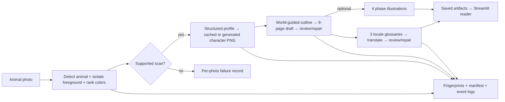
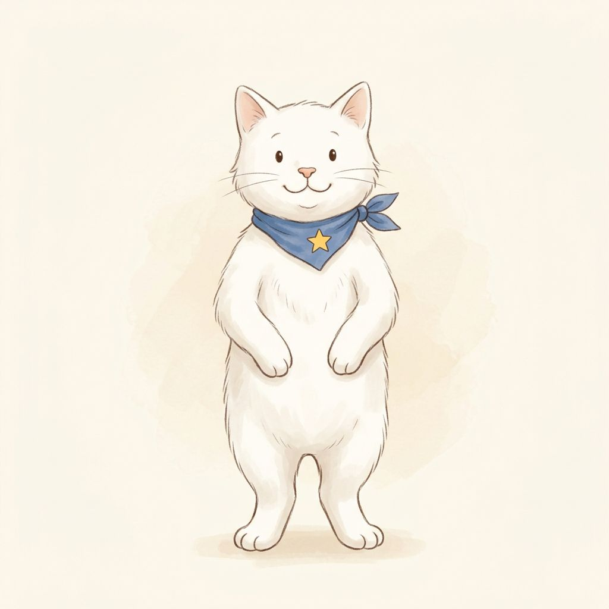
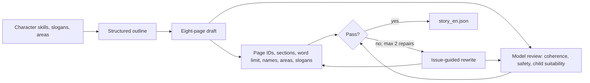
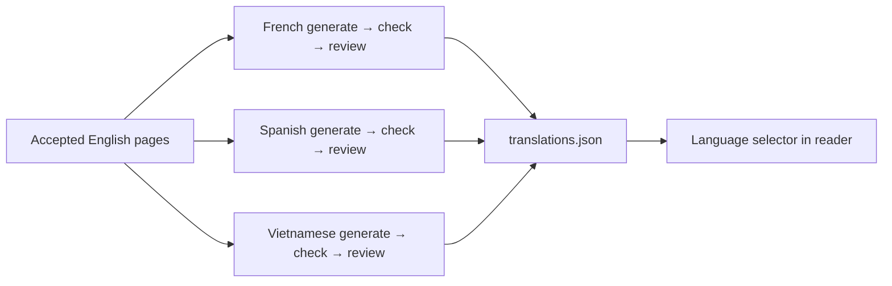

# Let's Story — Project Presentation

**Animal photo → illustrated, multilingual story for children aged 5–7**  
Animal Story Pipeline · Repository snapshot: 28 October 2026

> **Presenter format:** Each `---` starts a slide. The short *Speaker notes* are a suggested talk track. Use [`code_walkthrough.md`](code_walkthrough.md) for code-level details and interview answers. The numbers below summarize a local Stage 1 evaluation; its source images and generated JSON report are not included in the repository, while the labels CSV is included.

---

## 01 · The idea

### Turn one animal photograph into a story a child can read in four languages

**Input:** a cat, dog, hare, owl, or squirrel photo.  
**Experience:** a consistent story-world character, an eight-page English story, French/Spanish/Vietnamese versions, and a local page reader.

**Design constraint:** an animal outside the supported taxonomy is recorded as `unknown`; the batch continues without inventing a character profile.

*Speaker notes:* “This is a pipeline for an end-user artifact, not just a classifier. Each stage writes evidence that the next stage can check.”

---

## 02 · What the system actually does



**Control plane:** [`main.py`](../main.py) coordinates per-photo checkpoints and errors.  
**Data plane:** JSON contracts, PNG images, prompt files, and locale artifacts carry the result.

*Speaker notes:* “The important branches are the supported-species gate, cache/checkpoint reuse, bounded review loops, and optional context images.”

---

## 03 · Photo understanding

| Job | Implementation | Output |
| --- | --- | --- |
| Animal identification | SpeciesNet animal detection and classification, then exact configured alias mapping | Supported species or `unknown` |
| Foreground evidence | BiRefNet mask; fall back to SpeciesNet box or full image | Animal-focused crop and uncertainty note |
| Main color | CLIP comparison against five configured color prompts | Best configured color and score margin |

The scan writes values **and** diagnostic uncertainty to [`scan.json`](../outputs/cat_1-5e9713b6559d/scan.json). An `unknown` species is kept as such even when a color can be estimated.

*Speaker notes:* “The CLIP score is a relative ranking over the five prompts, not a calibrated confidence probability.”

---

## 04 · The character and the world

**World source:** [`data/story_world.yaml`](../data/story_world.yaml) defines five named characters, their skills, slogans, visual details, and four localized garden areas.  
**Image source:** Replicate `google/imagen-4` receives a rendered text prompt from the scan and profile.  
**Reuse:** a shared `<species>_<color>` image cache avoids repeating the same character prompt across photos.



**Honest boundary:** this image is a story-world character, not a verified portrait of the source cat. The original photo is not passed as a reference image.

*Speaker notes:* “The cache saves cost but merges distinct animals of the same species and color. Individual appearance is a future design change.”

---

## 05 · Eight pages, one controlled narrative



The story has two pages each for beginning, problem, solution, and happy ending, with a 40-word limit per page. The accepted cat example has eight pages and is titled **“Milo and Pip at the Tall Oak”** in [`story_en.json`](../outputs/cat_1-5e9713b6559d/story_en.json).

*Speaker notes:* “Local rules cover measurable structure. A model reviews semantic qualities; this is screening, not a human guarantee.”

---

## 06 · Three translations with separate recovery

**French · Spanish · Vietnamese**

Each locale gets the same eight source pages plus a glossary of names, gender, pronouns, slogans, and area names. Local checks verify page alignment and selected glossary/punctuation rules; a Groq review examines faithfulness and natural child-friendly language. A failed locale does not discard successful locale files.



**Optional diagnostic:** `--back-translation` compares saved translations with English through additional model calls. It is off by default.

*Speaker notes:* “The saved cat sample has all three locale outputs, but no independent bilingual quality score has been reported.”

---

## 07 · Reliability is part of the architecture

| Mechanism | Concrete behavior |
| --- | --- |
| Per-photo isolation | A failed bear does not prevent the cat or dog from proceeding. |
| Stage checkpoints | `manifest.json` reuses a stage only when fingerprint and output files validate. |
| Shared character cache | Species/color image reuse also works with `--no-resume`. |
| Atomic files | JSON and image outputs are written through temporary files before replacement. |
| Retry boundaries | Transient provider failures are retried; a completed Replicate prediction's image download is retried separately. |
| Observability | One `run_<id>.jsonl` plus A–D part logs and a `run_end` summary. |

**Read the latest run log and manifest to determine current status.** A historical `failure.json` may remain after later success.

*Speaker notes:* “This makes partial completion visible and avoids paying for identical work when validated artifacts are available.”

---

## 08 · Measured result: Stage 1

| Evaluated subset | Species correct | Color correct |
| --- | ---: | ---: |
| All labeled images (356) | **259/356 · 72.8%** | **208/356 · 58.4%** |
| Five supported species (267) | **170/267 · 63.7%** | **144/267 · 53.9%** |
| Cat (51) | 48/51 · 94.1% | 30/51 · 58.8% |
| Dog (54) | 28/54 · 51.9% | 27/54 · 50.0% |
| Hare (56) | 46/56 · 82.1% | 22/56 · 39.3% |
| Owl (52) | **2/52 · 3.8%** | 29/52 · 55.8% |
| Squirrel (54) | 46/54 · 85.2% | 36/54 · 66.7% |
| Unknown (89) | 89/89 · 100% | 64/89 · 71.9% |

Source figures are summarized in the [results report](../report_and_demo/report/results_report.md). The `unknown` set contains curated source classes; no held-out generalization estimate is available.

*Speaker notes:* “The largest improvement opportunity is visible: owl classification and color. I would not hide class-level performance behind the overall number.”

---

## 09 · Demo path

```bash
python main.py --input-dir inference_data --limit 3 --display
```

1. **Cat:** inspect [`scan.json`](../outputs/cat_1-5e9713b6559d/scan.json), [`character.png`](../outputs/cat_1-5e9713b6559d/character.png), [`story_en.json`](../outputs/cat_1-5e9713b6559d/story_en.json), and [`translations.json`](../outputs/cat_1-5e9713b6559d/translations.json).
2. **Dog:** show the separate saved [`story_en.json`](../outputs/dog_1-10ce1ee5a263/story_en.json) and locale artifacts.
3. **Bear:** show [`scan.json`](../outputs/bear_1-6c5bc1aee464/scan.json) with `unknown`, followed by the explicit [`failure.json`](../outputs/bear_1-6c5bc1aee464/failure.json) at character generation.
4. **Reader:** use the language selector and page controls; optional phase images appear when generated, otherwise the character keyframe is used.

The demo command may make provider calls if checkpoints are invalid or absent. Recorded walkthroughs are available in the [demo directory](../report_and_demo/demo/).

*Speaker notes:* “The bear is the designed boundary case. I would show its reason, then return to the successful cat/dog outputs.”

---

## 10 · What I would improve next

1. **Vision evidence:** freeze a held-out test set, report confusion matrices and intervals, and investigate owl and dog errors.
2. **Color method:** compare full image, detection box, and BiRefNet crop on the same labeled images; calibrate the uncertainty threshold.
3. **Character identity:** evaluate an image-conditioned provider and an appearance-aware cache key if likeness to the input photo becomes a requirement.
4. **Generative quality:** use blinded child-story and bilingual human reviews, then measure the benefit of the outline/review loops against simpler baselines.
5. **Recovery:** persist provider prediction IDs for output download recovery, expose stage status clearly, and clean up stale failure indicators after successful reruns.

*Speaker notes:* “These are proposals, not implemented results. I would prioritize the evaluation gaps before claiming production quality.”

---

## 11 · Closing claim

> The project demonstrates a traceable workflow from supported animal photo to character, constrained story, three translations, and a local reader. Its checkpoints and per-photo errors make the pipeline inspectable and recoverable. The measured vision performance is uneven, and generative quality still needs independent human evaluation.

**Questions to invite:** Why these models? How is `unknown` handled? What does a passing review prove? What gets reused after a partial failure? The companion [`code walkthrough and interview defense`](code_walkthrough.md) contains source-backed answers.
