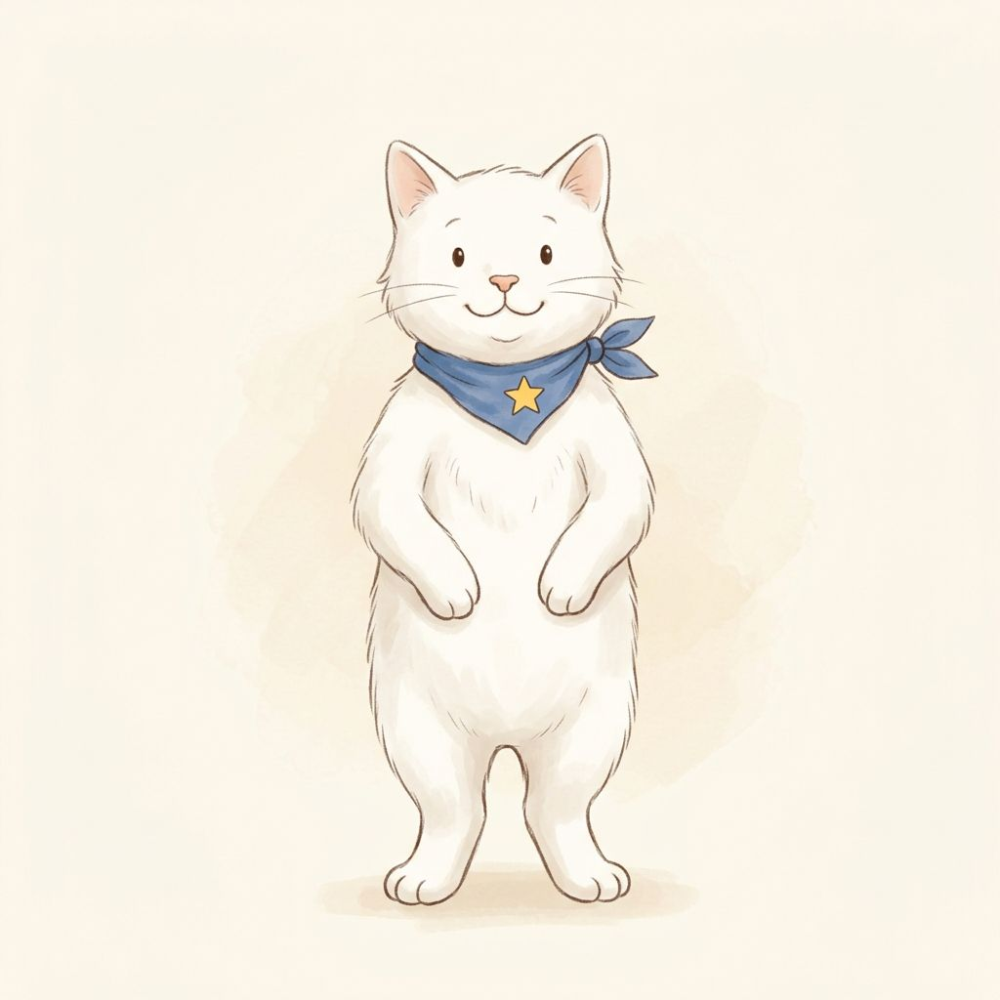

# Results Report

## Evaluation results

Evaluation used 356 images in `data/raw`, with the included `data/animal_colors.csv` as ground truth. The images and generated JSON report are not included in the repository. The percentages below are correct predictions divided by evaluated images. The overall species figure includes the `unknown` class; the supported-species-only figure excludes its 89 unknown images.

The following table summarizes that local evaluation.
| Evaluation group | Species accuracy | Color accuracy |
| --- | ---: | ---: |
| **Overall, 356 images** | **259/356 (72.8%)** | **208/356 (58.4%)** |
| Five supported species, 267 images | 170/267 (63.7%) | 144/267 (53.9%) |
| Cat, 51 images | 48/51 (94.1%) | 30/51 (58.8%) |
| Dog, 54 images | 28/54 (51.9%) | 27/54 (50.0%) |
| Hare, 56 images | 46/56 (82.1%) | 22/56 (39.3%) |
| Owl, 52 images | 2/52 (3.8%) | 29/52 (55.8%) |
| Squirrel, 54 images | 46/54 (85.2%) | 36/54 (66.7%) |
| Unknown, 89 images | 89/89 (100%) | 64/89 (71.9%) |

The low owl and dog species results and the 58.4% overall color result are current limitations. Unknown accuracy is measured on the dataset’s known out-of-taxonomy folder, not on a hidden test set. To reproduce the metrics, prepare the images with the dataset script and run the evaluation command in the README using the included labels CSV.

## Sample output

Sample input: `inference_data/cat_1.jpg` → the Stage 1 result **cat / white** → character **Milo**. Stage 2 used `google/imagen-4` through Replicate, with a 1:1 aspect ratio and 1K image size. The saved metadata records that this model did not support a seed for this request.

Stage 3 saved an eight-page English story, `Milo and Pip at the Tall Oak`.

Page 1: *`Milo, a white cat with a blue neckerchief, played at the Flower Path. His friend Pip, a brown hare with a green wrist ribbon, ran beside him in the Sunny Garden..`* The complete story is [`story_en.json`](../../outputs/cat_1-5e9713b6559d/story_en.json).

Stage 4 saved all eight pages in French, Spanish, and Vietnamese; the saved translation validation passed. Page 1 samples:

- **FR:** `Milo, un chat blanc avec un foulard bleu autour du cou, jouait sur le Sentier des fleurs. Son ami Pip, un lapin brun avec un ruban vert au poignet, courait à côté de lui dans le Jardin ensoleillé.`
- **ES:** `Milo, un gato blanco con un pañuelo azul al cuello, jugaba en el Camino de las flores. Su amigo Pip, una liebre marrón con una cinta verde en la muñeca, corría a su lado en el Jardín Soleado.`
- **VI:** `Milo, một chú mèo trắng đeo khăn cổ xanh, đang chơi ở Lối Hoa. Bạn ấy Pip, một chú thỏ nâu đeo ruy băng xanh trên cổ tay, chạy bên cạnh Milo trong Vườn Nắng.`

See the full translations in [`translations.json`](../../outputs/cat_1-5e9713b6559d/translations.json). The full pipeline output also includes a dog story; the three-photo demo includes a bear to show per-photo handling of unsupported species.
